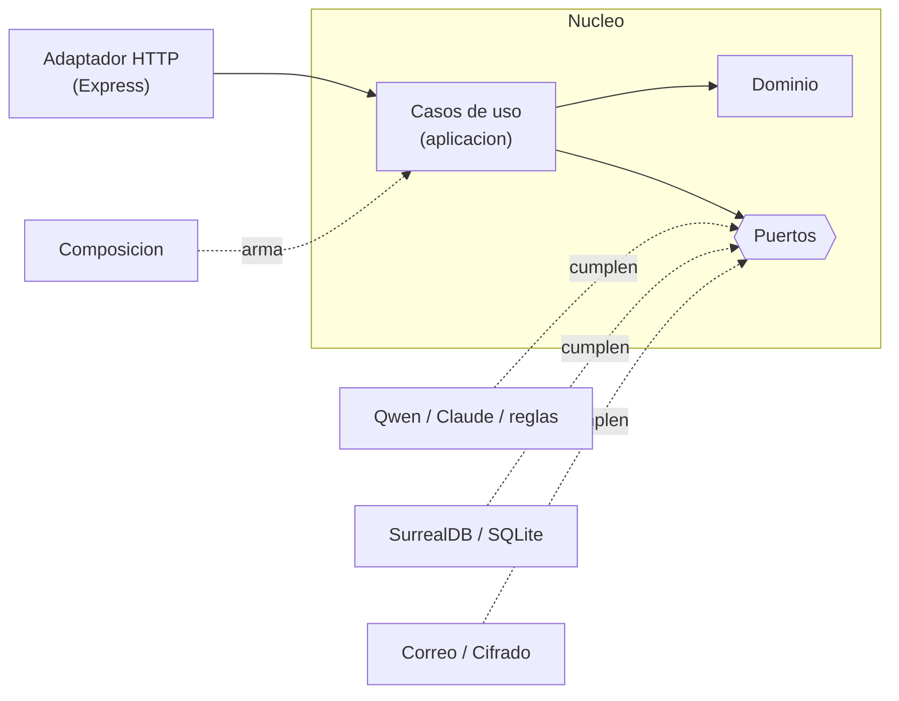
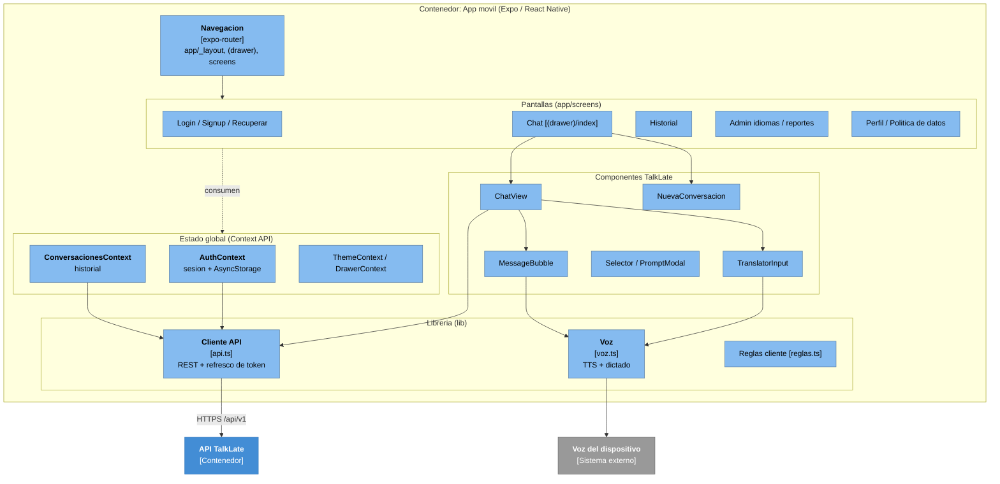
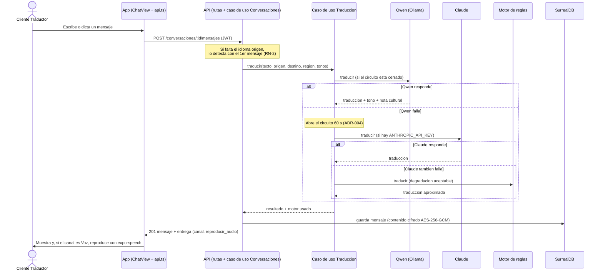
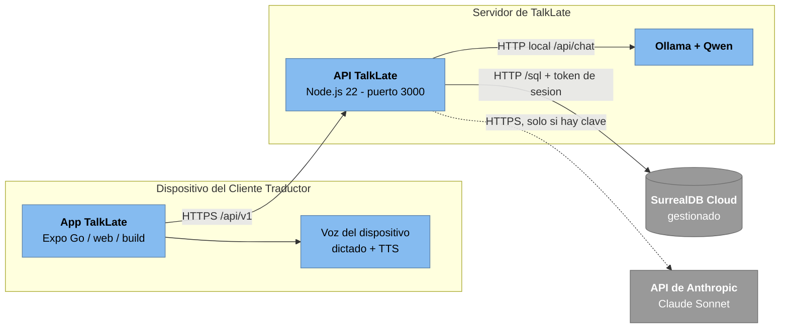

# Arquitectura de TalkLate - Documento maestro

**Fase 3 - Arquitectura de Software & Base de Datos**

Este es el documento de entrada a la arquitectura de TalkLate. Describe la **arquitectura
actual** (la que esta construida, no un ideal) y **justifica cada decision contra su ADR**
(`decisiones.md`) y el driver que la obliga (`drivers.md`). Para el detalle de cada parte,
enlaza a los documentos especializados en vez de repetirlos.

**Metodo:** como autorizo el mentor, primero se construyo y despues se justifico
(`seguimiento/records/2026-10-14-reunion-presencial.md`). Cada afirmacion de este documento
apunta al codigo real (`backend/src`, `frontend/`), al ADR que la sustenta y al driver que la motiva.

## Como leer esta carpeta

| Documento | Vista C4 / tema | Contenido |
| --- | --- | --- |
| `arquitectura.md` (este) | Sintesis y justificacion | Todas las vistas amarradas y justificadas por ADR |
| `drivers.md` | Drivers | Requisitos que obligan decisiones (DRV-01 a DRV-08) |
| `decisiones.md` | Decisiones | 13 ADR con contexto, alternativas y consecuencias |
| `c4.md` | C4 Niveles 1 y 2 | Contexto del sistema y contenedores |
| `componentes.md` | C4 Nivel 3 (API) | Componentes internos de la API TalkLate |
| `modelo_datos.md` | Datos | Modelo de dominio, reglas y correspondencia con la base |
| `tech_stack.md` | Stack | Tecnologia por capa y alternativas evaluadas |
| `medicion_traduccion.md` | Evidencia | Medicion de tiempo y calidad (DRV-01, DRV-02) |
| `revision_recomendaciones.md` | Revision critica | Analisis de las recomendaciones de la revision del 22/10/2026 y orden propuesto |

---

## 1. Estilo arquitectonico

TalkLate es una arquitectura **cliente-servidor** de tres contenedores:

- **App movil** multiplataforma en Expo / React Native, una sola base de codigo para iOS,
  Android y web (ADR-001, responde a DRV-07).
- **API TalkLate**, un **monolito modular** en Node.js 22 + Express con API REST sincrona
  `/api/v1` (ADR-002, ADR-011, responde a DRV-01, DRV-08).
- **Base de datos** SurrealDB 3.x en la nube, detras de un patron **Repository** que permite
  cambiar a SQLite en pruebas (ADR-012, responde a DRV-04, DRV-08).

El corazon del producto -traducir conservando tono, intencion y modismos- vive en un
**subsistema de traduccion** que encadena motores con el patron **Circuit Breaker**:
Qwen local -> Claude Sonnet -> motor de reglas (ADR-004, responde a DRV-01, DRV-02, DRV-05).

Por dentro, la API sigue una **arquitectura hexagonal (puertos y adaptadores)** (ADR-013): el
dominio y los casos de uso estan en el centro y no dependen de Express, de la base ni de los
motores de IA; cada dependencia externa entra por un puerto (`Repositorio`, `MotorTraduccion`,
`Notificador`, `Cifrador`) y se conecta con un adaptador. Es la respuesta a "y si manana crece?":
no se parte en servicios, se separa bien por dentro.

---

## 2. Como la arquitectura responde a los drivers (justificacion)

Esta es la tabla central: por cada driver, que se decidio (ADR), con que mecanismo del codigo
se realiza, y con que evidencia se comprueba hoy.

| Driver | Decision (ADR) | Mecanismo en el codigo | Evidencia |
| --- | --- | --- | --- |
| DRV-01 Tiempo de respuesta | ADR-002 (REST por turno), ADR-004 (motores en cadena, sin reintentos dentro de la peticion) | `aplicacion/traduccion.js`: al fallar un motor no se reintenta, se pasa al siguiente; el circuito evita esperar el timeout en cada mensaje (falta acotar el tiempo de espera de Qwen, ver `revision_recomendaciones.md`) | `npm run medir` + evento `traduccion` con `duracion_ms`; linea base en `medicion_traduccion.md` (**falta medir con Qwen**) |
| DRV-02 Calidad cultural | ADR-004 (prompt de equivalencia cultural) | `adaptadores/traduccion/prompt.js` arma el prompt con tono y region destino; devuelve nota cultural y marca de aproximada | `npm run medir` (14/15 con reglas, pero ese glosario esta dentro del motor de reglas; la medicion valida es con Qwen y un glosario aparte) |
| DRV-03 Privacidad | ADR-006 (JWT + refresco), ADR-010 (proteccion de datos) | `adaptadores/cifrado/aesGcm.js` (AES-256-GCM en reposo), `compartido/log.js` (JSON sin PII), aislamiento por usuario en los casos de uso, eliminar cuenta | `test/api.test.js`, `test/seguridad.test.js` |
| DRV-04 Crecimiento de idiomas | ADR-003/ADR-012 (catalogo en datos), ADR-008 (LenguajeRegion N:M) | `aplicacion/catalogo.js` + puerto `Repositorio.catalogo`: alta/activacion de idiomas y regiones sin tocar codigo | Prueba del administrador que activa un idioma y agrega una region |
| DRV-05 Continuidad ante fallas | ADR-004 (Circuit Breaker con degradacion aceptable) | `aplicacion/traduccion.js`: circuito abierto 60 s por motor; `adaptadores/traduccion/reglas.js` como ultimo recurso | `test/motores.test.js`: Qwen falla -> Claude -> reglas, y el caso de uso probado con motores falsos |
| DRV-06 Costo y abuso | ADR-004 (Qwen local sin costo por mensaje), ADR-010 (limites) | `adaptadores/http/limites.js`: 30 msg/min por usuario, limites de registro y recuperacion | Pruebas de seguridad |
| DRV-07 Multiplataforma | ADR-001 (Expo), ADR-007 (template Luna) | Una base de codigo en `frontend/`; `lib/api.ts` resuelve el host en web, Expo Go y emulador | Compila para web; **falta probar en celular fisico con Expo Go** |
| DRV-08 Facilidad de prueba | ADR-002, ADR-012 (Repository de dos motores), ADR-013 (puertos) | El adaptador SQLite corre sin servidor ni claves y cumple el mismo puerto que el de SurrealDB; los casos de uso se prueban con adaptadores falsos | ~97 % de cobertura (`npm run coverage`), CI contra los dos motores |

---

## 3. Vista de contexto (C4 Nivel 1)

Quien usa TalkLate (Cliente Traductor, Interlocutor, Administrador) y con que sistemas externos
habla (Ollama+Qwen, Claude, voz del dispositivo, correo pendiente). Diagrama completo en
[`c4.md`](c4.md#nivel-1---contexto-del-sistema).

---

## 4. Vista de contenedores (C4 Nivel 2)

Tres contenedores (App, API, Base de datos) y su comunicacion. Diagrama completo en
[`c4.md`](c4.md#nivel-2---contenedores). Justificacion por contenedor:

| Contenedor | Decision | ADR |
| --- | --- | --- |
| App movil (Expo) | Una base de codigo multiplataforma, reusa el template Luna | ADR-001, ADR-007 |
| API TalkLate (Node + Express) | Monolito modular, REST sincrona por turno | ADR-002, ADR-011 |
| Base de datos (SurrealDB) | Fuente de verdad detras de un repositorio; enlaces nativos y ASSERT | ADR-012 |

---

## 5. Vista de componentes (C4 Nivel 3)

### 5.1 API TalkLate

Detalle completo (20 componentes C01-C20, bounded contexts y trazabilidad REQ->componente) en
[`componentes.md`](componentes.md). En resumen, en capas hexagonales: Adaptador HTTP (rutas,
sesion, limites) -> Casos de uso (cuentas, sesiones, conversaciones, traduccion, catalogo,
reportes) -> Dominio y Puertos <- Adaptadores de salida (motores Qwen, Claude y reglas;
repositorios SurrealDB y SQLite; notificador; cifrador), conectados por la Composicion.

### 5.2 App movil

El contenedor App reusa el sistema de componentes del template Luna (ADR-007) y agrega las
vistas y la logica de TalkLate. Es un cliente delgado: toda la logica de negocio esta en la API.

| Componente | Responsabilidad | Archivo(s) | ADR |
| --- | --- | --- | --- |
| Navegacion | Rutas y layout (drawer, pantallas) | `app/_layout.tsx`, `app/(drawer)/`, `app/[...404].tsx` | ADR-001 |
| Pantallas | Una vista por etapa del journey (ver [`especificacion_vistas_ui.md`](../componentes/especificacion_vistas_ui.md)) | `app/screens/*` | ADR-007 |
| AuthContext | Sesion en memoria + persistencia en AsyncStorage; renueva usuario al abrir | `app/contexts/AuthContext.tsx` | ADR-006 |
| ConversacionesContext | Historial del usuario para el menu lateral y la pantalla de historial | `app/contexts/ConversacionesContext.tsx` | ADR-007 |
| ChatView + TranslatorInput + MessageBubble | Flujo de chat: capturar (voz/texto), enviar, mostrar y reproducir la traduccion | `components/talklate/*` | ADR-005, ADR-007 |
| Cliente API | REST a `/api/v1`; **refresco automatico del token** (401 -> renueva una vez con guardia single-flight -> repite) | `lib/api.ts` | ADR-006, ADR-011 |
| Voz | TTS con `expo-speech` (pitch/rate segun entonacion) y dictado del navegador (solo web) | `lib/voz.ts` | ADR-005 |

> Justificacion: la App es delgada a proposito (ADR-002: la logica vive en la API). El dictado
> es del cliente y el reconocimiento de region es por vocabulario, no por el sonido de la voz
> (ADR-005, ver `../contexto.md`).

---

## 6. Vista de datos

Modelo de dominio (10 objetos + relacion N:M `LenguajeRegion` + tablas de soporte) y su
correspondencia con la base, en [`modelo_datos.md`](modelo_datos.md). Justificacion:

| Decision | ADR |
| --- | --- |
| SurrealDB como fuente de verdad, esquema SCHEMAFULL con ASSERT y UNIQUE | ADR-012 |
| Identificadores del dominio en espanol (lenguaje ubicuo); esquema de la base en ingles | ADR-009 |
| LenguajeRegion N:M y tablas de soporte (`reporte`, `token_refresco`, `sesion_revocada`, `recuperacion`) | ADR-008 |
| Contenido de mensajes cifrado en reposo (AES-256-GCM) | ADR-010 |

---

## 7. Vista dinamica: traducir un mensaje

El flujo central (HU0003). Muestra el Circuit Breaker (ADR-004), el cifrado al persistir
(ADR-010) y la entrega por el mismo canal (REQ-TRAD-005).

> Fuente editable: [`diagramas/secuencia_traduccion.drawio`](diagramas/secuencia_traduccion.drawio). El diagrama Mermaid de abajo es una copia para leer rapido en GitHub.

> El token de acceso dura 15 minutos. Si vence a mitad del flujo, `lib/api.ts` responde al 401
> renovando el token con el de refresco (una sola vez, con guardia) y repite la peticion sin que
> el usuario lo note (ADR-006).

---

## 8. Vista de despliegue

Donde corre cada pieza. Justifica que Qwen vive en el **servidor** (ADR-004) y que SurrealDB es
una instancia **remota** gestionada (ADR-012); la voz es del **dispositivo** (ADR-005).

> Fuente editable: [`diagramas/despliegue.drawio`](diagramas/despliegue.drawio). El diagrama Mermaid de abajo es una copia para leer rapido en GitHub.

> Pendiente (F10): desplegar la API y Ollama en un servidor real y medir con Qwen
> (`drivers.md`, DRV-01/DRV-02). El servicio de correo para el codigo de recuperacion tambien
> queda pendiente (ADR-006).

---

## 9. Patrones aplicados

Del catalogo `../convenciones/patrones-arquitectonicos.md`:

| Patron | Donde | ADR |
| --- | --- | --- |
| Request-Reply | API REST sincrona por turno | ADR-002, ADR-011 |
| Circuit Breaker (con degradacion aceptable) | Caso de uso de traduccion (`aplicacion/traduccion.js`) | ADR-004 |
| Token-Based Authentication | Sesion JWT + refresco rotativo | ADR-006 |
| Repository | Puerto `Repositorio` con dos adaptadores (`adaptadores/persistencia/`) | ADR-012 |
| Puertos y adaptadores (hexagonal) | Toda la API: dominio, casos de uso, puertos, adaptadores y composicion | ADR-013 |
| Structured Logging | Logs JSON sin PII (`compartido/log.js`) | ADR-010 |

Patrones del catalogo que **no** se usan y por que (microservicios, API Gateway, BFF, CQRS,
Event Sourcing, Strangler Fig): ver la nota en [`decisiones.md`](decisiones.md).

---

## 10. Indice de decisiones (ADR)

Detalle completo en [`decisiones.md`](decisiones.md). Resumen de que resuelve cada una:

| ADR | Decision | Driver |
| --- | --- | --- |
| ADR-001 | App Expo (React Native) + NativeWind | DRV-07 |
| ADR-002 | Backend monolitico Node + Express, REST sincrona | DRV-07, DRV-08 |
| ADR-003 | SQLite inicial (reemplazada por ADR-012; queda para pruebas) | DRV-04, DRV-08 |
| ADR-004 | Traduccion Qwen -> Claude -> reglas (Circuit Breaker) | DRV-01, DRV-02, DRV-05, DRV-06, DRV-08 |
| ADR-005 | Voz: dictado en el cliente + expo-speech | DRV-07 |
| ADR-006 | JWT de acceso corto + refresco rotativo | DRV-03 |
| ADR-007 | Interfaz basada en el template Luna | - |
| ADR-008 | Ajustes al modelo de dominio (LenguajeRegion, soporte) | DRV-04 |
| ADR-009 | Identificadores del dominio en espanol | - |
| ADR-010 | Proteccion de datos personales | DRV-03 |
| ADR-011 | API v1 REST + OpenAPI | - |
| ADR-012 | SurrealDB como fuente de verdad detras de un repositorio | DRV-01, DRV-03, DRV-04, DRV-08 |
| ADR-013 | Arquitectura hexagonal (puertos y adaptadores) dentro del monolito | DRV-04, DRV-05, DRV-08 |

---

## 11. Riesgos y pendientes

| Tema | Estado | Referencia |
| --- | --- | --- |
| Medir tiempo y calidad **con Qwen** (no solo reglas) y un glosario aparte | pendiente, es la evidencia valida de DRV-01/DRV-02 | `medicion_traduccion.md`, `revision_recomendaciones.md` |
| Tiempo de espera de Qwen (60 s) mayor que el limite de DRV-01 | ajustar | `revision_recomendaciones.md` |
| Gestion de claves (custodia, rotacion, fuerza) | proponer politica | `revision_recomendaciones.md` |
| SurrealDB o PostgreSQL | decidido: se mantiene SurrealDB (enlaces nativos, reglas en el esquema, multimodelo) | ADR-012 |
| Desplegar API + Ollama (F10) | pendiente | seccion 8 |
| Servicio de correo para recuperacion | pendiente (hoy el codigo vuelve en la respuesta en dev) | ADR-006 |
| Consultas por enlaces sin indice en SurrealDB | revisar con mas datos | ADR-012 |
| Reconocimiento de region por sonido de voz | evolucion futura (hoy por vocabulario) | ADR-005, `../contexto.md` |
| ADR-008 marcada **validar con el mentor** | pendiente de confirmacion (ADR-012 ya quedo cerrada: se mantiene SurrealDB) | `decisiones.md` |
| Probar en celular fisico con Expo Go | pendiente | DRV-07 |

---

## 12. Trazabilidad global

La cadena completa que recorre el proyecto:

**Vision** (`../contexto.md`) -> **Driver** (`drivers.md`) -> **ADR** (`decisiones.md`) ->
**Componente** (`componentes.md` y seccion 5.2) -> **Evidencia** (`medicion_traduccion.md`,
pruebas del backend). La trazabilidad requerimiento -> componente esta en
[`componentes.md`](componentes.md#trazabilidad-requerimiento---componente) y
requerimiento -> HU en [`../requerimientos/req.md`](../requerimientos/req.md).
