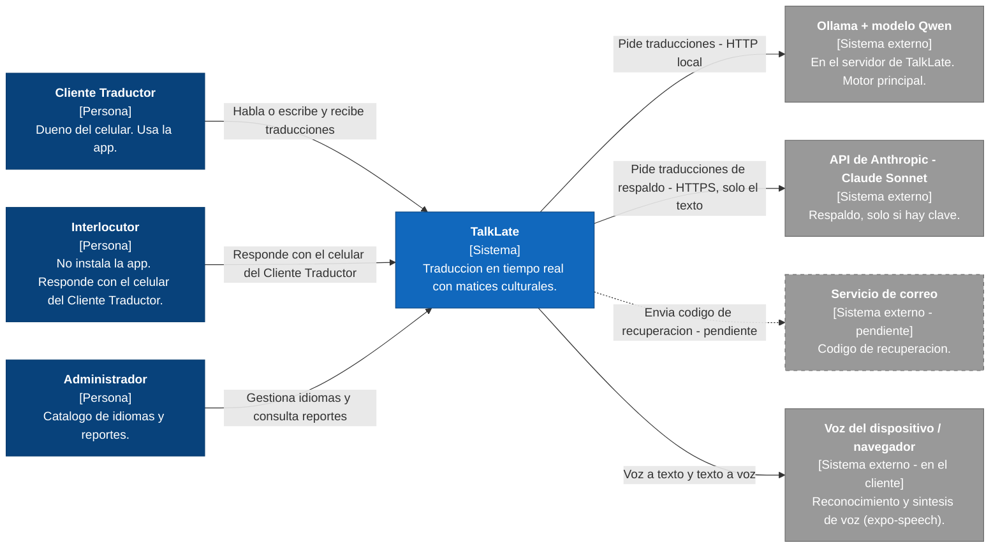
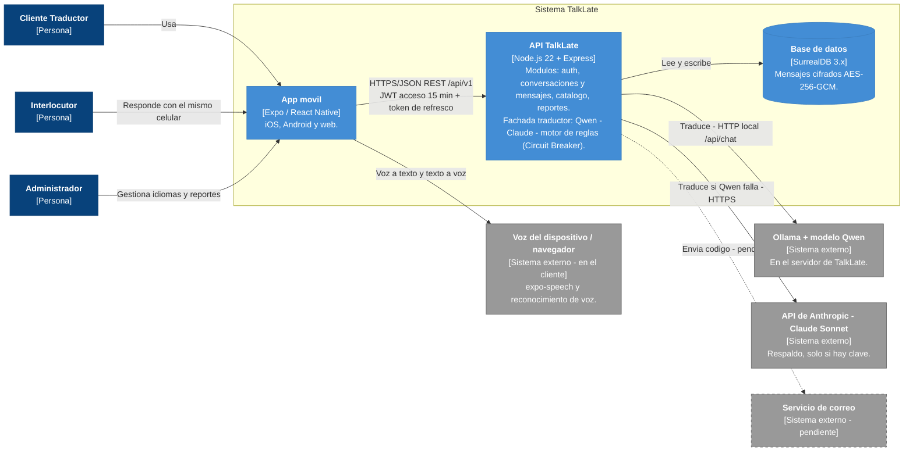

# Diagramas C4 de TalkLate

> Los archivos `.drawio` en `arquitectura/diagramas/` (`c4_contexto.drawio` y `c4_contenedores.drawio`) son la fuente editable. Los diagramas Mermaid de este documento son una copia para leer rapido en GitHub. Se pueden regenerar o mejorar con la skill Archify si el equipo la instala.

Este documento muestra la arquitectura de TalkLate con la notacion C4 en dos niveles:

- **Nivel 1 - Contexto:** quien usa TalkLate y con que sistemas externos habla.
- **Nivel 2 - Contenedores:** las piezas que forman TalkLate por dentro y como se comunican.

Ver tambien: [`tech_stack.md`](tech_stack.md), [`decisiones.md`](decisiones.md) y [`convenciones/diagramas-como-codigo.md`](../convenciones/diagramas-como-codigo.md).

---

## Nivel 1 - Contexto del sistema

---

## Nivel 2 - Contenedores

---

## Tabla de elementos

| Elemento | Tipo | Tecnologia | Descripcion |
| --- | --- | --- | --- |
| Cliente Traductor | Persona | - | Dueno del celular. Usa la app para traducir sus conversaciones. |
| Interlocutor | Persona | - | La otra persona de la conversacion. No instala la app; responde con el celular del Cliente Traductor. |
| Administrador | Persona | - | Gestiona el catalogo de idiomas y revisa reportes. |
| TalkLate | Sistema | - | Traduccion en tiempo real que considera contexto, emociones, jerga e intencion. |
| App movil | Contenedor | Expo / React Native (iOS, Android y web) | Interfaz de usuario. Captura voz o texto, muestra y reproduce traducciones. |
| API TalkLate | Contenedor | Node.js 22 + Express | REST en `/api/v1`. Modulos: auth, conversaciones y mensajes, catalogo, reportes. Fachada traductor con cadena Qwen -> Claude -> motor de reglas y patron Circuit Breaker. |
| Base de datos | Contenedor | SurrealDB 3.x (SQLite solo en pruebas) | Guarda usuarios, conversaciones, catalogo y reportes. Los mensajes se guardan cifrados con AES-256-GCM. |
| Ollama + modelo Qwen | Sistema externo | Ollama, HTTP local `/api/chat` | Corre en el servidor de TalkLate. Motor de traduccion principal. |
| API de Anthropic (Claude Sonnet) | Sistema externo | HTTPS | Respaldo. Solo se usa si hay clave configurada y recibe solo el texto a traducir. |
| Servicio de correo | Sistema externo (pendiente) | Por definir | Envia el codigo de recuperacion de cuenta. |
| Voz del dispositivo / navegador | Sistema externo (en el cliente) | Reconocimiento de voz nativo o del navegador, expo-speech | Convierte voz a texto y lee en voz alta la traduccion. |

## Comunicaciones principales

| Origen | Destino | Protocolo | Detalle |
| --- | --- | --- | --- |
| App movil | API TalkLate | HTTPS/JSON REST `/api/v1` | JWT de acceso de 15 min + token de refresco. |
| API TalkLate | Base de datos | HTTP `/sql` con token de sesion | Lectura y escritura; mensajes cifrados AES-256-GCM. |
| API TalkLate | Ollama + Qwen | HTTP local `/api/chat` | Primer intento de traduccion. |
| API TalkLate | Anthropic Claude Sonnet | HTTPS | Segundo intento si Qwen falla y hay clave. |
| API TalkLate | Motor de reglas | En proceso | Ultimo recurso si fallan los dos modelos. |
| API TalkLate | Servicio de correo | Por definir (pendiente) | Envio del codigo de recuperacion. |
| App movil | Voz del dispositivo / navegador | API local del dispositivo | Voz a texto y texto a voz. |
