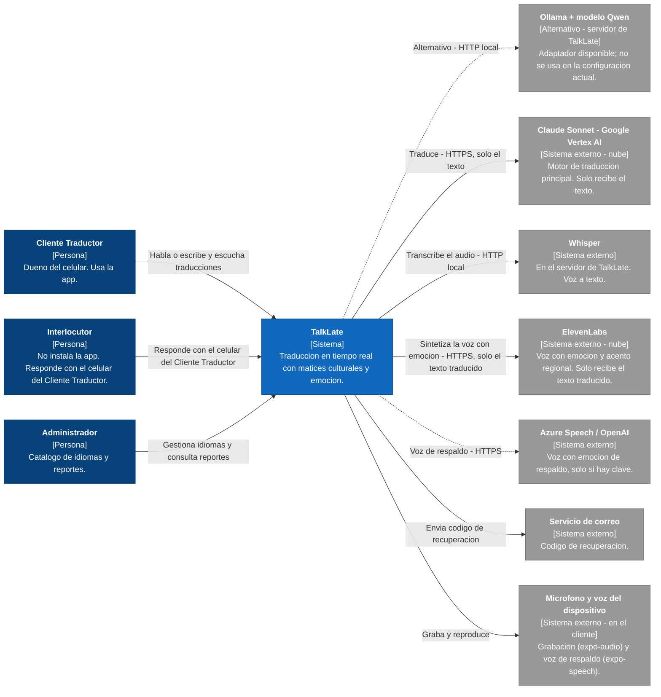
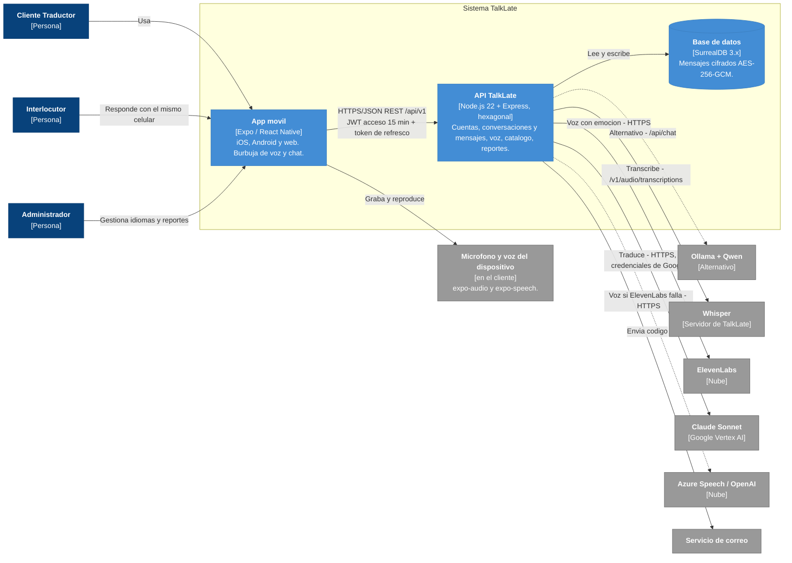

# Diagramas C4 - TalkLate

**Fase 3 - Arquitectura**

**Version:** 1.0 (29/10/2026)

La arquitectura de TalkLate en notacion C4:

- **Nivel 1 - Contexto:** quien usa TalkLate y con que sistemas externos habla.
- **Nivel 2 - Contenedores:** las piezas que forman TalkLate y como se comunican.
- **Nivel 3 - Componentes:** el interior de la API TalkLate, en `10_componentes.md`.

Fuentes editables en `diagramas/` (`c4_contexto.drawio`, `c4_contenedores.drawio`). Vistas interactivas (Archify): `../entrega/diagramas/arquitectura_talklate.html` (general, con el flujo de voz) y `../entrega/diagramas/arquitectura_hexagonal.html` (backend por puertos y adaptadores). La justificacion de cada vista esta en `07_arquitectura.md`.

---

## Nivel 1 - Contexto del sistema

---

## Nivel 2 - Contenedores

---

## Tabla de elementos

| Elemento | Tipo | Tecnologia | Descripcion |
| --- | --- | --- | --- |
| Cliente Traductor | Persona | - | Dueno del celular. Usa la app para traducir sus conversaciones. |
| Interlocutor | Persona | - | La otra persona de la conversacion. No instala la app; responde con el celular del Cliente Traductor. |
| Administrador | Persona | - | Gestiona el catalogo de idiomas y revisa reportes. |
| TalkLate | Sistema | - | Traduccion en tiempo real que considera contexto, emociones, jerga e intencion. |
| App movil | Contenedor | Expo / React Native (iOS, Android y web) | Burbuja de voz animada y modo chat. Graba la voz, muestra y reproduce traducciones. |
| API TalkLate | Contenedor | Node.js 22 + Express, arquitectura hexagonal | REST en `/api/v1`. Transcribe, estima la entonacion, traduce y sintetiza la voz con emocion. |
| Base de datos | Contenedor | SurrealDB 3.x (SQLite solo en pruebas) | Usuarios, conversaciones, catalogo y reportes. Mensajes cifrados con AES-256-GCM. |
| Ollama + Qwen | Sistema externo (alternativo) | Ollama, HTTP local `/api/chat` | Adaptador alternativo de traduccion, en el servidor de TalkLate; no se usa en la configuracion actual. |
| Whisper | Sistema externo | whisper.cpp o faster-whisper, API compatible con OpenAI | Pasa el audio a texto, en el servidor de TalkLate. |
| ElevenLabs | Sistema externo (nube) | API REST (`/v1/text-to-speech/{voz}`, `eleven_multilingual_v2`) | Voz con emocion y acento regional; recibe solo el texto traducido, el tono, el genero y la velocidad. |
| Claude Sonnet (Google Vertex AI) | Sistema externo (nube) | SDK de Anthropic para Vertex, credenciales de Google (ADC) | Motor de traduccion principal (ADR-020); solo recibe el texto y el contexto del prompt. |
| Azure Speech / OpenAI | Sistema externo | HTTPS (SSML con estilos / `gpt-4o-mini-tts`) | Respaldo de la voz con emocion; solo con clave. |
| Servicio de correo | Sistema externo | Puerto `Notificador` | Envia el codigo de recuperacion de cuenta. |
| Microfono y voz del dispositivo | Sistema externo (en el cliente) | expo-audio, expo-speech | Graba el mensaje y reproduce la voz de respaldo. |

## Comunicaciones principales

| Origen | Destino | Protocolo | Detalle |
| --- | --- | --- | --- |
| App movil | API TalkLate | HTTPS/JSON REST `/api/v1` | JWT de acceso de 15 min + token de refresco. El audio viaja en base64 (hasta 10 MB). |
| API TalkLate | Base de datos | HTTP `/sql` con token de sesion | Lectura y escritura; mensajes cifrados AES-256-GCM. |
| API TalkLate | Whisper | HTTP local multipart `/v1/audio/transcriptions` | Transcripcion del mensaje hablado con pista de idioma. |
| API TalkLate | Ollama + Qwen | HTTP local `/api/chat` | Alternativo: solo si se configura `TRADUCTOR=auto` o `qwen`. |
| API TalkLate | Claude Sonnet (Vertex) | HTTPS | Traduccion principal; tiempo limite de 30 s y sin reintentos del SDK. |
| API TalkLate | Motor de reglas | En proceso | Respaldo parcial: solo traduce modismos conocidos; sin coincidencias responde un error. |
| API TalkLate | ElevenLabs | HTTPS | Voz con la emocion del tono detectado, por region y genero. |
| API TalkLate | Azure Speech / OpenAI | HTTPS | Respaldo de la voz si ElevenLabs falla. |
| App movil | API TalkLate | HTTPS `GET /voz/audio/:id` | Descarga el audio sintetizado (vence en 5 minutos). |
| API TalkLate | Servicio de correo | Puerto `Notificador` | Envio del codigo de recuperacion. |
