# C4 Nivel 3 - Componentes de la API TalkLate

**Fase 3 - Arquitectura de Software & Base de Datos**

Este documento abre el contenedor **API TalkLate** (ver `c4.md`, Nivel 2) y muestra sus
componentes internos: que piezas lo forman, de que se encarga cada una y como se comunican.
Es el Nivel 3 de C4; solo se detalla este contenedor porque la App movil reusa el template
Luna (ver `componentes/especificacion_vistas_ui.md`) y la Base de datos se describe en
`modelo_datos.md`.

**Metodo:** el diagrama refleja el codigo real de `backend/src` (no un ideal). Cada componente
cita sus archivos, el Bounded Context al que pertenece, el patron del catalogo
(`convenciones/patrones-arquitectonicos.md`) y el ADR que lo justifica (`decisiones.md`).

> Punto de entrada: [`arquitectura.md`](arquitectura.md) es el documento maestro que amarra todas las vistas y las justifica contra los ADR.

Ver tambien: [`c4.md`](c4.md) (Niveles 1 y 2), [`tech_stack.md`](tech_stack.md),
[`decisiones.md`](decisiones.md), [`modelo_datos.md`](modelo_datos.md) y
[`../requerimientos/req.md`](../requerimientos/req.md).

---

## Diagrama de componentes

```mermaid
flowchart TB
    app["<b>App movil</b><br/>[Contenedor externo]<br/>Expo / React Native"]
    ollama["<b>Ollama + Qwen</b><br/>[Sistema externo]"]
    claude["<b>Claude Sonnet</b><br/>[Sistema externo]"]
    db[("<b>SurrealDB / SQLite</b><br/>[Contenedor]")]

    subgraph api["Contenedor: API TalkLate (Node.js 22 + Express)"]
        http["<b>Composicion HTTP</b><br/>[app.js]<br/>CORS, JSON, /health, OpenAPI, manejo de errores"]

        subgraph ctrl["Controladores (una ruta por recurso)"]
            cAuth["<b>Auth y Usuarios</b><br/>[routes/auth.js]"]
            cConv["<b>Conversaciones y Mensajes</b><br/>[routes/conversaciones.js]"]
            cCat["<b>Catalogo de idiomas</b><br/>[routes/catalogo.js]"]
            cRep["<b>Reportes de calidad</b><br/>[routes/reportes.js]"]
        end

        subgraph trad["Subsistema de traduccion"]
            fachada["<b>Fachada Traductor</b><br/>[lib/traductor.js]<br/>Cadena de motores + Circuit Breaker"]
            mQwen["<b>Motor Qwen</b><br/>[lib/motorQwen.js]"]
            mClaude["<b>Motor Claude</b><br/>[lib/motorClaude.js]"]
            mLocal["<b>Motor de reglas</b><br/>[lib/motorLocal.js]"]
            prompt["<b>Constructor de prompt</b><br/>[lib/prompt.js]"]
            analisis["<b>Analisis de texto</b><br/>[lib/analisis.js + lib/acentos.js]<br/>Idioma, tono, region por vocabulario"]
        end

        subgraph trans["Plataforma y seguridad (transversal)"]
            sesion["<b>Sesion y roles</b><br/>[lib/auth.js]<br/>JWT, bcrypt, requerirSesion/Admin"]
            limites["<b>Limites de uso</b><br/>[lib/limites.js]"]
            cifrado["<b>Cifrado</b><br/>[lib/cifrado.js]<br/>AES-256-GCM"]
            valida["<b>Validaciones</b><br/>[lib/validaciones.js]"]
            logc["<b>Log estructurado</b><br/>[lib/log.js]"]
            errores["<b>Errores</b><br/>[lib/errores.js]"]
            correo["<b>Correo (pendiente)</b><br/>[lib/correo.js]"]
        end

        subgraph datos["Acceso a datos"]
            repo["<b>Repositorio</b><br/>[repos/surreal.js | repos/sqlite.js]<br/>Interfaz async comun"]
            conex["<b>Conexion SurrealDB</b><br/>[surreal.js]<br/>HTTP /sql + token de sesion"]
        end
    end

    app -->|HTTPS/JSON /api/v1| http
    http --> cAuth & cConv & cCat & cRep
    ctrl -.->|protege| sesion
    cConv -->|traduce| fachada
    fachada --> mQwen --> ollama
    fachada --> mClaude --> claude
    fachada --> mLocal
    fachada --> analisis
    mQwen & mClaude --> prompt
    ctrl -->|lee y escribe| repo
    repo --> conex --> db
    repo -. SQLite en pruebas .-> db
    cConv -->|cifra contenido| cifrado
    cRep --> cifrado

    classDef externo fill:#999999,stroke:#6B6B6B,color:#FFFFFF
    classDef contenedor fill:#438DD5,stroke:#3C7FC0,color:#FFFFFF
    classDef componente fill:#85BBF0,stroke:#5D82A8,color:#000000
    classDef pendiente fill:#BBBBBB,stroke:#6B6B6B,color:#000000,stroke-dasharray:5 5
    class app,ollama,claude externo
    class db contenedor
    class http,cAuth,cConv,cCat,cRep,fachada,mQwen,mClaude,mLocal,prompt,analisis,sesion,limites,cifrado,valida,logc,errores,repo,conex componente
    class correo pendiente
```

> Para no volver ilegible el diagrama, las flechas transversales se dibujan una sola vez.
> **Sesion y roles**, **Limites de uso**, **Validaciones**, **Log estructurado** y **Errores**
> los usan todos los controladores; aqui se resume con la flecha "protege".

---

## Catalogo de componentes

| # | Componente | Tipo | Bounded Context | Responsabilidad | Archivo(s) | Patron / ADR |
| --- | --- | --- | --- | --- | --- | --- |
| C01 | Composicion HTTP | Arranque | Plataforma | Arma Express: CORS, limite de cuerpo, `/health`, OpenAPI/Swagger, monta routers `/api/v1`, 404 y manejador global de errores. | `src/app.js`, `src/server.js` | ADR-002, ADR-011 |
| C02 | Controlador Auth y Usuarios | Controlador | Identidad y Acceso | Registro, login, refresco, recuperacion, logout, `/usuarios/yo` y eliminar cuenta. Limite de intentos de login. | `src/routes/auth.js` | ADR-006, ADR-010 |
| C03 | Controlador Conversaciones y Mensajes | Controlador | Conversaciones y Mensajes | CRUD de conversaciones y el flujo central de traducir un mensaje (deteccion de idioma origen, orquesta la fachada, persiste cifrado). | `src/routes/conversaciones.js` | ADR-004, ADR-011 |
| C04 | Controlador Catalogo | Controlador | Catalogo de Idiomas | Listar idiomas activos; alta/edicion/activacion de idiomas y regiones (solo admin). | `src/routes/catalogo.js` | ADR-011 |
| C05 | Controlador Reportes | Controlador | Reportes de Calidad | Reportar una traduccion propia (una vez) y revision por el administrador. | `src/routes/reportes.js` | ADR-011 |
| C06 | Fachada Traductor | Servicio | Traduccion | Prueba los motores en orden (Qwen -> Claude -> reglas); abre el circuito 60 s ante un fallo y degrada al siguiente. | `src/lib/traductor.js` | Circuit Breaker (4.1) / ADR-004 |
| C07 | Motor Qwen | Adaptador | Traduccion | Traduce via Ollama local (HTTP `/api/chat`). | `src/lib/motorQwen.js` | ADR-004 |
| C08 | Motor Claude | Adaptador | Traduccion | Traduce via API de Anthropic (solo si hay clave). | `src/lib/motorClaude.js` | ADR-004 |
| C09 | Motor de reglas | Servicio | Traduccion | Traduccion espanol/ingles con modismos por pais; degradacion aceptable. | `src/lib/motorLocal.js` | ADR-004 |
| C10 | Constructor de prompt | Servicio | Traduccion | Arma el prompt de equivalente cultural (tono, region destino, nota cultural). | `src/lib/prompt.js` | ADR-004 |
| C11 | Analisis de texto | Servicio | Traduccion | Detecta idioma, tono y region de origen por vocabulario. | `src/lib/analisis.js`, `src/lib/acentos.js` | ADR-004, ADR-005 |
| C12 | Sesion y roles | Transversal | Identidad y Acceso | JWT de acceso, token de refresco rotativo, `requerirSesion`/`requerirAdmin`, bcrypt. | `src/lib/auth.js` | Token-Based Auth (5.1) / ADR-006 |
| C13 | Limites de uso | Transversal | Plataforma | Rate limiting por usuario e IP (mensajes, registro, recuperacion). | `src/lib/limites.js` | ADR-010 (RNF-006) |
| C14 | Cifrado | Transversal | Plataforma | Cifra/descifra el contenido de los mensajes en reposo (AES-256-GCM). | `src/lib/cifrado.js` | ADR-010 |
| C15 | Validaciones | Transversal | Plataforma | Reglas de formato de entrada (nombres, correo, contrasena, contenido). | `src/lib/validaciones.js` | ADR-011 |
| C16 | Log estructurado | Transversal | Plataforma | Logs JSON sin datos personales; evento `traduccion` con `duracion_ms`. | `src/lib/log.js` | Structured Logging (6.1) / ADR-010 |
| C17 | Errores | Transversal | Plataforma | `ErrorNegocio` y cuerpo de error uniforme de la API. | `src/lib/errores.js` | ADR-011 |
| C18 | Correo (pendiente) | Adaptador | Identidad y Acceso | Envio del codigo de recuperacion (hoy se devuelve en la respuesta en desarrollo). | `src/lib/correo.js` | ADR-006 |
| C19 | Repositorio | Acceso a datos | (todos) | Interfaz async comun: `usuarios`, `tokens`, `sesiones`, `recuperaciones`, `catalogo`, `conversaciones`, `mensajes`, `reportes`. Dos motores intercambiables. | `src/repos/surreal.js`, `src/repos/sqlite.js`, `src/db.js` | Repository / ADR-012 |
| C20 | Conexion SurrealDB | Adaptador | (todos) | Conexion HTTP `/sql` con token de sesion; valores serializados, nunca concatenando texto del usuario. | `src/surreal.js` | ADR-012 |

---

## Bounded Contexts

Cada contexto agrupa componentes y las entidades del modelo (`modelo_datos.md`) que gobierna.
En el codigo se reconocen por el namespace del repositorio.

| Bounded Context | Componentes | Namespace del repositorio | Entidades principales |
| --- | --- | --- | --- |
| Identidad y Acceso | C02, C12, C18 | `usuarios`, `tokens`, `sesiones`, `recuperaciones` | Usuario, TokenRefresco, SesionRevocada, Recuperacion |
| Conversaciones y Mensajes | C03 | `conversaciones`, `mensajes` | Conversacion, LenguajePorConversacion, MensajeOriginal, MensajeDestino |
| Traduccion | C06-C11 | - (servicio, sin tablas propias) | - |
| Catalogo de Idiomas | C04 | `catalogo` | Pais, Region, Lenguaje, LenguajeRegion, Canal, Entonacion |
| Reportes de Calidad | C05 | `reportes` | Reporte |
| Plataforma (transversal) | C01, C13-C17, C19, C20 | - | - |

---

## Trazabilidad: requerimiento -> componente

Completa la cadena REQ -> HU -> impacto de `../requerimientos/req.md` hasta el componente que lo realiza.

| Requerimiento | Componentes que lo realizan |
| --- | --- |
| REQ-TRAD-001 (mensaje por voz) | C03 (canal Voz); dictado en el cliente (ADR-005) |
| REQ-TRAD-002 (mensaje escrito 1-5000) | C03, C15 |
| REQ-TRAD-003 (traducir con tono/modismos + nota) | C03, C06, C07/C08/C09, C10, C11 |
| REQ-TRAD-004 (reproducir en audio) | C03 entrega `reproducir_audio`; `expo-speech` en el cliente (ADR-005) |
| REQ-TRAD-005 (entregar por el mismo canal) | C03 |
| REQ-CONV-001 (idioma/region destino valida) | C03, C04 (`regionValidaParaLenguaje`), C15 |
| REQ-CONV-002 (reconocer origen y fijarlo) | C03, C11 (`detectarIdioma`), C19 (`conversaciones.crearLpc`) |
| REQ-CONV-003 (crear conversacion, par soportado) | C03, C06 (`soportaPar`), C19 |
| REQ-CONV-004 (configurar una sola vez) | C03, C19 (`lpcDe`) |
| REQ-CONV-005 (guardar hilo en orden) | C03, C14, C19 (`mensajes.crear`) |
| REQ-CONV-006 (historial paginado) | C03 (`paginar`), C19 |
| REQ-CONV-007 (ver mios, negar ajenos) | C03 (`conversacionDelUsuario`), C12 |
| REQ-CONV-008 (renombrar 3-80) | C03, C15 (`validarNombreConversacion`) |
| REQ-CONV-009 (eliminar con cascada) | C03, C19 (`conversaciones.eliminar`) |
| REQ-USR-001 (registro + consentimiento) | C02, C15, C19 (`usuarios.crear`) |
| REQ-USR-002 (login + bloqueo + refresco) | C02, C12, C13 |
| REQ-USR-003 (codigo de recuperacion) | C02, C18, C19 (`recuperaciones`) |
| REQ-USR-004 (logout invalida tokens) | C02, C12, C19 (`sesiones`, `tokens`) |
| REQ-USR-005 (eliminar cuenta) | C02, C19 (`usuarios.eliminar`) |
| REQ-INT-001 (traduccion al interlocutor sin cuenta) | C03 |
| REQ-INT-002 (responder en mi idioma) | C03 (`remitente=interlocutor`), C06 |
| REQ-REP-001 (reportar una vez) | C05, C19 (`reportes.existe`, `reportes.crear`) |
| REQ-REP-002 (admin revisa reportes) | C05, C12 (`requerirAdmin`) |
| REQ-IDIOMA-001 (ver idiomas activos) | C04, C19 (`catalogo.obtener`) |
| REQ-IDIOMA-002 (agregar idioma/region) | C04, C12, C15 |
| REQ-IDIOMA-003 (activar/desactivar) | C04, C12 |
| RNF-001 (3 s por mensaje) | C06 (Circuit Breaker), C16 (`duracion_ms`) |
| RNF-003 (proteccion de datos) | C14, C16, C12, C02 (eliminar cuenta) |
| RNF-005 (degradacion si falla la IA) | C06, C09 |
| RNF-006 (limites de uso) | C13 |
| RNF-009 (API REST + OpenAPI) | C01, C17 |

---

## Pendientes conocidos (del codigo)

- **C18 Correo:** el envio real del codigo esta pendiente; en desarrollo se devuelve en la respuesta (ADR-006).
- **C19 Repositorio:** algunas consultas filtran recorriendo enlaces y no aprovechan indices; revisar con mas datos (ADR-012).
- **C11 Analisis:** la region de origen se reconoce por vocabulario, no por el sonido de la voz (evolucion futura, ver `../contexto.md`).
