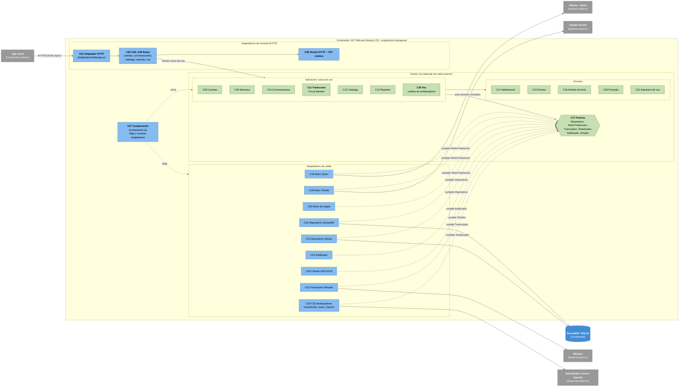

# 10. Componentes de la API TalkLate (C4 Nivel 3)

**Fase 3 - Arquitectura de software y base de datos**

**Version:** 1.0 (29/10/2026)

Este documento abre el contenedor **API TalkLate** (`09_diagramas_c4.md`, Nivel 2) y muestra sus
componentes internos: que piezas lo forman, de que se encarga cada una y como se comunican.
Solo se detalla este contenedor: la App movil se describe en `07_arquitectura.md` (seccion 5.2)
y en `13_especificacion_vistas_ui.md`, y la base de datos en `12_modelo_de_datos.md`.

**Metodo:** el diagrama refleja el codigo real de `backend/src`. Cada componente cita sus
archivos, el Bounded Context al que pertenece y el ADR que lo justifica
(`11_decisiones_de_arquitectura_ADR.md`).

**Organizacion:** la API sigue una **arquitectura hexagonal (puertos y adaptadores)** dentro del
monolito modular (ADR-013): el dominio y los casos de uso estan en el centro y no dependen de
Express, de la base de datos ni de los motores de IA; cada dependencia externa entra por un puerto
y se conecta con un adaptador. La composicion (`src/composicion.js`) es el unico lugar que conoce
los adaptadores concretos. Las reglas de dependencia se validan con dependency-cruiser
(`backend/.dependency-cruiser.cjs`, `npm run arch:check`).

---

## Diagrama de componentes

> **Regla de dependencias:** las flechas siempre apuntan hacia el nucleo. Los casos de uso
> (aplicacion) solo importan el dominio y los puertos; nunca un adaptador, ni Express, ni la base.
> Los adaptadores de salida "cumplen" un puerto y la composicion verifica al arrancar que lo
> cumplen (`asegurarPuerto`). Por eso se puede cambiar SurrealDB por otra base, o agregar un
> motor de traduccion, sin tocar los casos de uso. Log estructurado (C26) lo usan todas las capas.

---

## Catalogo de componentes

| # | Componente | Capa | Bounded Context | Responsabilidad | Archivo(s) | Patron / ADR |
| --- | --- | --- | --- | --- | --- | --- |
| C01 | Adaptador HTTP | Entrada | Plataforma | Arma Express: CORS, limite de cuerpo, `/health`, OpenAPI/Swagger, monta las rutas `/api/v1`, 404 y manejador global de errores. | `src/adaptadores/http/app.js`, `src/server.js` | ADR-002, ADR-011, ADR-013 |
| C02 | Rutas de cuentas | Entrada | Identidad y Acceso | Traduce HTTP a casos de uso: registro, login, refresco, recuperacion, logout, `/usuarios/yo` y eliminar cuenta. | `src/adaptadores/http/rutas/cuentas.js` | ADR-011 |
| C03 | Rutas de conversaciones | Entrada | Conversaciones y Mensajes | CRUD de conversaciones, envio de mensajes escritos y hablados (`/mensajes/voz`), `Location` y paginacion. | `src/adaptadores/http/rutas/conversaciones.js` | ADR-011 |
| C04 | Rutas de catalogo | Entrada | Catalogo de Idiomas | Consultar el catalogo y las operaciones del administrador. | `src/adaptadores/http/rutas/catalogo.js` | ADR-011 |
| C05 | Rutas de reportes | Entrada | Reportes de Calidad | Reportar una traduccion y revision del administrador. | `src/adaptadores/http/rutas/reportes.js` | ADR-011 |
| C06 | Sesion HTTP y roles | Entrada | Identidad y Acceso | Lee la cabecera `Authorization` y delega en el caso de uso de sesiones; `requerirAdmin`. | `src/adaptadores/http/sesion.js` | Token-Based Auth (5.1) / ADR-006 |
| C07 | Limites de uso | Entrada | Plataforma | Rate limiting por usuario e IP (mensajes, registro, recuperacion). | `src/adaptadores/http/limites.js` | ADR-010 (RNF-006) |
| C08 | Caso de uso Cuentas | Aplicacion | Identidad y Acceso | Registro con consentimiento, login con bloqueo por intentos, recuperacion, cierre de sesion y eliminar cuenta. | `src/aplicacion/cuentas.js` | ADR-006, ADR-010 |
| C09 | Caso de uso Sesiones | Aplicacion | Identidad y Acceso | JWT de acceso, token de refresco rotativo y atomico, revocacion. | `src/aplicacion/sesiones.js` | Token-Based Auth (5.1) / ADR-006 |
| C10 | Caso de uso Conversaciones | Aplicacion | Conversaciones y Mensajes | Reglas Conversacion-RN-1 a RN-5, deteccion del idioma origen, mensajes hablados (transcribe, valida tipo y tamano del audio, estima la prosodia), orquesta la traduccion, cifra al guardar; paginacion. | `src/aplicacion/conversaciones.js`, `src/aplicacion/paginacion.js` | ADR-004, ADR-010, ADR-014 |
| C11 | Caso de uso Traduccion | Aplicacion | Traduccion | Prueba los motores en orden y salta 60 s el que falla (Circuit Breaker); no conoce ningun motor concreto. | `src/aplicacion/traduccion.js` | Circuit Breaker (4.1) / ADR-004, ADR-013 |
| C12 | Caso de uso Catalogo | Aplicacion | Catalogo de Idiomas | Alta, edicion y activacion de idiomas y regiones; combinaciones unicas. | `src/aplicacion/catalogo.js` | ADR-008 |
| C13 | Caso de uso Reportes | Aplicacion | Reportes de Calidad | Reportar una traduccion propia una vez y revision del administrador. | `src/aplicacion/reportes.js` | ADR-010 |
| C14 | Validaciones | Dominio | Plataforma | Reglas de formato de entrada (nombres, correo, contrasena, contenido, nombre de conversacion). | `src/dominio/validaciones.js` | ADR-011 |
| C15 | Errores | Dominio | Plataforma | `ErrorNegocio` y cuerpo de error uniforme de la API. | `src/dominio/errores.js` | ADR-011 |
| C16 | Analisis de texto | Dominio | Traduccion | Detecta idioma, tono y region de origen por vocabulario. | `src/dominio/analisis.js` | ADR-004, ADR-005 |
| C17 | Puertos | Puertos | (todos) | Contratos `Repositorio`, `MotorTraduccion`, `Transcriptor`, `Sintetizador`, `Notificador` y `Cifrador`, y su verificacion al arrancar. | `src/puertos/index.js` | Puertos y adaptadores / ADR-013 |
| C18 | Motor Qwen | Salida | Traduccion | Cumple `MotorTraduccion` via Ollama local (HTTP `/api/chat`). | `src/adaptadores/traduccion/qwen.js` | ADR-004 |
| C19 | Motor Claude | Salida | Traduccion | Cumple `MotorTraduccion` via la API de Anthropic (solo si hay clave). | `src/adaptadores/traduccion/claude.js` | ADR-004 |
| C20 | Motor de reglas | Salida | Traduccion | Cumple `MotorTraduccion` sin red: espanol/ingles con modismos por pais; degradacion aceptable. | `src/adaptadores/traduccion/reglas.js`, `acentos.js` | ADR-004 |
| C21 | Constructor de prompt | Salida | Traduccion | Prompt de equivalente cultural comun a Qwen y Claude (incluye tono y prosodia de la voz), y lectura de su JSON. | `src/adaptadores/traduccion/prompt.js` | ADR-004 |
| C22 | Repositorio SurrealDB | Salida | (todos) | Cumple `Repositorio` sobre SurrealDB (HTTP `/sql` con token de sesion; valores serializados, nunca texto concatenado). | `src/adaptadores/persistencia/surreal/repositorio.js`, `cliente.js` | Repository / ADR-012 |
| C23 | Repositorio SQLite | Salida | (todos) | Cumple `Repositorio` sobre SQLite para pruebas sin servidor. | `src/adaptadores/persistencia/sqlite/repositorio.js`, `esquema.js` | Repository / ADR-003 |
| C24 | Notificador | Salida | Identidad y Acceso | Cumple `Notificador`; en desarrollo devuelve el codigo de recuperacion en la respuesta; un proveedor de correo se conecta como otro adaptador del mismo puerto. | `src/adaptadores/correo/consola.js` | ADR-006 |
| C25 | Cifrador AES-GCM | Salida | Plataforma | Cumple `Cifrador`: cifra/descifra el contenido de los mensajes en reposo. | `src/adaptadores/cifrado/aesGcm.js` | ADR-010 |
| C26 | Log estructurado | Transversal | Plataforma | Logs JSON sin datos personales; evento `traduccion` con `duracion_ms`. | `src/compartido/log.js` | Structured Logging (6.1) / ADR-010 |
| C27 | Composicion | Arranque | Plataforma | Unico lugar que conoce los adaptadores: los elige segun el entorno (`TRADUCTOR`, `TRANSCRIPCION_URL`, `VOZ_MOTOR`), verifica sus puertos y arma los casos de uso. | `src/composicion.js` | ADR-013 |
| C28 | Rutas de voz | Entrada | Voz | `POST /voz` (con sesion y limite por usuario) y `GET /voz/audio/:id` (id aleatorio de 128 bits que vence en 5 minutos). | `src/adaptadores/http/rutas/voz.js` | ADR-015 |
| C29 | Caso de uso Voz | Aplicacion | Voz | Valida texto, idioma y tono; prueba los sintetizadores en orden; guarda el audio en memoria con vencimiento. | `src/aplicacion/voz.js` | ADR-015 |
| C30 | Prosodia | Dominio | Voz | Estima intensidad, ritmo y expresividad con el volumen y las palabras por segundo; combina el tono de la voz con el de las palabras. | `src/dominio/prosodia.js` | ADR-014 |
| C31 | Expresion de voz | Dominio | Voz | Define como suena cada tono: voz por idioma y pais, estilo SSML, prosodia, instruccion y vector de emocion. | `src/dominio/voz.js` | ADR-015, ADR-016 |
| C32 | Transcriptor Whisper | Salida | Voz | Cumple `Transcriptor`: envia el audio multipart a la API compatible con OpenAI y devuelve el texto. | `src/adaptadores/transcripcion/whisper.js` | ADR-014 |
| C33 | Sintetizador VoiceStudio | Salida | Voz | Cumple `Sintetizador`: IndexTTS 2 por `/generate` con vector de emocion, u otros motores por `/v1/audio/speech`. | `src/adaptadores/sintesis/voicestudio.js` | ADR-016 |
| C34 | Sintetizador Azure | Salida | Voz | Cumple `Sintetizador`: SSML con `mstts:express-as` y prosodia de respaldo. | `src/adaptadores/sintesis/azure.js` | ADR-015 |
| C35 | Sintetizador OpenAI | Salida | Voz | Cumple `Sintetizador`: `/v1/audio/speech` con la emocion y el acento como instruccion. | `src/adaptadores/sintesis/openai.js` | ADR-015 |

---

## Bounded Contexts

Cada contexto agrupa componentes y las entidades del modelo (`12_modelo_de_datos.md`) que gobierna.
En el codigo se reconocen por el caso de uso y por el namespace del repositorio.

| Bounded Context | Componentes | Namespace del repositorio | Entidades principales |
| --- | --- | --- | --- |
| Identidad y Acceso | C02, C06, C08, C09, C24 | `usuarios`, `tokens`, `sesiones`, `recuperaciones` | Usuario, TokenRefresco, SesionRevocada, Recuperacion |
| Conversaciones y Mensajes | C03, C10 | `conversaciones`, `mensajes` | Conversacion, LenguajePorConversacion, MensajeOriginal, MensajeDestino |
| Traduccion | C11, C16, C18-C21 | - (servicio, sin tablas propias) | - |
| Catalogo de Idiomas | C04, C12 | `catalogo` | Pais, Region, Lenguaje, LenguajeRegion, Canal, Entonacion |
| Reportes de Calidad | C05, C13 | `reportes` | Reporte |
| Voz | C28-C35 | - (audio en memoria, sin tablas) | - |
| Plataforma (transversal) | C01, C07, C14, C15, C17, C22, C23, C25-C27 | - | - |

---

## Trazabilidad: requerimiento -> componente

Completa la cadena requisito -> historia -> impacto de `05_requisitos_funcionales_y_no_funcionales.md` hasta el componente que lo realiza.

| Requerimiento | Componentes que lo realizan |
| --- | --- |
| REQ-TRAD-001 (mensaje hablado) | C03, C10, C30, C32; grabacion con `expo-audio` en la app (ADR-014) |
| REQ-TRAD-002 (mensaje escrito 1-5000) | C10, C14 |
| REQ-TRAD-003 (traducir con tono/modismos + nota) | C10, C11, C18/C19/C20, C21, C16 |
| REQ-TRAD-004 (voz natural con emocion) | C10 (`ritmo_voz`), C28, C29, C31, C33-C35; `expo-speech` de respaldo en la app |
| REQ-TRAD-005 (entregar por el mismo canal) | C10 |
| REQ-CONV-001 (idioma/region destino valida) | C10, C14, C22 (`regionValidaParaLenguaje`) |
| REQ-CONV-002 (reconocer origen y fijarlo) | C10, C16 (`detectarIdioma`), C22 (`conversaciones.crearLpc`) |
| REQ-CONV-003 (crear conversacion, par soportado) | C10, C11 (`soportaPar`) |
| REQ-CONV-004 (configurar una sola vez) | C10, C22 (`lpcDe`) |
| REQ-CONV-005 (guardar hilo en orden) | C10, C25, C22 (`mensajes.crear`) |
| REQ-CONV-006 (historial paginado) | C03 (`paginar`), C10 |
| REQ-CONV-007 (ver mios, negar ajenos) | C10 (`delUsuario`), C06 |
| REQ-CONV-008 (renombrar 3-80) | C10, C14 (`validarNombreConversacion`) |
| REQ-CONV-009 (eliminar con cascada) | C10, C22 (`conversaciones.eliminar`) |
| REQ-USR-001 (registro + consentimiento) | C02, C08, C14 |
| REQ-USR-002 (login + bloqueo + refresco) | C02, C08, C09 |
| REQ-USR-003 (codigo de recuperacion) | C02, C08, C24 |
| REQ-USR-004 (logout invalida tokens) | C02, C08, C09 |
| REQ-USR-005 (eliminar cuenta) | C02, C08 |
| REQ-INT-001 (traduccion al interlocutor sin cuenta) | C10 |
| REQ-INT-002 (responder en mi idioma) | C10 (`remitente=interlocutor`), C11 |
| REQ-REP-001 (reportar una vez) | C05, C13 |
| REQ-REP-002 (admin revisa reportes) | C05, C13, C06 (`requerirAdmin`) |
| REQ-IDIOMA-001 (ver idiomas activos) | C04, C12 |
| REQ-IDIOMA-002 (agregar idioma/region) | C04, C12, C06, C14 |
| REQ-IDIOMA-003 (activar/desactivar) | C04, C12, C06 |
| RNF-001 (3 s texto, 5 s voz) | C11 (Circuit Breaker), C26 (`duracion_ms`), C32, C33 |
| RNF-003 (proteccion de datos) | C25, C26, C09, C08 (eliminar cuenta) |
| RNF-005 (degradacion si falla la IA) | C11, C20, C29 |
| RNF-006 (limites de uso) | C07, C08 (bloqueo de login) |
| RNF-008 (facilidad de prueba) | C17 (puertos), C23, C27 (adaptadores falsos en pruebas) |
| RNF-009 (API REST + OpenAPI) | C01, C15 |
| RNF-010 (voz con emocion) | C30, C31, C33-C35 |

---

## Limitaciones conocidas y evolucion

- **C24 Notificador:** en desarrollo el codigo de recuperacion vuelve en la respuesta; en produccion se conecta un proveedor de correo como otro adaptador del mismo puerto (ADR-006).
- **C22 Repositorio SurrealDB:** algunas consultas filtran recorriendo enlaces; se agregan indices sobre esos campos al crecer el volumen (ADR-012).
- **C16 Analisis:** la region de origen se reconoce por vocabulario; reconocerla por el sonido de la voz es evolucion futura sobre el puerto `Transcriptor`.
