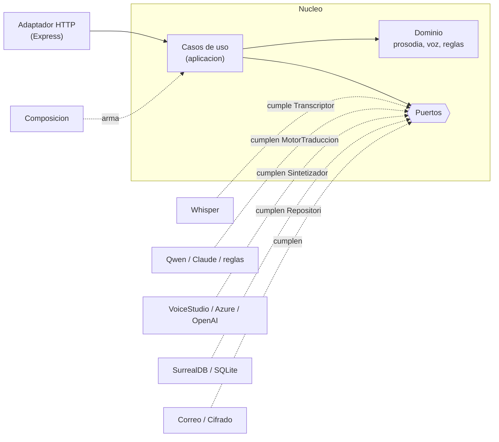
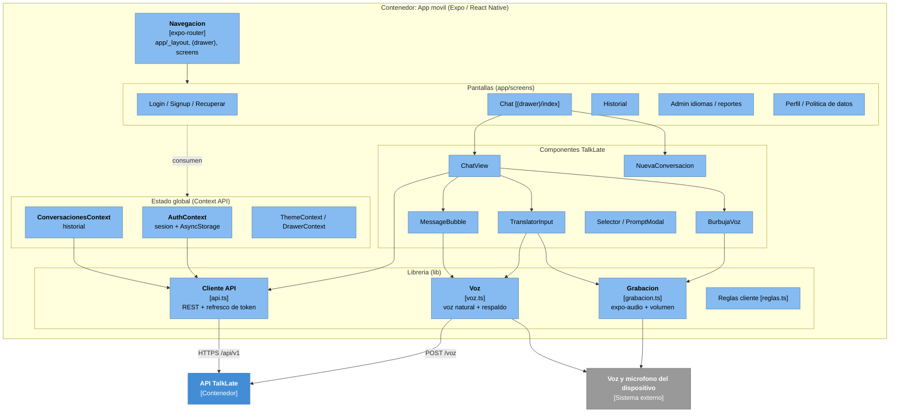
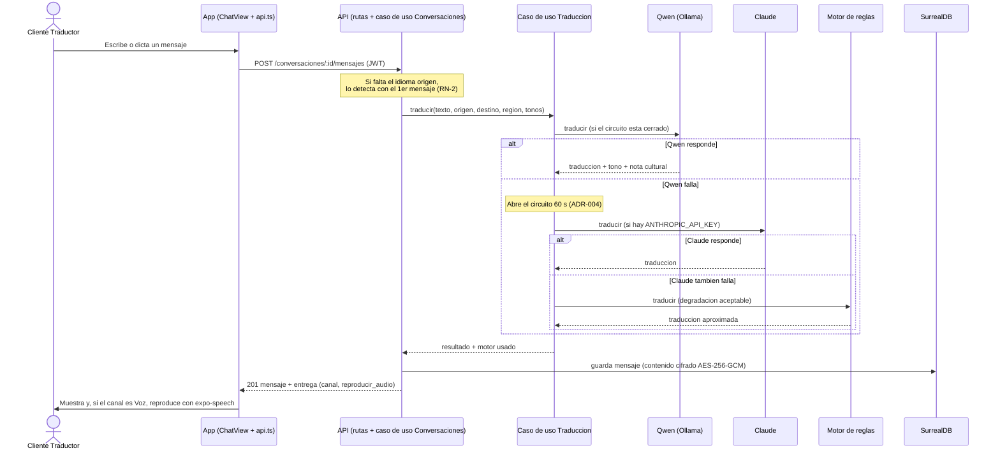
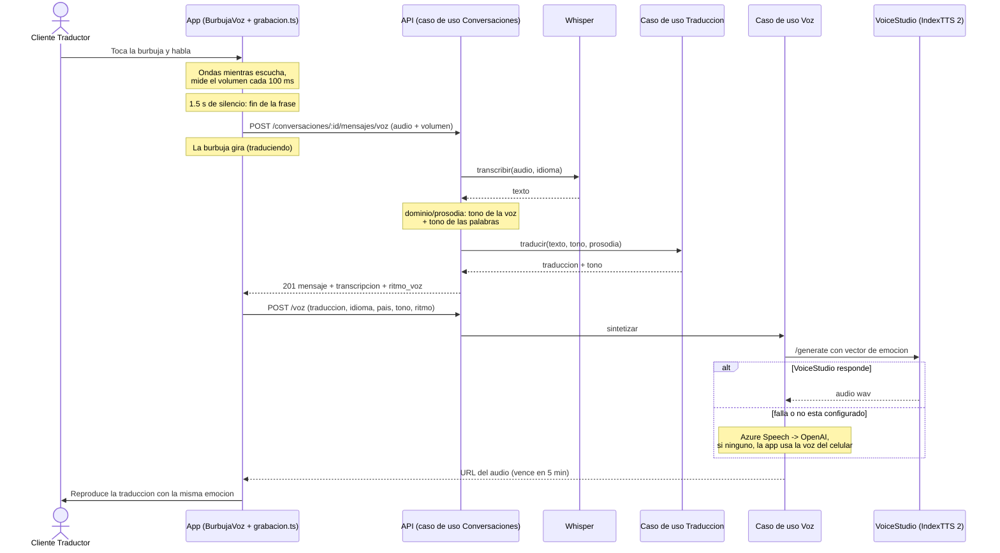
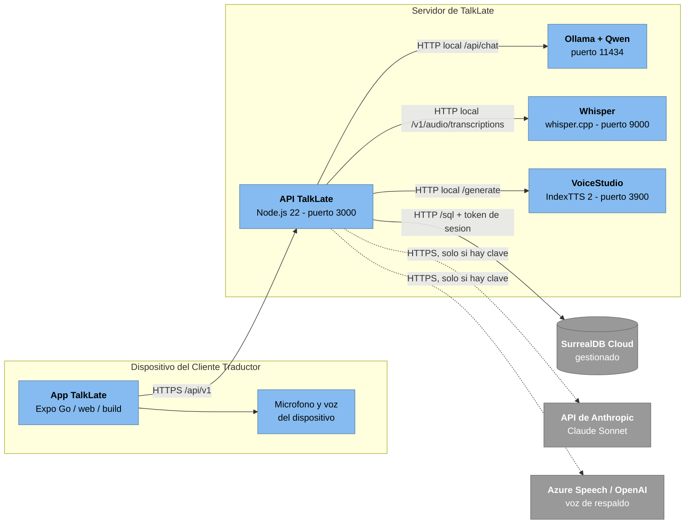

# 7. Arquitectura de TalkLate

**Fase 3 - Arquitectura de software y base de datos**

**Version:** 1.0 (29/10/2026)

Este es el documento de entrada a la arquitectura de TalkLate. Describe la **arquitectura
construida** y **justifica cada decision con su ADR** (`11_decisiones_de_arquitectura_ADR.md`)
y el driver que la obliga (`06_drivers_de_arquitectura.md`). Cada afirmacion apunta al codigo
real (`backend/src`, `frontend/`).

## Como leer esta entrega

| Documento | Vista C4 / tema | Contenido |
| --- | --- | --- |
| `07_arquitectura.md` (este) | Sintesis y justificacion | Todas las vistas amarradas y justificadas por ADR |
| `06_drivers_de_arquitectura.md` | Drivers | Requisitos que obligan decisiones (DRV-01 a DRV-08) |
| `08_stack_tecnologico.md` | Stack | Tecnologia por capa y alternativas evaluadas |
| `09_diagramas_c4.md` | C4 Niveles 1 y 2 | Contexto del sistema y contenedores |
| `10_componentes.md` | C4 Nivel 3 (API) | Componentes internos de la API TalkLate |
| `11_decisiones_de_arquitectura_ADR.md` | Decisiones | 16 ADR con contexto, alternativas y consecuencias |
| `12_modelo_de_datos.md` | Datos | Modelo de dominio, reglas y correspondencia con la base |
| `diagramas/arquitectura_talklate.html` | Vista general interactiva | Diagrama de arquitectura (Archify) con el flujo de voz |
| `diagramas/arquitectura_hexagonal.html` | Vista interactiva del backend | Nucleo, 6 puertos y adaptadores (Archify) |

## 1. Estilo arquitectonico

TalkLate es una arquitectura **cliente-servidor** de tres contenedores:

- **App movil** multiplataforma en Expo / React Native, una sola base de codigo para iOS,
  Android y web (ADR-001, responde a DRV-07).
- **API TalkLate**, un **monolito modular** en Node.js 22 + Express con API REST sincrona
  `/api/v1` (ADR-002, ADR-011, responde a DRV-01, DRV-08).
- **Base de datos** SurrealDB 3.x, detras de un patron **Repository** que permite usar SQLite
  en pruebas (ADR-012, responde a DRV-04, DRV-08).

El corazon del producto -traducir conservando tono, intencion, emocion y modismos- vive en tres
subsistemas que dependen de motores de IA, cada uno detras de un puerto y con respaldo:

| Subsistema | Puerto | Motores (en orden) | ADR | Drivers |
| --- | --- | --- | --- | --- |
| Transcripcion de voz | `Transcriptor` | Whisper (API compatible con OpenAI: whisper.cpp o faster-whisper locales) | ADR-014 | DRV-01, DRV-06 |
| Traduccion cultural | `MotorTraduccion` | Qwen local (Ollama) -> Claude Sonnet -> motor de reglas, con Circuit Breaker | ADR-004 | DRV-01, DRV-02, DRV-05 |
| Voz con emocion | `Sintetizador` | VoiceStudio local (IndexTTS 2) -> Azure Speech -> OpenAI -> voz del celular | ADR-015, ADR-016 | DRV-02, DRV-05, DRV-06 |

La entonacion de un mensaje hablado se estima en el dominio (`dominio/prosodia.js`) con el
volumen, la variacion y la velocidad de la voz, y se combina con el tono de las palabras. Ese
tono viaja al prompt de traduccion y al sintetizador, que lo convierte en emocion audible
(`dominio/voz.js`).

Por dentro, la API sigue una **arquitectura hexagonal (puertos y adaptadores)** (ADR-013): el
dominio y los casos de uso estan en el centro y no dependen de Express, de la base ni de los
motores de IA; cada dependencia externa entra por un puerto (`Repositorio`, `MotorTraduccion`,
`Transcriptor`, `Sintetizador`, `Notificador`, `Cifrador`) y se conecta con un adaptador. Las
reglas de dependencia entre capas se verifican con dependency-cruiser
(`npm run arch:check`). Hoy marca dos dependencias pendientes de mover detras de un puerto: `bcryptjs` en `aplicacion/cuentas.js` y `jsonwebtoken` en `aplicacion/sesiones.js`.

---

## 2. Como la arquitectura responde a los drivers

Por cada driver: que se decidio (ADR), con que mecanismo del codigo se realiza y como se comprueba.

| Driver | Decision (ADR) | Mecanismo en el codigo | Como se comprueba |
| --- | --- | --- | --- |
| DRV-01 Tiempo por turno | ADR-002 (REST por turno), ADR-004 (motores en cadena, sin reintentos), ADR-014, ADR-016 | `aplicacion/traduccion.js`: al fallar un motor se pasa al siguiente y el circuito evita esperar el timeout en cada mensaje; Whisper y VoiceStudio corren locales, sin viaje a internet | `npm run medir` y `npm run medir:voz`; evento de log `traduccion` con `duracion_ms` |
| DRV-02 Calidad cultural y emocional | ADR-004 (prompt de equivalencia cultural), ADR-014 (entonacion), ADR-015 y ADR-016 (voz con emocion) | `adaptadores/traduccion/prompt.js` arma el prompt con tono, prosodia y region destino; `dominio/voz.js` traduce el tono a estilo SSML, instruccion o vector de emocion | `npm run medir` con glosario de prueba; audios de `npm run medir:voz`; prueba de escucha |
| DRV-03 Privacidad | ADR-006 (JWT + refresco), ADR-010 (proteccion de datos) | `adaptadores/cifrado/aesGcm.js` (AES-256-GCM en reposo), `compartido/log.js` (JSON sin datos personales), aislamiento por usuario, eliminar cuenta; los audios de voz solo viven en memoria 5 minutos | `test/api.test.js`, `test/seguridad.test.js` |
| DRV-04 Crecimiento de idiomas | ADR-008 (LenguajeRegion N:M), ADR-012 (catalogo en datos) | `aplicacion/catalogo.js` + puerto `Repositorio.catalogo`: alta y activacion de idiomas y regiones sin tocar codigo | Prueba del administrador |
| DRV-05 Continuidad ante fallas | ADR-004 (Circuit Breaker), ADR-015 (cadena de voz) | Circuito abierto 60 s por motor; motor de reglas y voz del celular como ultimo recurso | `test/motores.test.js` |
| DRV-06 Costo y abuso | ADR-004, ADR-010, ADR-016 | Qwen, Whisper y VoiceStudio locales sin costo por mensaje; `adaptadores/http/limites.js`: 30 mensajes por minuto, limites de registro, recuperacion y voz | Pruebas de seguridad |
| DRV-07 Multiplataforma | ADR-001 (Expo), ADR-007 (template Luna) | Una base de codigo en `frontend/`; grabacion con `expo-audio`, que funciona en Expo Go | Compilacion web y Expo Go |
| DRV-08 Facilidad de prueba | ADR-002, ADR-012, ADR-013 | Adaptador SQLite sin servidor ni claves; casos de uso probados con adaptadores falsos; dependency-cruiser verifica las capas | `npm run coverage` (cercana al 96 %), `npm run arch:check`, CI contra SQLite y SurrealDB |

---

## 3. Vista de contexto (C4 Nivel 1)

Quien usa TalkLate (Cliente Traductor, Interlocutor, Administrador) y con que sistemas externos
habla: Ollama + Qwen, Claude, Whisper, VoiceStudio (con Azure Speech u OpenAI de respaldo) y la
voz del dispositivo. Diagrama completo en `09_diagramas_c4.md`.

---

## 4. Vista de contenedores (C4 Nivel 2)

Tres contenedores propios (App, API, Base de datos) y los servicios de IA locales. Diagrama
completo en `09_diagramas_c4.md`. Justificacion por contenedor:

| Contenedor | Decision | ADR |
| --- | --- | --- |
| App movil (Expo) | Una base de codigo multiplataforma, reusa el template Luna; graba la voz con `expo-audio` | ADR-001, ADR-007, ADR-014 |
| API TalkLate (Node + Express) | Monolito modular hexagonal, REST sincrona por turno | ADR-002, ADR-011, ADR-013 |
| Base de datos (SurrealDB) | Fuente de verdad detras de un repositorio; enlaces nativos, ASSERT y UNIQUE | ADR-012 |
| Servicios de IA locales (Ollama, Whisper, VoiceStudio) | Corren en el servidor de TalkLate, sin costo por mensaje ni datos a terceros | ADR-004, ADR-014, ADR-016 |

---

## 5. Vista de componentes (C4 Nivel 3)

### 5.1 API TalkLate

Detalle completo (componentes, bounded contexts y trazabilidad requisito -> componente) en
`10_componentes.md`. En resumen, en capas hexagonales: Adaptador HTTP (rutas, sesion, limites)
-> Casos de uso (cuentas, sesiones, conversaciones, traduccion, voz, catalogo, reportes) ->
Dominio (reglas, prosodia, voz) y Puertos <- Adaptadores de salida (motores Qwen, Claude y
reglas; transcriptor Whisper; sintetizadores VoiceStudio, Azure y OpenAI; repositorios
SurrealDB y SQLite; notificador; cifrador), conectados por la Composicion.

### 5.2 App movil

El contenedor App reusa el sistema de componentes del template Luna (ADR-007) y agrega las
vistas y la logica de TalkLate. Es un cliente delgado: toda la logica de negocio esta en la API.

| Componente | Responsabilidad | Archivo(s) | ADR |
| --- | --- | --- | --- |
| Navegacion | Rutas y layout (drawer, pantallas) | `app/_layout.tsx`, `app/(drawer)/`, `app/[...404].tsx` | ADR-001 |
| Pantallas | Una vista por etapa del journey (ver `13_especificacion_vistas_ui.md`) | `app/screens/*` | ADR-007 |
| AuthContext | Sesion en memoria + persistencia en AsyncStorage; renueva usuario al abrir | `app/contexts/AuthContext.tsx` | ADR-006 |
| ConversacionesContext | Historial del usuario para el menu lateral y la pantalla de historial | `app/contexts/ConversacionesContext.tsx` | ADR-007 |
| ChatView | Pantalla del traductor con dos modos: burbuja de voz (por defecto) y chat | `components/talklate/ChatView.tsx` | ADR-007, ADR-014 |
| BurbujaVoz | Burbuja animada que representa la IA: escucha (ondas), traduce (gira) y habla | `components/talklate/BurbujaVoz.tsx` | ADR-014 |
| TranslatorInput + MessageBubble | Modo chat: escribir o grabar, mostrar y reproducir la traduccion | `components/talklate/*` | ADR-007 |
| Grabacion | Graba con `expo-audio`, mide el volumen cada 100 ms y detecta el fin de la frase (1.5 s de silencio) | `lib/grabacion.ts` | ADR-014 |
| Cliente API | REST a `/api/v1`; **refresco automatico del token** (401 -> renueva una vez con guardia single-flight -> repite) | `lib/api.ts` | ADR-006, ADR-011 |
| Voz | Pide la voz natural con emocion a la API (`POST /voz`) y la reproduce; si no hay motor, usa `expo-speech` con tono y velocidad ajustados | `lib/voz.ts` | ADR-015 |

> Justificacion: la App es delgada a proposito (ADR-002: la logica vive en la API). La app solo
> graba y reproduce; transcribir, estimar la entonacion, traducir y sintetizar la voz ocurre en
> el servidor (ADR-014, ADR-015). La region de origen se reconoce por el vocabulario.

---

## 6. Vista de datos

Modelo de dominio (10 objetos + relacion N:M `LenguajeRegion` + tablas de soporte) y su
correspondencia con la base, en `12_modelo_de_datos.md`. Justificacion:

| Decision | ADR |
| --- | --- |
| SurrealDB como fuente de verdad, esquema SCHEMAFULL con ASSERT y UNIQUE | ADR-012 |
| Identificadores del dominio en espanol (lenguaje ubicuo); esquema de la base en ingles | ADR-009 |
| LenguajeRegion N:M y tablas de soporte (`reporte`, `token_refresco`, `sesion_revocada`, `recuperacion`) | ADR-008 |
| Contenido de mensajes cifrado en reposo (AES-256-GCM) | ADR-010 |

---

## 7. Vista dinamica: traducir un mensaje

El flujo central (HU0003). Muestra el Circuit Breaker (ADR-004), el cifrado al persistir
(ADR-010) y la entrega por el mismo canal (REQ-TRAD-005).

> Fuente editable: `diagramas/secuencia_traduccion.drawio`.

### 7.1 Mensaje hablado (burbuja de voz)

> El token de acceso dura 15 minutos. Si vence a mitad del flujo, `lib/api.ts` responde al 401
> renovando el token con el de refresco (una sola vez, con guardia) y repite la peticion sin que
> el usuario lo note (ADR-006).

---

## 8. Vista de despliegue

Donde corre cada pieza. Los motores de IA principales (Qwen, Whisper y VoiceStudio) viven en el
**servidor** de TalkLate (ADR-004, ADR-014, ADR-016); SurrealDB es una instancia **remota**
gestionada (ADR-012). Equipo de referencia para la demostracion: Mac con chip M5 y 32 GB de RAM
(aceleracion Metal/MLX); la guia de montaje es `backend/VOICESTUDIO_MAC.md`.

> Fuente editable: `diagramas/despliegue.drawio`. Vista interactiva: `diagramas/arquitectura_talklate.html`.

---

## 9. Patrones aplicados

Patrones del catalogo de la convencion del proyecto:

| Patron | Donde | ADR |
| --- | --- | --- |
| Request-Reply | API REST sincrona por turno | ADR-002, ADR-011 |
| Circuit Breaker (con degradacion aceptable) | Caso de uso de traduccion (`aplicacion/traduccion.js`) | ADR-004 |
| Cadena de respaldo (fallback) | Caso de uso de voz (`aplicacion/voz.js`): VoiceStudio -> Azure -> OpenAI -> voz del celular | ADR-015 |
| Token-Based Authentication | Sesion JWT + refresco rotativo | ADR-006 |
| Repository | Puerto `Repositorio` con dos adaptadores (`adaptadores/persistencia/`) | ADR-012 |
| Puertos y adaptadores (hexagonal) | Toda la API: dominio, casos de uso, puertos, adaptadores y composicion | ADR-013 |
| Structured Logging | Logs JSON sin PII (`compartido/log.js`) | ADR-010 |

Patrones del catalogo que **no** se usan y por que (microservicios, API Gateway, BFF, CQRS,
Event Sourcing, Strangler Fig): ver la nota en `11_decisiones_de_arquitectura_ADR.md`.

---

## 10. Indice de decisiones (ADR)

Detalle completo en `11_decisiones_de_arquitectura_ADR.md`. Resumen de que resuelve cada una:

| ADR | Decision | Driver |
| --- | --- | --- |
| ADR-001 | App Expo (React Native) + NativeWind | DRV-07 |
| ADR-002 | Backend monolitico Node + Express, REST sincrona | DRV-07, DRV-08 |
| ADR-003 | SQLite inicial (reemplazada por ADR-012; queda para pruebas) | DRV-04, DRV-08 |
| ADR-004 | Traduccion Qwen -> Claude -> reglas (Circuit Breaker) | DRV-01, DRV-02, DRV-05, DRV-06, DRV-08 |
| ADR-005 | Voz en el cliente con expo-speech (la entrada por voz la reemplaza ADR-014) | DRV-07 |
| ADR-006 | JWT de acceso corto + refresco rotativo | DRV-03 |
| ADR-007 | Interfaz basada en el template Luna | - |
| ADR-008 | Ajustes al modelo de dominio (LenguajeRegion, soporte) | DRV-04 |
| ADR-009 | Identificadores del dominio en espanol | - |
| ADR-010 | Proteccion de datos personales | DRV-03 |
| ADR-011 | API v1 REST + OpenAPI | - |
| ADR-012 | SurrealDB como fuente de verdad detras de un repositorio | DRV-01, DRV-03, DRV-04, DRV-08 |
| ADR-013 | Arquitectura hexagonal (puertos y adaptadores) dentro del monolito | DRV-04, DRV-05, DRV-08 |
| ADR-014 | Voz en Expo Go: grabacion en el celular, Whisper en el servidor y entonacion por texto y voz | DRV-01, DRV-02, DRV-07 |
| ADR-015 | Voz natural con emocion en el servidor (puerto Sintetizador) | DRV-02, DRV-05 |
| ADR-016 | VoiceStudio local como primer motor de voz con emocion | DRV-02, DRV-06 |

---

## 11. Riesgos tecnicos y mitigaciones

| Riesgo | Impacto | Mitigacion |
| --- | --- | --- |
| La latencia de Qwen, Whisper y VoiceStudio en el equipo de despliegue supera DRV-01 | Conversacion lenta | Medicion con `npm run medir` y `npm run medir:voz` antes de cada demostracion; motores mas livianos (CosyVoice, Kokoro) y respaldo en la nube sin cambiar la app |
| El tiempo de espera de Qwen (60 s) es mayor que el limite de DRV-01 | Un turno puede tardar demasiado si Qwen se cuelga | El Circuit Breaker abre el circuito y los mensajes siguientes van directo al respaldo |
| IndexTTS 2 sin GPU es lento | Voz con emocion tardia | Equipo de referencia con Apple Silicon (Metal/MLX); en otros equipos, Azure Speech como primer motor (`VOZ_MOTOR=azure`) |
| Licencia AGPL-3.0 de VoiceStudio y licencias por modelo | Restriccion para uso comercial | Uso academico permitido; para uso comercial, Azure u OpenAI detras del mismo puerto |
| Consultas por enlaces sin indice en SurrealDB | Lentitud con muchos datos | Indices sobre los campos de enlace al crecer el volumen (ADR-012) |
| Servicio de correo para recuperacion | El codigo de recuperacion no llega por correo en produccion | Puerto `Notificador` listo para un proveedor SMTP; en desarrollo el codigo se muestra en la respuesta (ADR-006) |
| Reconocer la region por el sonido de la voz | Precision regional limitada al vocabulario | Evolucion futura sobre el mismo puerto `Transcriptor` |

---

## 12. Trazabilidad global

La cadena completa que recorre el proyecto:

**Vision** (`01_vision_y_contexto.md`) -> **Impacto** (`02_mapa_de_impacto.md`) -> **Historia**
(`03_historias_de_usuario.md`) -> **Requisito** (`05_requisitos_funcionales_y_no_funcionales.md`)
-> **Driver** (`06_drivers_de_arquitectura.md`) -> **ADR** (`11_decisiones_de_arquitectura_ADR.md`)
-> **Componente** (`10_componentes.md` y seccion 5.2) -> **Evidencia** (pruebas del backend,
`npm run medir` y `npm run medir:voz`).
