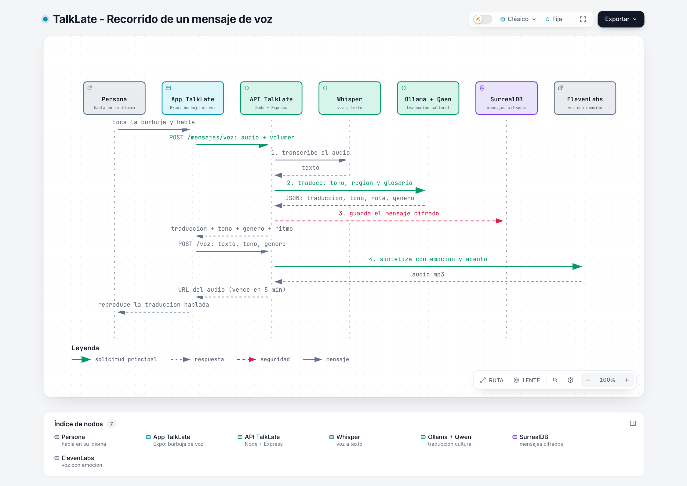
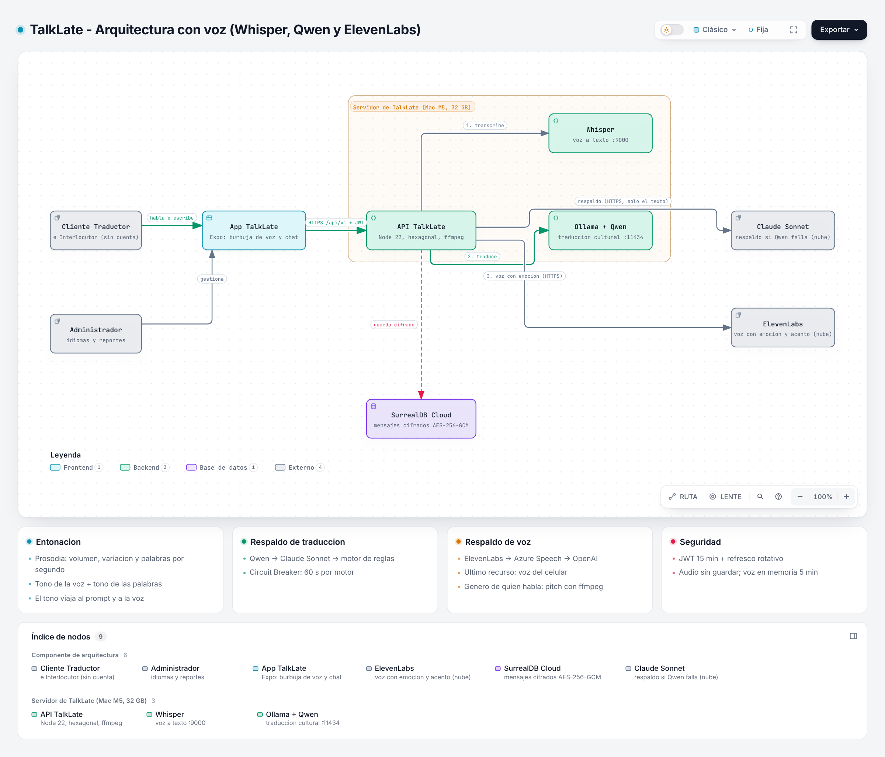
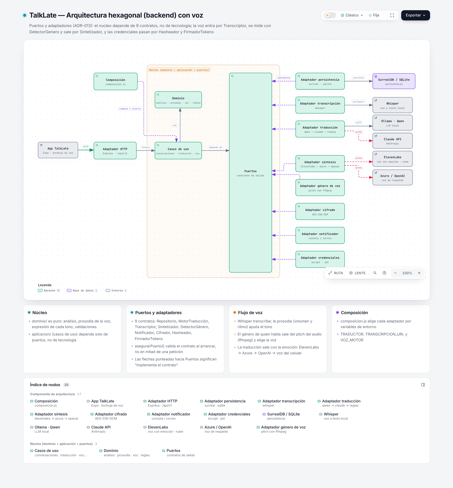
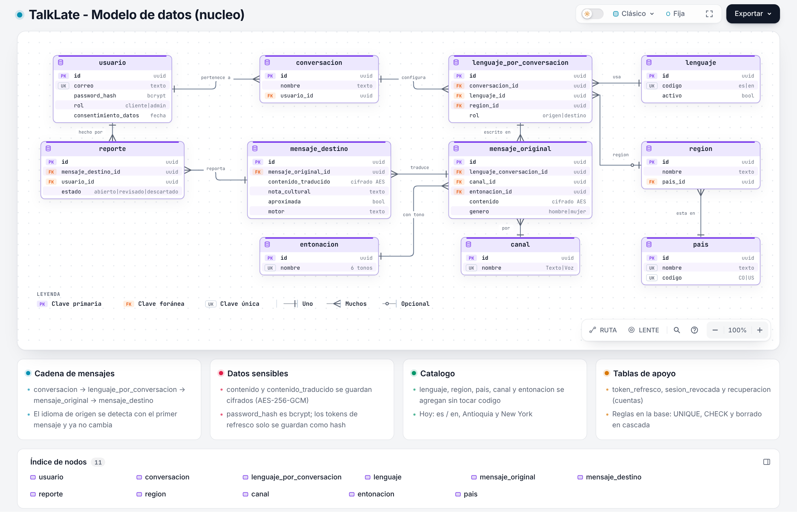

# TalkLate: guia tecnica completa para exponer

**Version:** 1.0 (12/11/2026)
**Para quien es:** alguien que no conoce el proyecto y necesita entenderlo de cero para exponerlo. Esta escrito en el orden en que conviene aprenderlo: primero que es y como se usa, despues como funciona por dentro, y al final donde esta debil y que preguntas esperar.

Todo lo que dice este documento sale del codigo y de los documentos del repositorio. Donde algo **no esta hecho o no esta medido**, lo dice, porque eso es lo que mas conviene saber antes de pararse frente a un jurado.

## Como leerlo

| Parte | Que aprendes | Tiempo |
| --- | --- | --- |
| 1. Que es TalkLate | El producto, el problema y un ejemplo concreto | 5 min |
| 2. Quien lo usa y que puede hacer | Actores y funciones | 5 min |
| 3. Recorrido de un mensaje | Lo que pasa de punta a punta, en texto y en voz | 15 min |
| 4. Arquitectura | Las piezas, la arquitectura hexagonal y los 9 puertos | 20 min |
| 5. La traduccion por dentro | Motores, prompt, glosario, tono y respaldo | 15 min |
| 6. La voz por dentro | Grabar, transcribir, medir el tono, el genero y hablar | 15 min |
| 7. Los datos | Modelo, base de datos y reglas de negocio | 10 min |
| 8. Seguridad y privacidad | Sesiones, cifrado, limites, Ley 1581, OWASP y Trivy | 10 min |
| 9. La app movil | Pantallas, modos y como habla con la API | 10 min |
| 10. Pruebas y CI | Que se prueba y como | 5 min |
| 11. Como se organizo el proyecto | SoftVerse, historias, sprints, drivers y ADR | 10 min |
| 12. Estado real y puntos debiles | Lo que falta y donde pueden preguntar | 10 min |
| 13. Preguntas probables | Respuestas cortas | 10 min |
| 14. Guion de exposicion y demo | Como contarlo | 5 min |
| 15. Glosario | Todos los terminos tecnicos | consulta |

---

## 1. Que es TalkLate

**En una frase:** una aplicacion movil donde dos personas que hablan idiomas distintos conversan, y cada mensaje se traduce **conservando la intencion, el tono y los modismos**, no palabra por palabra.

**El problema.** Los traductores comunes (Google Translate, DeepL) traducen bien lo literal pero fallan con la jerga. Si un paisa de Medellin dice *"hay que ponerse las pilas con el trabajo"*, una traduccion literal sale como *"we have to put on the batteries"*. Eso no significa nada en ingles. Lo natural es **"we need to get cracking on the work"**. TalkLate esta hecho para dar esa segunda respuesta.

**Que lo hace distinto** (la "propuesta de valor" del documento de vision):
- Adapta el mensaje a **una region concreta** del idioma destino. En este MVP: espanol de **Antioquia (Colombia)** e ingles de **New York (Estados Unidos)**.
- Entiende el **tono** del mensaje (neutral, amigable, alegre, preocupado, enojado, formal), tanto por las palabras como, en los mensajes hablados, por **como** se dijo (volumen, ritmo, variacion).
- La traduccion se puede **escuchar con una voz natural** que replica la emocion y el acento regional.
- Explica la adaptacion con una **nota cultural** ("en Colombia 'pilas' significa estar atento y activo...").

**Que NO es** (el alcance del MVP, que conviene decir antes de que lo pregunten):
- **No es traduccion simultanea.** "Tiempo real" significa **por turno**: cada mensaje se traduce en pocos segundos (meta: 3 s o menos en texto y 5 s o menos en voz). No traduce mientras la persona sigue hablando.
- **No reconoce el acento por el sonido.** La region de origen se reconoce por el **vocabulario** ("parce", "wey", "che", "mate"). Reconocerla por la voz es trabajo futuro.
- **Solo dos idiomas activos:** espanol e ingles.
- No comparte ni exporta conversaciones, no edita el perfil, no clona la voz del usuario.

**Estado de los idiomas hoy (dato verificado en el codigo):** el catalogo tiene exactamente dos idiomas (Espanol e Ingles) y dos regiones (Antioquia y New York). El documento de vision dice que frances y portugues "existen inactivos"; en el codigo no existen, porque el administrador los puede agregar desde la app. Es una imprecision del documento, no del producto.

---

## 2. Quien lo usa y que puede hacer

Hay tres actores:

| Actor | Quien es | Que hace |
| --- | --- | --- |
| **Cliente Traductor** | La persona con cuenta que usa la app | Se registra, crea una conversacion, escribe o habla, lee y escucha la traduccion, revisa su historial, reporta malas traducciones, borra su cuenta |
| **Interlocutor** | La otra persona de la conversacion, **sin cuenta ni app** | Su mensaje lo ingresa el Cliente por el: su respuesta se traduce de vuelta al idioma del Cliente |
| **Administrador** | Cuenta con rol `admin` | Revisa los reportes de mala traduccion y gestiona los idiomas y regiones (agregar, activar, desactivar) |

Nota sobre el Interlocutor: en el MVP no tiene pantalla propia. El Cliente marca que el mensaje es de la otra persona y el sistema lo traduce en sentido contrario. En el codigo es el campo `remitente: "usuario" | "interlocutor"`.

**Las 26 historias de usuario** se agrupan en 6 epicas:

| Epica | Historias (resumen) |
| --- | --- |
| Traduccion de mensajes | Ingresar mi mensaje hablando o escribiendo, traducirlo, escucharlo, recibirlo por el mismo canal que use |
| Gestion de conversaciones | Elegir idioma y region destino, reconocer el idioma origen, crear, configurar una sola vez, hilo continuo, historial, abrir, renombrar, eliminar |
| Cuenta de usuario | Registrarme, iniciar y cerrar sesion, recuperar contrasena, eliminar mi cuenta |
| Participacion del interlocutor | Recibir el mensaje traducido, responder en mi idioma |
| Reportes | Reportar una mala traduccion, revisar los reportes (admin) |
| Administracion de idiomas y regiones | Consultar, agregar y activar o desactivar idiomas y regiones |

---

## 3. Recorrido de un mensaje

Este es el corazon del proyecto. Si entiendes esta parte, entiendes TalkLate.

### 3.1 Antes del primer mensaje: crear la conversacion

1. La persona abre **Nueva conversacion** y elige: a que idioma quiere traducir (**Ingles**), la region de ese idioma (**New York**) y, opcionalmente, su propio idioma (por defecto "Detectar automaticamente").
2. La app llama `POST /api/v1/conversaciones`. El backend valida que el idioma este **activo**, que la region **sea valida para ese idioma** y que algun motor soporte el par.
3. Queda guardada una conversacion con su configuracion. **Se configura una sola vez** (historia HU0009).

### 3.2 Un mensaje escrito

Ejemplo: la persona escribe *"Hay que ponerse las pilas con el trabajo"*.

| Paso | Que pasa | Donde (codigo) |
| --- | --- | --- |
| 1 | La app envia `POST /conversaciones/:id/mensajes` con el texto y el canal `texto` | `frontend/lib/api.ts` |
| 2 | El backend comprueba que la conversacion **sea de ese usuario**; si no, responde "no existe" (no revela que existe) | `aplicacion/conversaciones.js` `delUsuario` |
| 3 | Valida el contenido: de 1 a 5000 caracteres | `dominio/validaciones.js` |
| 4 | Si es el **primer mensaje**, **detecta el idioma de origen** (palabras comunes del espanol contra las del ingles, tildes, enie, signos de apertura) y lo fija: **ya no cambia** en esa conversacion. Tambien intenta reconocer la region de origen por regionalismos ("parce" -> Antioquia) | `dominio/analisis.js`, `asegurarOrigen` |
| 5 | Calcula el **tono por las palabras** (senales como "idiota", "urgente", "felicidades", "estimado"; MAYUSCULAS sostenidas o "!!" indican enojo) | `dominio/analisis.js` `detectarTono` |
| 6 | Llama al **servicio de traduccion**, que prueba los motores en orden: **Qwen -> Claude -> reglas** (ver parte 5) | `aplicacion/traduccion.js` |
| 7 | El motor devuelve un JSON: traduccion, tono, genero de quien escribe, nota cultural, region de origen | `adaptadores/traduccion/prompt.js` |
| 8 | **Cifra** el original y la traduccion con AES-256-GCM y los guarda como dos filas: `mensaje_original` y `mensaje_destino` | `adaptadores/cifrado/aesGcm.js` |
| 9 | Responde con el mensaje, la traduccion, la nota cultural, el tono, la configuracion y los datos de entrega (si hay que reproducir audio, a que velocidad, con que genero) | `enviarMensaje` |

Resultado esperado: **"We need to get cracking on the work"**, con tono Preocupado y una nota cultural. Esto es lo que verifica la prueba automatica del navegador.

### 3.3 Un mensaje hablado



*Figura 1. Recorrido de un mensaje de voz (Archify, version interactiva en `entrega/diagramas/secuencia_voz.html`).*

Es el mismo flujo, con pasos extra al inicio y al final:

| Paso | Que pasa |
| --- | --- |
| 1 | La app **graba** el audio con `expo-audio` y, mientras graba, **mide el volumen** cada 100 ms. Eso resume en tres numeros: volumen promedio, volumen maximo y variacion (en decibelios) |
| 2 | Envia el audio en **base64** con esas medidas a `POST /conversaciones/:id/mensajes/voz`. Se valida el formato (m4a, aac, webm, wav...) y que pese **menos de 10 MB** |
| 3 | El servidor envia el audio a **Whisper** (voz a texto) y recibe el texto. Si no escucha nada, pide acercarse al microfono |
| 4 | Calcula la **prosodia**: con el volumen y las palabras por segundo estima intensidad (alta, media, baja), ritmo (rapido, normal, lento) y si la voz fue expresiva. De ahi sale un **tono de la voz** (ver parte 6) |
| 5 | Mide el **genero** de quien habla por la **agudeza (pitch)** de la voz, con ffmpeg |
| 6 | Sigue el flujo del mensaje escrito, pero el prompt incluye como hablo la persona ("hablo fuerte, rapido, con mucha variacion") |
| 7 | La respuesta indica `reproducir_audio: true`. La app llama `POST /voz` con el texto traducido, el tono, el genero y el ritmo |
| 8 | El servidor pide la voz a **ElevenLabs**, guarda el mp3 **en memoria 5 minutos** y devuelve una URL con un identificador aleatorio de 128 bits |
| 9 | La app reproduce el audio. Si no hay voz natural disponible, usa la **voz del celular** con tono y velocidad ajustados |

**Regla de "mismo canal":** quien escribe recibe texto; quien habla recibe voz (historia HU0005).

### 3.4 La respuesta del Interlocutor

El Cliente marca el mensaje como del Interlocutor. El sistema traduce en **sentido contrario** (del idioma destino al de origen). Una restriccion: no se puede registrar un mensaje del Interlocutor **antes** del primero del Cliente, porque aun no se sabe cual es el idioma de origen.

---

## 4. Arquitectura

### 4.1 Vista general

TalkLate tiene **tres contenedores** (piezas que corren por separado):

| Contenedor | Tecnologia | Responsabilidad |
| --- | --- | --- |
| **App movil** | Expo SDK 58 / React Native 0.88, expo-router, NativeWind | Pantallas, grabar y reproducir voz. Es un **cliente delgado**: no tiene logica de negocio |
| **API TalkLate** | Node.js 22.5+, Express 4, **monolito modular**, REST en `/api/v1` | Toda la logica: cuentas, conversaciones, traduccion, voz, catalogo, reportes |
| **Base de datos** | **SurrealDB 3.x** en la nube (SurrealDB Cloud) | Guarda todo. SQLite se usa **solo en pruebas** |

Alrededor hay servicios externos. Los que corren en el **servidor del equipo** (en la demo, una Mac M5 de 32 GB) y los que estan **en la nube**:

| Servicio | Donde corre | Para que | Sale informacion del servidor? |
| --- | --- | --- | --- |
| **Ollama + Qwen** (`qwen2.5:7b`) | Servidor de TalkLate | Traducir (motor principal) | No |
| **Whisper** | Servidor de TalkLate | Voz a texto | No (por defecto) |
| **ffmpeg** | Servidor de TalkLate | Medir el pitch de la voz | No |
| **Claude Sonnet** | Nube (Anthropic) | Traducir **solo si Qwen falla** | Si: el **texto** del mensaje |
| **ElevenLabs** | Nube | Convertir la traduccion en voz con emocion | Si: el **texto traducido** |
| Azure Speech / OpenAI | Nube | Voz de respaldo (solo si estan configurados) | Si: el texto traducido |



*Figura 2. Arquitectura general con voz (Archify, `entrega/diagramas/arquitectura_talklate.html`).*

**Por que un monolito y no microservicios** (pregunta clasica): el alcance es de 2 personas y 6 meses; una traduccion por turno no necesita nada asincrono; un monolito **modular** da limites claros sin el costo de operar muchos servicios. La respuesta a "y si crece?" es la arquitectura hexagonal: se separa bien **por dentro**, y partirlo despues seria mover carpetas, no reescribir (ADR-002, ADR-013).

### 4.2 Arquitectura hexagonal, explicada desde cero

**La idea con una analogia.** Piensa en un electrodomestico y un enchufe. El electrodomestico (el **nucleo**: las reglas del negocio) solo sabe que necesita "corriente". No le importa si viene de una pared, de un generador o de una bateria. El **enchufe** es el **puerto**: un contrato que dice "necesito esto, con esta forma". Cada fuente concreta que cumple el contrato es un **adaptador**.

En TalkLate:
- El **nucleo** (dominio + casos de uso) contiene lo que hace valioso al producto: las reglas de validacion, el orden de los pasos al enviar un mensaje, la logica de los respaldos.
- El nucleo **no sabe** que existe Express, SurrealDB, Qwen ni ElevenLabs. Solo conoce **puertos**: "necesito algo que traduzca", "necesito algo que guarde conversaciones", "necesito algo que convierta texto en voz".
- Los **adaptadores** son los que hablan con el mundo real y cumplen esos contratos.

**Para que sirve (y que preguntaran):**
1. **Cambiar una tecnologia sin tocar las reglas.** Se paso de VoiceStudio a ElevenLabs cambiando **un solo archivo** (el adaptador); los casos de uso no se enteraron. Lo mismo con SQLite y SurrealDB.
2. **Probar sin internet ni claves.** Los casos de uso se prueban con adaptadores falsos; por eso hay 68 pruebas unitarias que corren en menos de 2 segundos.
3. **Que no se rompa por descuido.** `npm run arch:check` (dependency-cruiser) falla si alguien hace que el nucleo importe algo de afuera. Corre en el CI.



*Figura 3. Arquitectura hexagonal del backend (Archify, `entrega/diagramas/arquitectura_hexagonal.html`). Las flechas punteadas hacia "Puertos" significan "implementa el contrato".*

### 4.3 Los 9 puertos

| Puerto | Para que sirve | Quien lo cumple hoy |
| --- | --- | --- |
| `Repositorio` | Guardar y leer usuarios, conversaciones, mensajes, catalogo, reportes | SurrealDB (real) y SQLite (pruebas) |
| `MotorTraduccion` | Traducir un mensaje | Qwen, Claude, motor de reglas |
| `Transcriptor` | Pasar audio a texto | Whisper |
| `Sintetizador` | Pasar texto a voz con emocion | ElevenLabs, Azure, OpenAI-compatible |
| `DetectorGenero` | Estimar el genero de quien habla por el pitch | ffmpeg + autocorrelacion |
| `Notificador` | Enviar el codigo de recuperacion de contrasena | Consola (en el MVP no hay correo real) |
| `Cifrador` | Cifrar y descifrar mensajes en reposo | AES-256-GCM |
| `Hasheador` | Hash de contrasenas y codigos | bcrypt |
| `FirmadorTokens` | Firmar y verificar el token de acceso | JWT (HS256) |

`asegurarPuerto()` verifica que cada adaptador cumpla su contrato **al arrancar el servidor**, no en mitad de una peticion.

### 4.4 Capas del backend y donde esta cada cosa

```
backend/src/
  dominio/        Reglas puras, sin dependencias: validaciones, analisis (idioma, tono, region),
                  prosodia, voz, errores de negocio
  aplicacion/     Casos de uso, uno por epica: cuentas, sesiones, conversaciones, traduccion,
                  voz, catalogo, reportes
  puertos/        Los 9 contratos
  adaptadores/    Todo lo que toca el exterior
    http/           Express: rutas, sesion, limites de uso
    persistencia/   surreal/ y sqlite/
    traduccion/     qwen, claude, reglas, prompt, glosario
    transcripcion/  whisper
    sintesis/       elevenlabs, azure, openai
    audio/          genero (pitch con ffmpeg)
    cifrado/        aesGcm
    credenciales/   bcrypt y jwt
    correo/         consola
  composicion.js  Elige que adaptador usar segun variables de entorno y arma los casos de uso
  server.js       Arranca el servidor
```

**`composicion.js` es la pieza que "enchufa" todo.** Por ejemplo: `TRADUCTOR=auto` arma la cadena Qwen -> Claude -> reglas; `VOZ_MOTOR=auto` arma ElevenLabs -> Azure -> OpenAI. Cambiar de motor es cambiar una variable, no codigo.

### 4.5 La API

Es una API REST bajo `/api/v1`, documentada con **OpenAPI 3.0** (visible en `/api/v1/docs`). Los errores siguen una convencion unica: `{ statusCode, message, path }`. Hay 22 rutas; las principales:

| Grupo | Rutas |
| --- | --- |
| Cuenta | `POST /auth/registro`, `/auth/login`, `/auth/refrescar`, `/auth/recuperar`, `/auth/restablecer`, `/auth/logout`; `GET` y `DELETE /usuarios/yo` |
| Catalogo | `GET /catalogo` (idiomas, regiones, tonos, canales) |
| Conversaciones | `GET` y `POST /conversaciones`; `GET`, `PATCH` (renombrar) y `DELETE /conversaciones/:id` |
| Mensajes | `POST /conversaciones/:id/mensajes` (texto), `/mensajes/voz` (audio) |
| Voz | `POST /voz`, `GET /voz/audio/:id` |
| Reportes | `POST /reportes`; admin: `GET /admin/reportes`, `PATCH /admin/reportes/:id` |
| Administracion | `POST /admin/idiomas` y `GET`/`PATCH /admin/idiomas/:id` (consultar, modificar y activar); `POST /admin/regiones` y `GET /admin/regiones/:id` |
| Salud | `GET /health` (estado de la base y de los motores) |

---

## 5. La traduccion por dentro

### 5.1 La cadena de motores y el Circuit Breaker

El servicio de traduccion (`aplicacion/traduccion.js`) recibe una lista de motores y usa **el primero que responda**:

1. **Qwen 2.5 (7B)** en Ollama, local. Es el principal: cuesta cero por mensaje y el texto no sale del servidor. Se le pide JSON, temperatura 0.2 (poca aleatoriedad) y un tiempo limite de 60 s.
2. **Claude Sonnet** (Anthropic), en la nube. Respaldo. Solo se usa si hay clave configurada. Tiempo limite de 30 s.
3. **Motor de reglas**: un traductor propio espanol <-> ingles con un diccionario de modismos. No es inteligente, pero **siempre responde**. Sus traducciones se marcan como **aproximadas** y la app lo avisa al usuario.

**Circuit Breaker (cortacircuitos).** Si un motor falla, se **salta durante 60 segundos** para no esperar su tiempo limite en cada mensaje siguiente. Es la respuesta al driver de continuidad (DRV-05): **si la IA se cae, el servicio sigue funcionando**, con menos calidad pero sin error.

### 5.2 El prompt

El prompt (`adaptadores/traduccion/prompt.js`) es compartido por Qwen y Claude. Le dice al modelo:
- que **no traduzca palabra por palabra** y conserve intencion, tono y modismos;
- el idioma origen y destino, con la **region** de cada uno;
- los tonos posibles;
- si el mensaje llego por voz, **como hablo** la persona;
- que responda **solo con un JSON**: `traduccion`, `tono`, `genero`, `nota_cultural`, `region_origen`;
- los **modismos detectados** del glosario con su equivalente (ver abajo).

Despues, `leerRespuesta` **valida** lo que devuelve el modelo: la traduccion debe ser texto no vacio y el tono debe estar en la lista permitida; si no, lo descarta.

### 5.3 El glosario cultural

`glosario.json` contiene **196 modismos** del espanol paisa y del ingles neoyorquino. Cada entrada trae: el termino, su significado, el **equivalente natural** en la otra variedad, un ejemplo, el registro, si es **sensible** (26 lo son: pueden ofender fuera de contexto) y la **fuente** de donde salio.

Cuando el mensaje contiene uno de esos modismos, el sistema lo **inyecta al prompt**: "'pilas' = estar atento; en New York: 'get cracking'". Asi el modelo no tiene que adivinar. Se inyectan como maximo 15, priorizando las expresiones mas largas (mas especificas).

**Dato importante para no ser sorprendido:** las 196 entradas tienen `native_validated: false`. Es decir, **ningun hablante nativo las ha revisado todavia**. El campo existe justamente para eso; falta hacer la validacion.

### 5.4 Detectar idioma, tono y region (sin IA)

Estas tres cosas las hace codigo normal, rapido y que funciona sin internet (`dominio/analisis.js`):
- **Idioma:** cuenta palabras funcionales (el, la, que, de... contra the, and, of...). Si empata, no se sabe y se pide escribir mas.
- **Tono:** busca palabras senal por tono; las mayusculas sostenidas o los signos "!!" suman enojo.
- **Region de origen:** busca regionalismos ("parce", "no manches", "che", "mate").

El modelo de IA tambien devuelve tono y region; el codigo local es el **respaldo** y la verificacion.

---

## 6. La voz por dentro

### 6.1 Entrada: grabar, transcribir y medir como se dijo

- **Grabar:** `expo-audio` graba en el celular (funciona en Expo Go). Mientras graba, mide el volumen.
- **Transcribir:** **Whisper** (API compatible con OpenAI; corre local con faster-whisper o whisper.cpp). Se recomienda el modelo `small`; `tiny` confunde jerga como "parce".
- **Prosodia** (`dominio/prosodia.js`): *como* se dijo, no *que* se dijo.

| Medida | Como se obtiene | Resultado |
| --- | --- | --- |
| Intensidad | Volumen promedio y pico en dB | alta, media, baja |
| Ritmo | Palabras por segundo | rapido (3.2 o mas), normal, lento (1.8 o menos) |
| Expresividad | Variacion del volumen | si sube y baja mucho (8 dB o mas) |

De ahi se infiere un tono de la voz: voz **fuerte y expresiva** -> Alegre; **fuerte y pareja** -> Enojado; **baja** -> Preocupado; **lenta y pareja** -> Formal; **expresiva** -> Amigable. Es una **heuristica**, no ciencia exacta.

**Regla de combinacion:** lo que dicen las **palabras manda**; la voz decide solo cuando el texto es neutro. Ademas calcula una **velocidad de salida** (entre 0.85 y 1.2) para que la traduccion hablada imite el ritmo de quien hablo.

### 6.2 Deteccion de genero por el pitch

Antes se inferia el genero del texto (concordancia en espanol: "cansada/cansado"), pero **fallaba en ingles**, que casi no marca genero. Ahora (`adaptadores/audio/genero.js`):
1. ffmpeg decodifica el audio a PCM mono de 16 bits.
2. Se estima la frecuencia fundamental (pitch) por **autocorrelacion**.
3. Si el pitch esta por debajo de **160 Hz** -> hombre; por encima de **180 Hz** -> mujer; entre 160 y 180 Hz es la **banda ambigua** y no se decide.

Si no se puede decidir, se cae al genero que infiere el modelo desde el texto y, al final, al valor por defecto (`ELEVENLABS_GENERO`, hombre). **Es solo una ayuda para elegir la voz de salida; no identifica a la persona.** Ojo: el resultado **si se guarda** por mensaje (campo `genero` de `mensaje_original`) y la matriz de sensibilidad de datos **no lo menciona** (ver parte 12).

### 6.3 Salida: hablar con emocion y acento

El puerto `Sintetizador` tiene cuatro posibilidades, en este orden (`VOZ_MOTOR=auto`):

1. **ElevenLabs** (`eleven_multilingual_v2`): la emocion va en `voice_settings` (menos *stability* = mas expresivo; *style* exagera los modismos) y la velocidad en `speed`. La **voz se elige por region y genero**: `es-CO` = voz paisa (hombre o mujer), `en-US` = voz de New York (hombre o mujer).
2. **Azure Speech:** voces neuronales; la emocion va en SSML (`angry`, `cheerful`, `sad`, `friendly`).
3. **API compatible con OpenAI** (`gpt-4o-mini-tts`): la emocion va como instruccion en lenguaje natural.
4. **Voz del celular** (`expo-speech`): ultimo recurso; ajusta tono y velocidad.

`dominio/voz.js` define **como suena cada tono** una sola vez; cada adaptador lo traduce a su API. El audio vive **5 minutos en memoria** (maximo 200) y **no se guarda en disco**.

**La historia de VoiceStudio (la pregunta que pueden hacer).** Primero se eligio VoiceStudio (voz local con emocion, ADR-016). Al medirlo en la Mac con chip Apple, el motor IndexTTS 2 **no usa la GPU** (Metal) y tardaba unos 30 segundos por frase: inviable en una conversacion en vivo. Se **revirtio** y se adopto ElevenLabs (ADR-019): 1 a 5 segundos por frase, con acento regional. **Costo de esa decision:** el texto traducido **sale a un tercero**, se pierde el enfoque 100 % local, y las voces de la libreria de ElevenLabs requieren plan pago para usarse por API.

---

## 7. Los datos

### 7.1 Modelo



*Figura 4. Modelo de datos del nucleo (Archify, `entrega/diagramas/modelo_datos.html`).*

**Como leerlo (la cadena principal):**
`usuario` -> `conversacion` -> `lenguaje_por_conversacion` -> `mensaje_original` -> `mensaje_destino`

- Una **conversacion** pertenece a un usuario y tiene **dos idiomas**: origen y destino (`lenguaje_por_conversacion`, con el campo `rol`). Cada uno puede llevar una region.
- Un **mensaje_original** guarda lo que dijo la persona, con su canal (Texto o Voz), su tono y su genero. Su **mensaje_destino** guarda la traduccion, la nota cultural, si fue aproximada y **que motor la hizo**.
- Un **reporte** es una queja sobre una traduccion; un usuario solo puede reportar una vez la misma traduccion.
- El **catalogo** (`lenguaje`, `region`, `pais`, `canal`, `entonacion`) son tablas de datos: el administrador agrega idiomas y regiones **sin tocar codigo** (driver DRV-04).
- Tablas de apoyo: `token_refresco`, `sesion_revocada`, `recuperacion`.

### 7.2 Reglas de negocio importantes

Cada regla tiene un codigo (Usuario-RN-1, Conversacion-RN-3...) y una prueba:

| Regla | Contenido |
| --- | --- |
| Usuario-RN-1 | No puede haber dos cuentas con el mismo correo |
| Usuario-RN-2 | Edad minima: **13 anos** |
| Usuario-RN-4 | Contrasena de 8 o mas caracteres con mayuscula, numero y simbolo |
| Usuario-RN-8 | El codigo de recuperacion vence (15 minutos) |
| Conversacion-RN-1 | La region debe ser valida para el idioma elegido |
| Conversacion-RN-2 | El idioma de origen se detecta con el primer mensaje y **no cambia** |
| Conversacion-RN-3 | El par de idiomas debe estar soportado por algun motor |
| Conversacion-RN-4 | Nombre de 3 a 80 caracteres, sin simbolos ni palabras ofensivas |
| Mensaje | De 1 a 5000 caracteres |

### 7.3 SurrealDB y SQLite

- **SurrealDB** es la base real (ADR-012). Se eligio porque el dominio es una **cadena de relaciones** que se guarda como enlaces nativos y se recorre sin JOIN, porque el esquema (`ASSERT`, `UNIQUE`) deja las reglas **dentro de la base**, y porque es multimodelo (a futuro, busqueda semantica).
- **SQLite** (`node:sqlite`, incluido en Node) se usa **solo para pruebas**: corre en memoria, sin servidor ni claves. Como ambos cumplen el mismo puerto `Repositorio`, **la misma suite de pruebas corre contra los dos** para demostrar que se comportan igual.
- **El idioma del codigo:** los identificadores del dominio estan en **espanol** (lenguaje ubicuo), mientras que el esquema de SurrealDB esta en ingles (ADR-009).

---

## 8. Seguridad y privacidad

### 8.1 Sesiones (ADR-006)

| Elemento | Detalle |
| --- | --- |
| Token de acceso | **JWT** firmado (HS256), dura **15 minutos** |
| Token de refresco | Cadena aleatoria de 48 bytes, dura **30 dias**, **rota en cada uso** (el usado queda revocado) y **solo se guarda su hash SHA-256** |
| Cerrar sesion | Revoca el refresco y agrega el identificador (`jti`) del token de acceso a una lista de revocados hasta que venza |
| Contrasenas | Solo el **hash bcrypt**; nunca se devuelven ni se registran |
| Intentos de login | Bloqueo temporal tras varios fallos (en memoria, por correo) |

**Por que JWT corto + refresco rotativo:** el token de acceso casi no tiene riesgo si se roba (vence rapido) y el refresco, que dura mas, rota: si alguien lo usa dos veces, el segundo uso falla. Permite **cerrar sesion de verdad**, algo que un JWT largo solo no permite.

### 8.2 Proteccion de datos personales (ADR-010, Ley 1581 de 2012)

- **Cifrado en reposo:** el contenido de los mensajes y de las traducciones se guarda cifrado con **AES-256-GCM** (cifrado con autenticacion: detecta si alguien altera el dato). La clave viene de `TALKLATE_CLAVE_CIFRADO`; en produccion el servidor **se niega a arrancar** sin ella.
- **Aislamiento:** cada persona solo ve sus conversaciones; para otra persona, "no existe".
- **Consentimiento:** al registrarse se guarda **cuando** acepto la politica de tratamiento de datos.
- **Derecho al olvido:** la persona puede **eliminar su cuenta** y todo lo suyo (HU0026).
- **Logs sin datos personales:** el registro de eventos **descarta por codigo** los campos `password`, `token`, `correo`, `contenido`, `texto` y `codigo`.
- **Matriz de sensibilidad:** clasifica cada dato (publico, interno, confidencial, PII) con su control.

### 8.3 Limites contra abuso (DRV-06)

| Que | Limite |
| --- | --- |
| Mensajes | 30 por minuto por usuario |
| Voces sintetizadas | 40 por minuto por usuario |
| Registros | 10 por hora por IP |
| Recuperar contrasena | 5 por 15 minutos por IP |
| Tamano del mensaje | 5000 caracteres (texto); 1000 (para voz de salida) |
| Audio | 10 MB |
| Peticion JSON | 1 MB (15 MB solo en el endpoint de voz) |

Todas las llamadas externas tienen **tiempo limite** (Qwen 60 s, Claude 30 s, Whisper 30 s, ElevenLabs 20 s, ffmpeg 15 s). **Limitacion:** los contadores estan **en memoria**; sirven para una sola instancia del servidor.

### 8.4 Trivy: escaneo de seguridad (ADR-018)

Trivy revisa **dependencias con vulnerabilidades conocidas, secretos en el codigo y configuraciones inseguras**. Corre en **cada pull request, cada push a develop y main, y cada lunes**. Si hay algo alto o critico, **bloquea el merge**.

- Primer resultado: 1 alta en el backend y 1 critica y 50 altas en el frontend (casi todas en librerias internas de Expo). **Todas corregidas** con `overrides` de npm a versiones parchadas de la misma version mayor.
- Hoy: **0 altas o criticas abiertas**, y **una excepcion documentada** (`decode-uri-component`, con vencimiento 28/02/2027): la version parchada rompe la navegacion de la app y el riesgo es bajo.
- **No se usa la accion oficial `trivy-action`**, porque fue comprometida en marzo de 2026. El CI descarga el binario oficial y **verifica su checksum**.

### 8.5 OWASP Top 10 para aplicaciones con LLM (edicion 2026)

Es la lista de los 10 riesgos de seguridad propios de usar modelos de lenguaje. El profesor pregunto si se aplico. **Respuesta honesta:** los controles existian pero no estaban contrastados con la lista; ya lo estan (`calidad/owasp_llm_top10.md`).

**El argumento central:** el modelo en TalkLate **solo recibe texto y devuelve texto**. No tiene herramientas, no toca la base de datos, no envia correos y no ve datos de otros usuarios. Lo peor que puede lograr un mensaje malicioso es danar **su propia** traduccion.

| Estado | Riesgos |
| --- | --- |
| Cubierto | LLM03 Excessive Agency (el modelo no tiene herramientas), LLM08 Hidden Context Exposure (el prompt no tiene secretos) |
| No aplica | LLM09 Vector and Embedding Weaknesses (no hay RAG) |
| Parcial | LLM01 Prompt Injection, LLM02 Sensitive Information Disclosure, LLM04 Supply Chain, LLM05 Data and Model Poisoning, LLM06 Unbounded Consumption, LLM07 Misinformation, LLM10 Improper Output Handling |

Las brechas concretas estan en la parte 12.

---

## 9. La app movil

### 9.1 Tecnologia

- **Expo SDK 58 + React Native 0.88**: una sola base de codigo para iOS, Android y web (DRV-07). Se prueba en el celular con **Expo Go**.
- **expo-router:** la navegacion es por carpetas (cada archivo en `app/` es una pantalla).
- **NativeWind (Tailwind):** estilos con clases.
- **Template Luna:** el sistema de componentes de UI (botones, inputs, tema claro y oscuro) viene de una plantilla adaptada (ADR-007).
- **Estado global** con Context API: `AuthContext` (sesion, guardada en el celular), `ConversacionesContext` (historial), tema y menu lateral.

### 9.2 Pantallas

| Pantalla | Para que |
| --- | --- |
| Welcome, Login, Signup, Recuperar contrasena | Entrar a la cuenta |
| **Chat** (pantalla principal, dentro del menu lateral) | Traducir: tiene dos modos |
| Historial | Ver y abrir conversaciones anteriores, renombrar, eliminar |
| Perfil y Politica de datos | Datos de la cuenta, consentimiento, borrar cuenta |
| Admin idiomas / Admin reportes | Solo para el rol `admin` |

### 9.3 El chat: dos modos

Como en los asistentes de voz modernos, el chat tiene **dos modos** que se alternan con un icono y **se recuerdan** en el celular:
- **Burbuja de voz:** una burbuja animada ("Toca la burbuja y habla"). Graba, traduce y reproduce.
- **Chat:** el modo clasico de escribir y leer burbujas de mensaje, cada una con su traduccion, su **nota cultural** desplegable y el aviso de "traduccion aproximada" cuando corresponde.

**Nueva conversacion** usa tres selectores desplegables (con bandera por opcion): **Traducir a**, **Region del idioma de destino** y **Mi idioma** (por defecto "Detectar automaticamente"), y un boton "Empezar a traducir".

### 9.4 Piezas clave del codigo

| Archivo | Que hace |
| --- | --- |
| `lib/api.ts` | Cliente de la API; resuelve el servidor en web, Expo Go y emulador; renueva el token de acceso solo |
| `lib/grabacion.ts` | Graba, mide el volumen y entrega el audio en base64 |
| `lib/voz.ts` | Reproduce la voz: primero la natural del servidor, y si no hay, la del celular |
| `lib/reglas.ts` | Reglas pequenas de la app (etiquetas, resumen del volumen) |
| `components/talklate/` | `ChatView`, `TranslatorInput`, `MessageBubble`, `NuevaConversacion`, `BurbujaVoz` |

---

## 10. Pruebas y CI

Tres niveles, como una piramide: **muchas pruebas rapidas abajo, pocas y caras arriba** (ADR-017).

| Nivel | Cantidad | Que prueba | Velocidad |
| --- | --- | --- | --- |
| **Unitarias** | 68 (63 backend + 5 frontend) | Una regla a la vez, con piezas falsas | Menos de 2 s |
| **Integracion** | 18 (por duplicado: SQLite y SurrealDB) | La API entera por HTTP con una base real | ~3 s |
| **Punta a punta** | 4 (2 de la API, 2 del navegador con Playwright) | El recorrido real de un usuario | ~1 min |

- **Cobertura del backend:** 96.3 % de lineas. El minimo exigido es 80 % y el CI falla si baja.
- **Prueba del navegador:** abre la app en Chromium con pantalla de celular, inicia sesion, crea una conversacion a Ingles / New York, escribe *"Hay que ponerse las pilas con el trabajo"* y comprueba que sale *"We need to get cracking on the work"*.
- **CI (GitHub Actions):** `backend`, `backend-surreal`, `frontend`, `e2e-web` y `trivy`. Cada pull request debe pasarlos todos para poder hacer merge.
- **Regla del equipo:** nunca se desactiva una prueba para que pase; se arregla la causa.

---

## 11. Como se organizo el proyecto

### 11.1 Metodologia

- **SoftVerse:** el framework del equipo, con **fases F0 a F10** (linea base, contexto, requerimientos, arquitectura, diagramas, UI, scaffolding, backend, frontend, integracion y despliegue). Cada fase tiene artefactos en el repositorio.
- **Scrum con 3 sprints de un mes** (120 horas cada uno, 2 personas): del 19/10/2026 al 08/01/2027, mas un mes de cierre (pruebas con usuarios, manual y documento final).
- **Priorizacion por valor, no por dependencia**, como pidio el mentor. Por eso "Cerrar sesion" cae en el sprint 2.
- **Tallas de ropa:** XS = 4 h, S = 8, M = 16, L = 24, XL = 32, XXL = 48.
- **Flujo de trabajo:** issue primero -> rama `feature/{issue}-...` -> commits convencionales -> pull request a `develop` revisado por el otro -> CI en verde.

### 11.2 Los tres sprints

| Liberacion | Fechas | Nombre | Que recibe el usuario |
| --- | --- | --- | --- |
| 1 | 19/10 al 13/11/2026 | Traduccion funcional | Escribir o hablar, recibir la traduccion con tono y modismos, escucharla |
| 2 | 16/11 al 11/12/2026 | Conversaciones completas | Reconocer idioma, historial, renombrar, eliminar, interlocutor, cerrar sesion |
| 3 | 14/12/2026 al 08/01/2027 | Cuentas, calidad y administracion | Registro con consentimiento, recuperar contrasena, borrar cuenta, reportes, administrar idiomas |

### 11.3 Los 8 drivers de arquitectura

Un **driver** es un requisito que **obliga a tomar decisiones de arquitectura** y que se puede **medir**.

| Driver | Meta | Decision que lo responde |
| --- | --- | --- |
| DRV-01 Tiempo de respuesta | Texto 3 s o menos (p95); voz 5 s o menos | REST por turno, motores en cadena sin reintentos |
| DRV-02 Calidad cultural | 80 % de los modismos del glosario de prueba adaptados | Prompt de equivalencia cultural y glosario |
| DRV-03 Privacidad | Mensajes cifrados, solo el dueno los ve, logs sin PII | JWT, AES-256-GCM, consentimiento, borrar cuenta |
| DRV-04 Crecimiento de idiomas | Agregar un idioma sin tocar codigo | Catalogo en datos |
| DRV-05 Continuidad ante fallas | Si la IA falla, el servicio sigue | Circuit Breaker y motor de reglas |
| DRV-06 Costo y abuso | Qwen sin costo por mensaje; 30 mensajes por minuto | Qwen local y limites de uso |
| DRV-07 Multiplataforma | Una base de codigo para iOS, Android y web | Expo |
| DRV-08 Facilidad de prueba | Cobertura de 80 % o mas, sin internet ni claves | Puertos y repositorio de dos motores |

### 11.4 Las 19 decisiones de arquitectura (ADR)

Un **ADR** (*Architecture Decision Record*) documenta una decision con su contexto, las alternativas que se compararon y las consecuencias.

| ADR | Decision |
| --- | --- |
| 001 | App movil con Expo (React Native) y NativeWind |
| 002 | Backend monolitico en Node + Express, REST sincrona |
| 003 | SQLite como base inicial (luego reemplazada por la 012) |
| 004 | Traduccion con Qwen local, Claude de respaldo y motor de reglas |
| 005 | Voz: dictado en el cliente (reemplazada en parte por la 014) |
| 006 | JWT de acceso corto con refresco rotativo |
| 007 | Interfaz basada en el template Luna |
| 008 | Ajustes al modelo de dominio al implementarlo |
| 009 | Identificadores del dominio en espanol |
| 010 | Proteccion de datos personales |
| 011 | API v1 segun la convencion REST y OpenAPI |
| 012 | SurrealDB como fuente de verdad, detras de un repositorio |
| 013 | Arquitectura hexagonal dentro del monolito modular |
| 014 | Voz: grabar en el celular, Whisper en el servidor, entonacion por texto y voz |
| 015 | Voz natural con emocion en el servidor (puerto Sintetizador) |
| 016 | VoiceStudio local como motor de voz (**revertida**) |
| 017 | Piramide de pruebas en tres niveles, todos en el CI |
| 018 | Escaneo de seguridad con Trivy en el CI |
| 019 | ElevenLabs como motor de voz (reemplaza a la 016) |

### 11.5 Como esta organizada la documentacion

| Carpeta | Contenido |
| --- | --- |
| `entrega/` | 19 documentos en Word y PDF y el documento completo con indice |
| `requerimientos/` | Mapa de impacto, historias, criterios, requisitos, sprints, liberaciones, matriz de sensibilidad, politica de datos |
| `arquitectura/` | Arquitectura, drivers, ADR, stack, modelo de datos, C4, componentes |
| `calidad/` | Piramide de pruebas, Trivy, OWASP |
| `convenciones/` | Reglas de git, seguridad, API REST, patrones |
| `seguimiento/` | Actas con el mentor, marco metodologico, bitacora |

---

## 12. Estado real y puntos debiles

Esta parte es la mas util antes de exponer. Esta ordenada de mas a menos peligrosa. **Nada de esto es motivo de panico: lo que importa es conocerlo y decirlo antes de que lo descubran.**

### 12.1 Cosas que dicen una cosa en el papel y otra en el codigo

| # | Problema | Evidencia | Como responder |
| --- | --- | --- | --- |
| 1 | **Los documentos de la entrega dicen VoiceStudio; el codigo usa ElevenLabs** | 11 de 19 documentos nombran VoiceStudio; el ADR-019 no esta en la entrega | "Cambiamos de motor al medir que VoiceStudio era inviable en la Mac (ADR-016 revertida, ADR-019). Los documentos de la entrega se estan actualizando." **Corregir antes de entregar** |
| 2 | Las cifras de pruebas estan viejas | Documentos dicen 51 unitarias; hoy son 68 | Actualizar a 68 y 96.3 % |
| 3 | El documento de stack esta desactualizado | Dice Expo SDK 57 y React Native 0.86; hoy son 58 y 0.88. Describe la voz como "dictado del teclado" | Actualizar `tech_stack.md` |
| 4 | Los documentos dicen 8 puertos | Hay 9 (se agrego `DetectorGenero`) | Actualizar |
| 5 | El estado de fases de SoftVerse no refleja lo construido | F7 y F8 "desbloqueadas", F9 y F10 "bloqueadas", pero ya hay pruebas de punta a punta y CI | Actualizar `.softverse/estado_fases.json` |
| 6 | El documento de vision dice que frances y portugues existen inactivos | En el codigo solo existen espanol e ingles | Corregir la frase |

### 12.2 Cosas que no estan medidas o validadas

| # | Problema | Como responder |
| --- | --- | --- |
| 7 | **La calidad de traduccion no esta medida con Qwen.** La medicion (14 de 15, 93 %) se hizo con el motor de reglas, que se construyo con esos mismos 15 modismos: es una **linea base, no una evidencia de calidad** | "Es la linea base. La medicion valida es con Qwen y modismos distintos; esta pendiente." **Correr `npm run medir` con Qwen antes de exponer** |
| 8 | **El glosario no esta validado por nativos** (0 de 196) | "Esta investigado con fuente por entrada; la validacion con hablantes nativos es trabajo pendiente" |
| 9 | **El tiempo de respuesta (DRV-01) no esta medido con Qwen** en la maquina de la demo | Medir en la Mac M5 antes de exponer |
| 10 | **La app no se ha probado en celular fisico** (las pruebas automaticas corren en la web) | Probar en Expo Go y llevar capturas |
| 11 | La deteccion de tono por la voz es **heuristica** | "Es una estimacion por volumen, ritmo y variacion; no reconoce emociones por IA" |

### 12.3 Brechas de seguridad conocidas (del analisis OWASP)

| # | Brecha | Riesgo | Gravedad real |
| --- | --- | --- | --- |
| 12 | El texto del usuario entra al prompt sin marcarlo como "dato, no instruccion" y no hay pruebas de inyeccion | LLM01 | Baja: el atacante solo afecta su propia traduccion |
| 13 | `nota_cultural` y `region_origen` salen del modelo y se guardan sin validar tipo ni largo | LLM10 | Baja, facil de corregir |
| 14 | **ElevenLabs recibe el texto traducido y la politica de datos solo menciona a Anthropic** | LLM02 | **Media: es un tema de privacidad que hay que documentar** |
| 15 | Qwen no tiene limite de tokens de salida; el modelo se baja por etiqueta (`qwen2.5:7b`), no por huella fija; no hay SBOM | LLM06, LLM04 | Baja |
| 16 | Los limites de uso estan en memoria y no hay tope de gasto para los servicios de pago | LLM06 | Baja para un MVP de una instancia |
| 17 | El **genero inferido de la voz** se guarda por mensaje y **no esta clasificado en la matriz de sensibilidad** ni en la politica de datos | Privacidad (fuera de la lista OWASP) | Media: es un dato inferido de la voz de una persona; hay que clasificarlo y mencionarlo en la politica |
| 18 | Al arrancar, se crea un **administrador con contrasena `Admin123!`** y un correo personal escritos en el codigo y los README, si no se definen `ADMIN_PASSWORD` y `ADMIN_CORREO` | Fuera de OWASP LLM | **Media: lo primero que un revisor probaria** |

### 12.4 Limites de alcance (decirlos tu primero)

- Solo espanol (Antioquia) e ingles (New York).
- "Tiempo real" es por turno, no simultaneo.
- La region de origen se reconoce por vocabulario, no por acento.
- No hay despliegue en produccion: el MVP corre local y en CI (no hay Dockerfile).
- No hay envio real de correos: el codigo de recuperacion de contrasena sale por consola.
- La voz natural depende de un servicio de pago (ElevenLabs).
- El proyecto se construyo con apoyo de IA, declarado en el marco metodologico.

---

## 13. Preguntas probables y respuestas

**Que hace TalkLate que no haga Google Translate?**
Adapta el mensaje a una region concreta, conserva el tono y los modismos, explica la adaptacion con una nota cultural y habla con la emocion del mensaje. Google traduce lo literal.

**Por que arquitectura hexagonal?**
Para que las reglas del negocio no dependan de ninguna tecnologia. Se cambio VoiceStudio por ElevenLabs tocando un solo archivo, y las 68 pruebas unitarias corren sin internet porque usan piezas falsas. Un chequeo automatico (`arch:check`) evita que alguien rompa esa separacion.

**Por que un monolito y no microservicios?**
Alcance de dos personas y seis meses, una traduccion por turno y nada que exija procesamiento asincrono. El monolito es modular, asi que partirlo despues es mover carpetas.

**Por que SurrealDB y no PostgreSQL?**
El dominio es una cadena de relaciones que SurrealDB guarda como enlaces nativos sin JOIN, el esquema deja las reglas dentro de la base y es multimodelo. Se evaluo PostgreSQL en la revision del 22/10 y se mantuvo SurrealDB por esas razones (ADR-012).

**Por que Qwen local?**
Privacidad (el texto no sale del servidor), costo cero por mensaje y control. Claude queda de respaldo y el motor de reglas como ultimo recurso.

**Que pasa si la IA falla?**
El Circuit Breaker salta el motor caido por 60 segundos y pasa al siguiente. Si Qwen y Claude fallan, traduce el motor de reglas, de forma aproximada, y la app avisa.

**Como saben que traduce bien?**
Hoy hay: reportes de usuarios, notas culturales, un glosario con fuente por entrada y una medicion de linea base. Falta medir con Qwen y validar el glosario con hablantes nativos; esta identificado como trabajo pendiente.

**Detecta emociones?**
Estima el tono (6 opciones) por las palabras y, en voz, por volumen, ritmo y variacion. Es una heuristica, no un modelo de reconocimiento de emociones.

**Como protegen los datos?**
Mensajes cifrados con AES-256-GCM, contrasenas con bcrypt, JWT de 15 minutos con refresco rotativo, aislamiento por usuario, consentimiento y borrado de cuenta (Ley 1581), logs sin datos personales, limites de uso y Trivy en cada pull request.

**Que datos salen a terceros?**
El texto a Anthropic solo si Qwen falla, y el texto traducido a ElevenLabs para generar la voz. Lo segundo hay que agregarlo a la politica de datos.

**Aplicaron OWASP LLM Top 10?**
Los controles existian y ahora estan contrastados con la lista 2026: 2 riesgos cubiertos, 1 no aplica y 7 parciales con brechas identificadas. El modelo no tiene herramientas ni acceso a datos, por eso el impacto de un ataque es bajo.

**Por que cambiaron VoiceStudio por ElevenLabs?**
VoiceStudio corria en CPU en la Mac y tardaba 30 segundos por frase. ElevenLabs responde en 1 a 5 segundos con acento regional. El costo es que el texto traducido sale a un tercero.

**Quien escribio el codigo?**
El equipo con apoyo de un asistente de IA, declarado en el marco metodologico. Cada decision esta en un ADR y cada regla tiene su prueba; podemos explicar cualquier parte.

**Que sigue?**
Medir con Qwen, validar el glosario con hablantes nativos, probar en celular fisico, desplegar y agregar el envio real de correos.

---

## 14. Guion de exposicion y demo

### Como contarlo en 5 minutos

1. **El problema (30 s):** "Una traduccion literal de 'ponerse las pilas' no significa nada en ingles."
2. **La solucion (30 s):** "TalkLate traduce intencion, tono y modismos, adaptados a una region: paisa y New York."
3. **Demo en vivo (2 min):** crear la conversacion, escribir el modismo, mostrar la traduccion con su nota cultural; hablar un mensaje y escuchar la traduccion con emocion.
4. **Como funciona (1 min):** mostrar el diagrama hexagonal y decir "el nucleo no sabe que tecnologia hay afuera".
5. **Confianza (1 min):** piramide de pruebas (68 + 18 + 4, 96 % de cobertura), Trivy y OWASP.
6. **Honestidad (30 s):** "Lo que falta: medir con Qwen, validar el glosario con nativos, probar en celular fisico."

### Antes de la demo (lista)

- [ ] Servidor encendido: `./run-talklate.sh --full` levanta backend, Expo, Ollama y Whisper.
- [ ] Modelo de Qwen descargado (`ollama pull qwen2.5:7b`) y Whisper `small` disponible.
- [ ] `ELEVENLABS_API_KEY` y las voces configuradas (requiere plan pago).
- [ ] Celular con Expo Go en la misma red que el servidor.
- [ ] Contrasena del administrador cambiada (no usar `Admin123!` en pantalla).
- [ ] Plan B si falla la voz: la app cae sola a la voz del celular; si falla Qwen, a Claude o al motor de reglas. **Decirlo en voz alta como ventaja**, es el Circuit Breaker funcionando.
- [ ] Diagramas abiertos en el navegador: `entrega/diagramas/arquitectura_hexagonal.html`, `arquitectura_talklate.html`, `secuencia_voz.html`, `modelo_datos.html`.

---

## 15. Glosario

| Termino | Significado |
| --- | --- |
| **ADR** | Registro de una decision de arquitectura: contexto, alternativas, decision y consecuencias |
| **Adaptador** | Pieza que conecta el nucleo con una tecnologia concreta (base, IA, HTTP) cumpliendo un puerto |
| **AES-256-GCM** | Cifrado simetrico con autenticacion: protege el dato y detecta si lo alteraron |
| **API REST** | Servicio web con rutas y verbos HTTP (GET, POST, PATCH, DELETE) |
| **bcrypt** | Algoritmo para guardar contrasenas como hash lento y con sal |
| **Circuit Breaker** | Patron que deja de llamar a un servicio que esta fallando durante un tiempo |
| **CI** | Integracion continua: pruebas y revisiones que corren solas en cada cambio |
| **Driver de arquitectura** | Requisito medible que obliga una decision de arquitectura |
| **Expo / Expo Go** | Herramienta para React Native; Expo Go es la app para probar sin compilar |
| **Hexagonal** | Arquitectura de puertos y adaptadores: el nucleo no depende de la tecnologia |
| **Hash** | Resultado de una funcion que no se puede revertir; sirve para guardar contrasenas |
| **Interlocutor** | La otra persona de la conversacion, sin cuenta |
| **JWT** | Token firmado que prueba quien eres sin consultar la base en cada peticion |
| **LLM** | Modelo de lenguaje grande (Qwen, Claude) |
| **MVP** | Producto minimo viable |
| **Monolito modular** | Una sola aplicacion dividida por dentro en modulos con limites claros |
| **Ollama** | Programa para correr modelos de lenguaje en tu propio computador |
| **OpenAPI** | Estandar para describir una API REST |
| **OWASP LLM Top 10** | Lista de los 10 riesgos de seguridad mas importantes al usar modelos de lenguaje |
| **Pitch** | Agudeza de la voz (frecuencia fundamental) |
| **PII** | Datos que identifican a una persona |
| **Prompt** | Instrucciones y datos que se le envian al modelo de lenguaje |
| **Prompt injection** | Ataque donde el texto del usuario intenta cambiar las instrucciones del modelo |
| **Prosodia** | Como se dice algo: volumen, ritmo, entonacion |
| **Puerto** | Contrato que el nucleo exige al exterior ("necesito algo que traduzca") |
| **Qwen** | Modelo de lenguaje abierto que usamos para traducir, local |
| **Refresh token** | Token de larga duracion que sirve para pedir otro de acceso |
| **Repositorio (patron)** | Capa que esconde como se guardan los datos detras de un contrato |
| **SBOM** | Lista de todos los componentes de software de un sistema |
| **SoftVerse** | El framework de fases F0 a F10 que usa el equipo |
| **SurrealDB** | Base de datos multimodelo con relaciones nativas |
| **TTS** | Texto a voz |
| **Trivy** | Escaner de seguridad de dependencias, secretos y configuracion |
| **Whisper** | Modelo de voz a texto |
