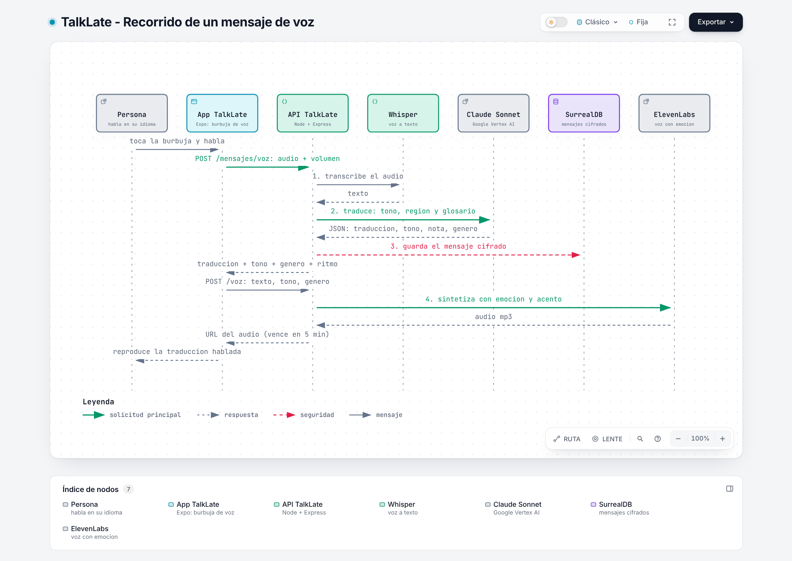
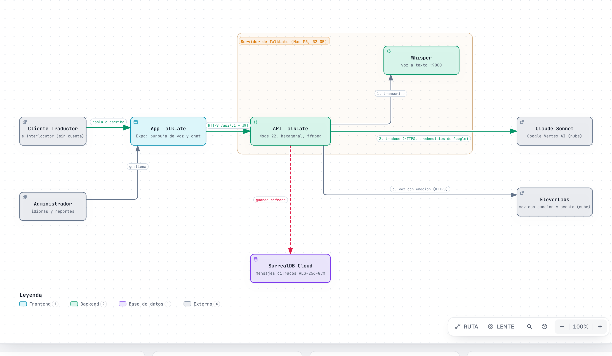
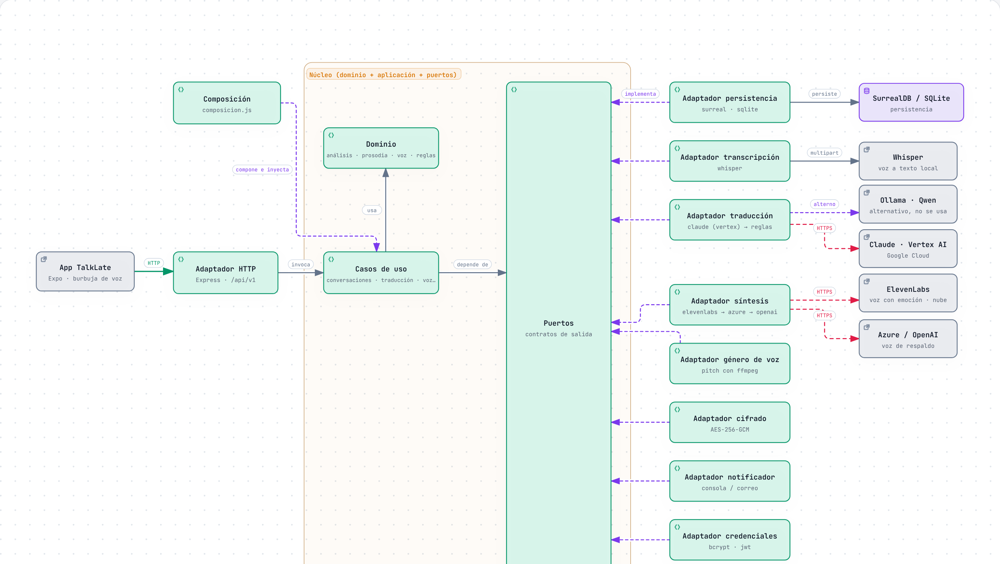
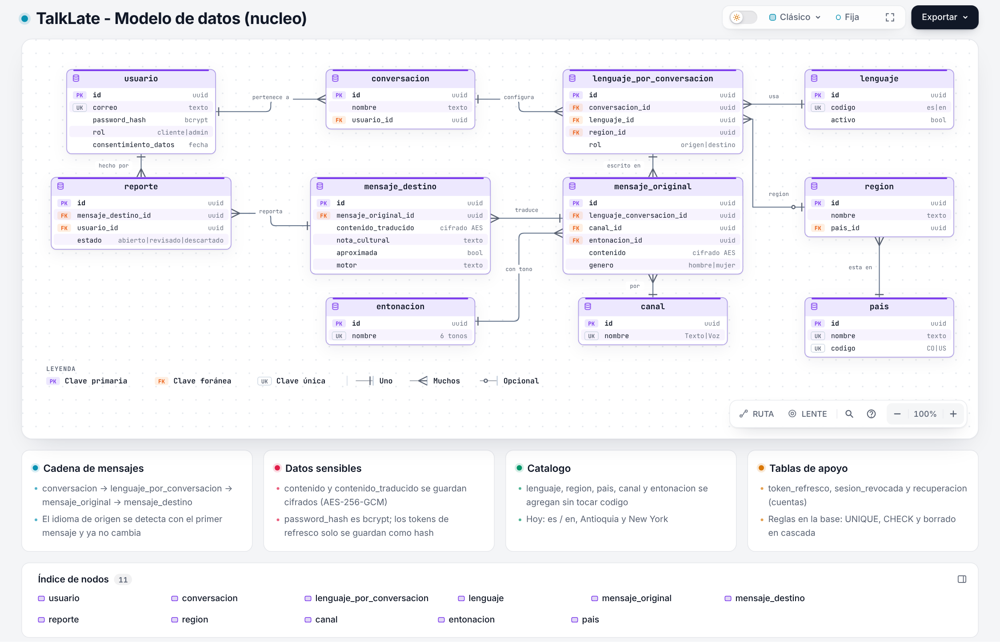

# TalkLate: manual de entendimiento

**Version:** 1.0 (12/11/2026)
**Para quien es:** para entender TalkLate **completo**, desde cero: el producto, los requisitos, las historias de usuario, las funcionalidades, la arquitectura, la inteligencia artificial, la seguridad, los datos, las pruebas, como se organizo el proyecto y donde esta debil. No necesitas saber programar para seguirlo; los terminos tecnicos se explican donde aparecen y hay un glosario al final.

Todo lo que dice este manual sale del codigo y de los documentos del repositorio, revisados el 12/11/2026 (con el pull request 53 de Julian ya integrado: traduccion con Claude Sonnet en Google Vertex AI y voz con ElevenLabs). Donde algo **no esta hecho o no esta medido**, lo dice.

## Como leerlo

Si solo tienes una hora, lee las partes **1, 2, 7, 9, 10 y 16**. Si vas a exponer, agrega la **17 y la 18**.

| Parte | Que aprendes | Tiempo |
| --- | --- | --- |
| 1. Que es TalkLate | El producto, el problema y un ejemplo concreto | 5 min |
| 2. Quien lo usa | Actores y las 6 epicas | 5 min |
| 3. Mapa de impacto y objetivo | Por que existe cada cosa y como se rastrea | 10 min |
| 4. Las 26 historias de usuario | Que se prometio, con sus criterios | 15 min |
| 5. Requisitos funcionales y no funcionales | Los 26 REQ y los 11 RNF | 10 min |
| 6. Funcionalidades | Todo lo que puede hacer cada persona en la app | 10 min |
| 7. Recorrido de un mensaje | Lo que pasa de punta a punta, en texto y en voz | 15 min |
| 8. Arquitectura | Las piezas, la arquitectura hexagonal y los 9 puertos | 20 min |
| 9. La traduccion por dentro | Motores, prompt, glosario, tono y respaldo | 15 min |
| 10. La voz por dentro | Grabar, transcribir, medir el tono, el genero y hablar | 15 min |
| 11. Los datos | Modelo, base de datos y reglas de negocio | 10 min |
| 12. Seguridad y privacidad | Sesiones, cifrado, limites, Ley 1581, Trivy y OWASP | 10 min |
| 13. La app movil | Pantallas, modos y como habla con la API | 10 min |
| 14. Pruebas y CI | Que se prueba y como | 5 min |
| 15. Como se organizo el proyecto | SoftVerse, sprints, drivers y ADR | 10 min |
| 16. Estado real y puntos debiles | Lo que falta y donde pueden preguntar | 10 min |
| 17. Preguntas probables | Respuestas cortas | 10 min |
| 18. Guion de exposicion y demo | Como contarlo | 5 min |
| 19. Glosario | Todos los terminos tecnicos | consulta |

**Un truco para no perderte:** cada cosa del proyecto tiene un identificador. **HU** = historia de usuario, **REQ** = requisito funcional, **RNF** = requisito no funcional, **DRV** = driver de arquitectura, **ADR** = decision de arquitectura, **RN** = regla de negocio. Con el identificador puedes buscarla en los documentos de `entrega/`.

---

## 1. Que es TalkLate

**En una frase:** una aplicacion movil donde dos personas que hablan idiomas distintos conversan, y cada mensaje se traduce **conservando la intencion, el tono y los modismos**, no palabra por palabra.

**El problema.** Los traductores comunes (Google Translate, DeepL) traducen bien lo literal pero fallan con la jerga. Si un paisa de Medellin dice *"hay que ponerse las pilas con el trabajo"*, una traduccion literal sale como *"we have to put on the batteries"*. Eso no significa nada en ingles. Lo natural es **"we need to get cracking on the work"**. TalkLate esta hecho para dar esa segunda respuesta.

**Que lo hace distinto** (la "propuesta de valor" del documento de vision):
- Adapta el mensaje a **una region concreta** del idioma destino. En este MVP: espanol de **Antioquia (Colombia)** e ingles de **New York (Estados Unidos)**.
- Entiende el **tono** del mensaje (neutral, amigable, alegre, preocupado, enojado, formal), tanto por las palabras como, en los mensajes hablados, por **como** se dijo (volumen, ritmo, variacion).
- La traduccion se puede **escuchar con una voz natural** que replica la emocion y el acento regional.
- Explica la adaptacion con una **nota cultural** ("en Colombia 'pilas' significa estar atento y activo...").

**Que NO es** (el alcance del MVP, que conviene decir antes de que lo pregunten):
- **No es traduccion simultanea.** "Tiempo real" significa **por turno**: cada mensaje se traduce en pocos segundos (meta: 3 s o menos en texto y 5 s o menos en voz). No traduce mientras la persona sigue hablando.
- **No reconoce el acento por el sonido.** La region de origen se reconoce por el **vocabulario** ("parce", "wey", "che", "mate"). Reconocerla por la voz es trabajo futuro.
- **Solo dos idiomas activos:** espanol e ingles.
- No comparte ni exporta conversaciones, no edita el perfil, no clona la voz del usuario.

**Estado de los idiomas hoy (dato verificado en el codigo):** el catalogo tiene exactamente dos idiomas (Espanol e Ingles) y dos regiones (Antioquia y New York). El documento de vision dice que frances y portugues "existen inactivos"; en el codigo no existen, porque el administrador los puede agregar desde la app. Es una imprecision del documento, no del producto.

## 2. Quien lo usa y que puede hacer

Hay tres actores:

| Actor | Quien es | Que hace |
| --- | --- | --- |
| **Cliente Traductor** | La persona con cuenta que usa la app | Se registra, crea una conversacion, escribe o habla, lee y escucha la traduccion, revisa su historial, reporta malas traducciones, borra su cuenta |
| **Interlocutor** | La otra persona de la conversacion, **sin cuenta ni app** | Su mensaje lo ingresa el Cliente por el: su respuesta se traduce de vuelta al idioma del Cliente |
| **Administrador** | Cuenta con rol `admin` | Revisa los reportes de mala traduccion y gestiona los idiomas y regiones (agregar, activar, desactivar) |

Nota sobre el Interlocutor: en el MVP no tiene pantalla propia. El Cliente marca que el mensaje es de la otra persona y el sistema lo traduce en sentido contrario. En el codigo es el campo `remitente: "usuario" | "interlocutor"`.

**Las 26 historias de usuario** se agrupan en 6 epicas:

| Epica | Historias (resumen) |
| --- | --- |
| Traduccion de mensajes | Ingresar mi mensaje hablando o escribiendo, traducirlo, escucharlo, recibirlo por el mismo canal que use |
| Gestion de conversaciones | Elegir idioma y region destino, reconocer el idioma origen, crear, configurar una sola vez, hilo continuo, historial, abrir, renombrar, eliminar |
| Cuenta de usuario | Registrarme, iniciar y cerrar sesion, recuperar contrasena, eliminar mi cuenta |
| Participacion del interlocutor | Recibir el mensaje traducido, responder en mi idioma |
| Reportes | Reportar una mala traduccion, revisar los reportes (admin) |
| Administracion de idiomas y regiones | Consultar, agregar y activar o desactivar idiomas y regiones |

## 3. Mapa de impacto y objetivo

El proyecto no empezo por la tecnologia sino por **para que sirve y para quien**. Eso se hizo con un **mapa de impacto** (Impact Mapping, de Gojko Adzic), guiado por el mentor Wider Farid Sanchez Garzon. Se lee asi: **Why** (el objetivo) -> **Who** (los actores) -> **How** (el impacto: el beneficio que obtiene cada actor) -> **What** (el entregable: la epica, que se abre en historias de usuario).

### 3.1 El objetivo (Why)

El objetivo es **SMART** (especifico, medible, alcanzable, relevante y con fecha): al cierre de la liberacion 3 (**08/01/2027**), al menos **10 personas de prueba** sostienen cada una una conversacion de **10 mensajes o mas** con alguien que habla otro idioma (espanol-ingles), con **menos del 20 % de traducciones reportadas como malas** y un tiempo por traduccion de **3 segundos o menos** (p95).

> Ojo para exponer: hoy **no hay mediciones** de ese objetivo (no se han hecho las pruebas con usuarios ni se ha medido el tiempo con el motor de produccion). Es lo que se mide en el mes de cierre.

### 3.2 Los 10 impactos (How)

Ordenados de mayor a menor valor. Cada impacto es un beneficio para un actor, no una funcion tecnica.

| # | Valor | Actor | Impacto | Historias que lo cumplen |
| --- | --- | --- | --- | --- |
| 1 | Alta | Cliente Traductor | Interactuar facil y rapidamente con personas que hablan otro idioma, traduciendo cada mensaje en tiempo real y conservando contexto cultural, tono y modismos | HU0003, HU0002, HU0001 |
| 2 | Alta | Cliente Traductor | Sostener una conversacion natural, hablando y escuchando como en su propio idioma | HU0004, HU0005 |
| 3 | Alta | Cliente Traductor | Empezar a conversar en menos de un minuto: idioma y region destino una sola vez y sin decir el idioma propio | HU0006, HU0007, HU0023 |
| 4 | Alta | Cliente Traductor | Mantener el contexto de toda la charla: cada respuesta se traduce dentro del mismo hilo sin reconfigurar | HU0008, HU0009, HU0010 |
| 5 | Alta | Interlocutor | Participar en su propio idioma y en igualdad de condiciones, **sin instalar la app ni crear cuenta** | HU0019, HU0020 |
| 6 | Media | Cliente Traductor | Aprender y ganar confianza apoyandose en conversaciones pasadas | HU0011, HU0012, HU0013, HU0014 |
| 7 | Media | Cliente Traductor | Tener conversaciones y configuracion en una cuenta segura que solo el usuario puede ver | HU0015, HU0016, HU0017, HU0018, HU0026 |
| 8 | Media | Cliente Traductor | Contribuir a mejorar el servicio senalando traducciones incorrectas o poco naturales | HU0021 |
| 9 | Baja | Administrador | Decidir que mejoras priorizar a partir de los reportes de mala traduccion | HU0022 |
| 10 | Baja | Administrador | Ampliar idiomas y regiones con calidad confiable, activando solo los que ya traducen bien | HU0024, HU0025 |

**Por que la IA no es un actor:** un actor es una persona que obtiene un beneficio. La IA no obtiene nada: es **parte del sistema** (el motor de traduccion, ADR-004 y ADR-020).

### 3.3 La cadena de trazabilidad

Todo lo que se hizo se puede rastrear hacia atras hasta un impacto, y hacia adelante hasta una prueba:

**Impacto -> Epica -> Historia de usuario (HU) -> Requisito funcional (REQ) -> Driver -> Decision (ADR) -> Componente -> Prueba**

Ejemplo completo: el impacto 1 (traducir conservando modismos) -> epica *Traduccion de mensajes* -> **HU0003** -> **REQ-TRAD-003** -> **DRV-02** (calidad cultural) -> **ADR-004 y ADR-020** (motores de IA) -> componentes del traductor (`aplicacion/traduccion.js`, `prompt.js`, `glosario.json`) -> la prueba del navegador que escribe "Hay que ponerse las pilas con el trabajo" y comprueba "We need to get cracking on the work".

Esa cadena es lo que responde a "¿por que existe esto?" ante un jurado.

---

## 4. Las 26 historias de usuario

Una **historia de usuario** dice quien necesita que, y para que: *"Como Cliente Traductor, necesito poder traducir mi mensaje, para interactuar facil y rapidamente con personas que hablan otro idioma"*. Cada una trae sus **criterios de aceptacion** (como se comprueba que esta terminada) y una **talla** de esfuerzo.

**Tallas de ropa y horas:** XS = 4 h, S = 8, M = 16, L = 24, XL = 32, XXL = 48. **Prioridad por valor, no por dependencia** (indicacion del mentor): por eso "Cerrar sesion" cae en el sprint 2 aunque dependa del registro.

Los identificadores HU00xx no cambian; solo cambia el orden de prioridad.

### 4.1 Epica: Traduccion de mensajes (el corazon del producto)

| HU | Historia | Talla / Sprint | Criterios de aceptacion (resumen) |
| --- | --- | --- | --- |
| HU0003 | Traducir mi mensaje al idioma destino en tiempo real | XXL (48 h) / 1 | Un modismo ("Hay que ponerse las pilas con el trabajo") sale con su equivalente cultural ("We need to get cracking on the work"), no literal; si se adapto un modismo hay **nota cultural**; si quedaron palabras sin traducir se marca **aproximada**; si no puede traducir, muestra un error y no un resultado vacio |
| HU0002 | Ingresar mi mensaje escribiendo | S (8 h) / 1 | Aparecen el mensaje original y su traduccion; no se acepta vacio ni de mas de 5000 caracteres |
| HU0001 | Ingresar mi mensaje hablando | L (24 h) / 1 | El mensaje se envia por el canal de voz; si el microfono no esta permitido, aviso claro y se puede escribir |
| HU0004 | Escuchar el mensaje traducido | M (16 h) / 1 | "Escuchar" reproduce con la voz del idioma y pais destino; velocidad y tono cambian segun la entonacion (alegre, preocupado...) |
| HU0005 | Recibir la traduccion por el mismo canal que use | S (8 h) / 1 | Si envie por voz, la traduccion se reproduce sola y tambien queda escrita; si envie texto, solo se muestra escrita |

### 4.2 Epica: Gestion de conversaciones

| HU | Historia | Talla / Sprint | Criterios de aceptacion (resumen) |
| --- | --- | --- | --- |
| HU0006 | Seleccionar el idioma y la region destino | M (16 h) / 1 | Al elegir idioma solo se ven regiones validas para ese idioma; no se empieza sin idioma y region |
| HU0007 | Reconocer el idioma origen | L (24 h) / 2 | Con el primer mensaje el sistema reconoce el idioma y lo muestra; **una vez reconocido no cambia**; si el mensaje es muy corto, pide escribir mas |
| HU0008 | Crear una conversacion | S (8 h) / 2 | Sin nombre se llama "Nueva Conversacion"; aparece en el menu y en el historial |
| HU0009 | Configurar los parametros una sola vez | S (8 h) / 2 | Los mensajes siguientes no piden configurar nada; el destino se mantiene |
| HU0010 | Mantener el hilo continuo | M (16 h) / 2 | Varios mensajes seguidos quedan en el mismo hilo, en orden; al reabrir se ven todos |
| HU0011 | Consultar mi historial | M (16 h) / 2 | Lista con nombre, idiomas, numero de mensajes y ultimo mensaje, las mas recientes primero; **busqueda por nombre**; solo las propias |
| HU0012 | Abrir una conversacion anterior | S (8 h) / 2 | Se ven los mensajes originales y traducidos en orden; no se puede abrir la de otra persona |
| HU0013 | Renombrar una conversacion | XS (4 h) / 2 | Nombre de 3 a 80 caracteres, sin simbolos ni palabras ofensivas; si no, se ve el motivo |
| HU0014 | Eliminar una conversacion | XS (4 h) / 2 | Pide confirmar y avisa que no se puede deshacer; borra mensajes y reportes |

### 4.3 Epica: Cuenta de usuario

| HU | Historia | Talla / Sprint | Criterios de aceptacion (resumen) |
| --- | --- | --- | --- |
| HU0015 | Registrarme en la aplicacion | L (24 h) / 3 | Contrasena de 8 o mas caracteres con mayuscula, numero y simbolo; correo valido y unico; **13 anos o mas**; **aceptar la politica de datos (Ley 1581)** o no se crea la cuenta |
| HU0016 | Iniciar sesion | M (16 h) / 3 | Con datos correctos entra; con incorrectos, "Usuario o contrasena incorrectos"; tras varios fallos seguidos se bloquea unos minutos; la sesion persiste al reabrir la app |
| HU0017 | Recuperar mi contrasena | L (24 h) / 3 | Codigo de 6 digitos que **vence en 15 minutos** y sirve **una sola vez**; con codigo incorrecto o vencido hay que pedir otro |
| HU0018 | Cerrar sesion | XS (4 h) / 2 | Vuelve a la bienvenida; el acceso anterior deja de funcionar aunque alguien lo conserve |
| HU0026 | Eliminar mi cuenta | XS (4 h) / 3 | Pide la contrasena y avisa que no se puede deshacer; borra cuenta, conversaciones, mensajes y reportes (**derecho al olvido**) |

### 4.4 Epica: Participacion del interlocutor

| HU | Historia | Talla / Sprint | Criterios de aceptacion (resumen) |
| --- | --- | --- | --- |
| HU0019 | Recibir el mensaje traducido (Interlocutor) | S (8 h) / 2 | La otra persona responde (se elige "Otra persona" y se le pasa el celular); su mensaje se traduce a mi idioma y se muestra a la izquierda junto a su original; **no instala nada** |
| HU0020 | Responder en mi idioma (Interlocutor) | M (16 h) / 2 | Su respuesta se traduce al idioma de la conversacion; para responder ya debe haberse reconocido mi idioma con mi primer mensaje |

### 4.5 Epica: Reportes

| HU | Historia | Talla / Sprint | Criterios de aceptacion (resumen) |
| --- | --- | --- | --- |
| HU0021 | Reportar una mala traduccion | M (16 h) / 3 | Motivo de 3 a 500 caracteres; el mensaje queda "Reportado"; solo una vez por traduccion y solo de mis conversaciones |
| HU0022 | Revisar los reportes de mala traduccion (Administrador) | M (16 h) / 3 | Ve original, traduccion, motivo y sugerencia; filtra por abiertos, revisados o descartados; un cliente no puede verlos |

### 4.6 Epica: Administracion de idiomas y regiones

| HU | Historia | Talla / Sprint | Criterios de aceptacion (resumen) |
| --- | --- | --- | --- |
| HU0023 | Consultar los idiomas disponibles | XS (4 h) / 2 | Solo se ven los idiomas activos con sus regiones |
| HU0024 | Agregar un idioma o una region (Administrador) | M (16 h) / 3 | Idioma con nombre unico y codigo de 2 a 5 letras, **queda desactivado** hasta activarlo; una region no se repite dentro del mismo pais |
| HU0025 | Activar o desactivar un idioma o una region (Administrador) | XS (4 h) / 3 | Activar lo hace aparecer al crear conversaciones; desactivarlo lo oculta; las conversaciones ya creadas no cambian |

### 4.7 Lo que conviene saber de las historias

- **Total: 26 historias, 6 epicas, 3 sprints** (120 horas cada uno: 6 + 12 + 8 historias).
- Los criterios fueron escritos antes de varios cambios; **dos estan desactualizados**: HU0001 habla de "dictar con el microfono del navegador o del teclado", pero hoy la app **graba el audio y el servidor lo transcribe con Whisper** (ADR-014); y HU0004 habla de la voz del dispositivo, pero hoy la voz natural la genera ElevenLabs y la del celular es el respaldo.
- Se agregaron funciones que **no estaban en las 26 historias**: **buscar** conversaciones con una pantalla de inicio en lista, el **menu de tres puntos** en cada tarjeta, y el **reporte de problemas generales de la app** (formulario del usuario y vista del administrador). Si te preguntan, son mejoras posteriores al plan original (pull request 53).

---

## 5. Requisitos funcionales y no funcionales

Un **requisito funcional** (REQ) dice **que debe hacer** el sistema. Uno **no funcional** (RNF) dice **que tan bien** lo debe hacer (rapidez, seguridad, disponibilidad...). Cada REQ sale de una historia; cada RNF responde a un driver de arquitectura.

### 5.1 Los 26 requisitos funcionales

| ID | El sistema debe... | Historia |
| --- | --- | --- |
| REQ-TRAD-001 | Permitir ingresar un mensaje por voz; se marca con el canal Voz | HU0001 |
| REQ-TRAD-002 | Permitir ingresar un mensaje escrito de 1 a 5000 caracteres, no vacio | HU0002 |
| REQ-TRAD-003 | Traducir cada mensaje al idioma y region destino conservando tono, intencion y modismos (equivalente cultural, no literal), con nota cultural cuando adapte un modismo y marca de aproximada | HU0003 |
| REQ-TRAD-004 | Reproducir la traduccion en audio con la voz del idioma y pais destino, ajustando tono y velocidad | HU0004 |
| REQ-TRAD-005 | Entregar la traduccion por el mismo canal del original (audio y texto si fue voz; texto si fue escrito) | HU0005 |
| REQ-CONV-001 | Exigir idioma y region destino, y que la region sea valida para ese idioma | HU0006 |
| REQ-CONV-002 | Reconocer el idioma de origen con el primer mensaje y no cambiarlo | HU0007 |
| REQ-CONV-003 | Crear conversaciones con nombre por defecto y validar que el par de idiomas este soportado | HU0008 |
| REQ-CONV-004 | Conservar la configuracion de idiomas para todos los mensajes de la conversacion | HU0009 |
| REQ-CONV-005 | Guardar cada mensaje original y su traduccion en el hilo, en orden | HU0010 |
| REQ-CONV-006 | Listar solo las conversaciones del usuario, paginadas y por actividad reciente | HU0011 |
| REQ-CONV-007 | Mostrar los mensajes de una conversacion propia y negar el acceso a las de otra persona | HU0012 |
| REQ-CONV-008 | Permitir renombrar con 3 a 80 caracteres, sin simbolos ni palabras ofensivas | HU0013 |
| REQ-CONV-009 | Eliminar la conversacion con sus mensajes y reportes, previa confirmacion | HU0014 |
| REQ-USR-001 | Registrar usuarios con nombre, apellido, correo unico, contrasena segura, fecha de nacimiento (13 anos o mas) y aceptacion de la politica de datos | HU0015 |
| REQ-USR-002 | Iniciar sesion con correo y contrasena, bloquear temporalmente tras intentos fallidos y mantener la sesion con un token de refresco | HU0016 |
| REQ-USR-003 | Enviar un codigo de 6 digitos valido 15 minutos y de un solo uso para definir una nueva contrasena | HU0017 |
| REQ-USR-004 | Invalidar el token de acceso y el de refresco al cerrar sesion | HU0018 |
| REQ-USR-005 | Eliminar la cuenta y todos sus datos cuando el usuario lo pida y confirme con su contrasena | HU0026 |
| REQ-INT-001 | Mostrar y reproducir la traduccion para la otra persona sin pedirle cuenta ni app | HU0019 |
| REQ-INT-002 | Traducir la respuesta de la otra persona al idioma del usuario dentro de la misma conversacion | HU0020 |
| REQ-REP-001 | Permitir reportar una traduccion propia una sola vez, con motivo de 3 a 500 caracteres | HU0021 |
| REQ-REP-002 | Permitir al administrador listar, filtrar y marcar reportes como revisados o descartados | HU0022 |
| REQ-IDIOMA-001 | Mostrar solo los idiomas activos con sus regiones | HU0023 |
| REQ-IDIOMA-002 | Permitir al administrador agregar idiomas (nombre y codigo unicos) y regiones (unicas dentro del pais) | HU0024 |
| REQ-IDIOMA-003 | Permitir al administrador activar o desactivar idiomas sin afectar las conversaciones existentes | HU0025 |

### 5.2 Los 11 requisitos no funcionales

| ID | Atributo | Requisito | Driver |
| --- | --- | --- | --- |
| RNF-001 | Desempeno | "Tiempo real" = traduccion **por turno**: texto en 3 s o menos (p95); voz en 5 s o menos, contando transcripcion y audio de salida | DRV-01 |
| RNF-002 | Exactitud cultural | El 80 % de los modismos del glosario de prueba se traducen con su equivalente cultural, no literal | DRV-02 |
| RNF-003 | Seguridad y privacidad | Mensajes cifrados en reposo (AES-GCM), acceso solo del dueno, logs sin datos personales, consentimiento y eliminacion de cuenta (Ley 1581 de 2012) | DRV-03 |
| RNF-004 | Extensibilidad | Agregar idiomas y regiones sin cambiar codigo | DRV-04 |
| RNF-005 | Disponibilidad | Si un motor de IA falla, el servicio sigue (traduccion Claude -> reglas; voz ElevenLabs -> Azure -> OpenAI -> voz del celular) | DRV-05 |
| RNF-006 | Seguridad (abuso) | 30 mensajes por minuto por usuario, 8 intentos de login fallidos, 5 solicitudes de recuperacion cada 15 minutos | DRV-06 |
| RNF-007 | Portabilidad | Una sola base de codigo para iOS, Android y web | DRV-07 |
| RNF-008 | Mantenibilidad | Cobertura de 80 % o mas; piramide de pruebas en el CI; arquitectura hexagonal con puertos verificados | DRV-08 |
| RNF-009 | Interoperabilidad | API REST segun la convencion del proyecto y documentada con OpenAPI 3.0 | DRV-08 |
| RNF-010 | Naturalidad de la voz | La voz de salida replica la emocion detectada; 7 de cada 10 personas de prueba la califican como comprensible y natural | DRV-02 |
| RNF-011 | Cadena de suministro | 0 vulnerabilidades HIGH o CRITICAL en dependencias y 0 secretos en el codigo, salvo excepciones con fecha de vencimiento | DRV-03 |

### 5.3 Fuera del alcance del MVP (decision registrada)

- Compartir o exportar conversaciones, editar los datos del perfil y personalizar o clonar la voz del usuario.
- Detectar el acento por el **sonido**: hoy la region de origen se reconoce por **vocabulario**.
- Reentrenar el modelo con los reportes: los reportes se guardan y se revisan; el reentrenamiento es evolucion futura.

---

## 6. Funcionalidades: que puede hacer cada persona en la app

Esta es la vista "de usuario": todo lo que existe hoy, agrupado por lo que alguien quiere lograr.

### 6.1 Entrar y administrar mi cuenta
- **Registrarme** con nombre, apellido, correo, contrasena segura, fecha de nacimiento (13 anos o mas) y aceptando la politica de tratamiento de datos.
- **Iniciar sesion** (con bloqueo temporal tras varios intentos fallidos) y mantener la sesion al cerrar y abrir la app.
- **Recuperar la contrasena** con un codigo de 6 digitos que vence en 15 minutos. *En el MVP no hay envio real de correos: el codigo sale por consola del servidor.*
- **Cerrar sesion**, que invalida el acceso aunque alguien conserve el token.
- **Ver mi perfil y la politica de datos**, y **eliminar mi cuenta** con todo lo mio (pide la contrasena).

### 6.2 Conversar y traducir
- **Crear una conversacion** eligiendo: idioma destino (Ingles), region del idioma (New York) y, opcionalmente, mi propio idioma (por defecto "Detectar automaticamente"). Los selectores son listas con bandera y buscador.
- **Escribir** un mensaje (1 a 5000 caracteres) y recibir su traduccion adaptada, con **nota cultural** desplegable cuando se adapto un modismo y aviso de "traduccion aproximada" cuando corresponde.
- **Hablar** un mensaje con la burbuja de voz y recibir la traduccion escrita y **hablada** con la emocion del mensaje y acento de la region destino.
- **Alternar** entre el modo burbuja de voz y el modo chat (el modo se recuerda).
- **Escuchar de nuevo** una traduccion: reusa el audio ya generado, sin volver a pagar la sintesis durante unos minutos.
- **Dar la palabra a la otra persona** (el Interlocutor): se marca "Otra persona", ella habla o escribe en su idioma y su mensaje se traduce al mio.
- Ver el **tono** detectado de cada mensaje y, en los mensajes hablados, se mide **como** se dijo (volumen, ritmo, variacion).

### 6.3 Mis conversaciones
- **Pantalla de inicio** = lista de mis conversaciones, para retomar cualquiera sin crear una nueva.
- **Buscar** por nombre (tolera tildes, puntuacion y errores de tipeo).
- **Renombrar** (3 a 80 caracteres) y **eliminar** (con confirmacion) desde el menu de tres puntos de cada tarjeta.
- **Abrir** una conversacion anterior y ver todos sus mensajes, originales y traducidos, en orden.

### 6.4 Mejorar el servicio
- **Reportar una mala traduccion** (motivo de 3 a 500 caracteres; una vez por traduccion).
- **Reportar un problema de la app** (descripcion, categoria y contacto opcional; maximo 10 por hora).

### 6.5 Lo que hace el Administrador
- **Revisar los reportes de mala traduccion** (original, traduccion, motivo, sugerencia), filtrarlos por estado y marcarlos como revisados o descartados.
- **Revisar los problemas de la app** reportados por usuarios.
- **Agregar idiomas y regiones** y **activarlos o desactivarlos** sin tocar codigo.

### 6.6 Lo que el sistema hace por su cuenta (sin que nadie lo pida)
- Reconoce el idioma de origen con el primer mensaje y lo fija para esa conversacion.
- Reconoce la region de origen por regionalismos ("parce", "no manches", "che", "mate").
- Estima el tono por palabras y, en voz, por volumen y ritmo.
- Estima el genero de quien habla por el pitch de la voz para elegir la voz de salida.
- Cifra cada mensaje antes de guardarlo y borra todo si la persona elimina su cuenta.
- Si un motor de IA falla, pasa al siguiente y deja de llamar al caido por 60 segundos.

### 6.7 Lo que NO hace (decirlo primero)
- No traduce mientras la persona sigue hablando: es **por turno**.
- No reconoce el acento por el sonido de la voz.
- Solo espanol (Antioquia) e ingles (New York) activos.
- No envia correos reales ni comparte/exporta conversaciones, ni edita el perfil.

---

## 7. Recorrido de un mensaje

Este es el corazon del proyecto. Si entiendes esta parte, entiendes TalkLate.

### 7.1 Antes del primer mensaje: crear la conversacion

1. La persona abre **Nueva conversacion** y elige: a que idioma quiere traducir (**Ingles**), la region de ese idioma (**New York**) y, opcionalmente, su propio idioma (por defecto "Detectar automaticamente").
2. La app llama `POST /api/v1/conversaciones`. El backend valida que el idioma este **activo**, que la region **sea valida para ese idioma** y que algun motor soporte el par.
3. Queda guardada una conversacion con su configuracion. **Se configura una sola vez** (historia HU0009).

### 7.2 Un mensaje escrito

Ejemplo: la persona escribe *"Hay que ponerse las pilas con el trabajo"*.

| Paso | Que pasa | Donde (codigo) |
| --- | --- | --- |
| 1 | La app envia `POST /conversaciones/:id/mensajes` con el texto y el canal `texto` | `frontend/lib/api.ts` |
| 2 | El backend comprueba que la conversacion **sea de ese usuario**; si no, responde "no existe" (no revela que existe) | `aplicacion/conversaciones.js` `delUsuario` |
| 3 | Valida el contenido: de 1 a 5000 caracteres | `dominio/validaciones.js` |
| 4 | Si es el **primer mensaje**, **detecta el idioma de origen** (palabras comunes del espanol contra las del ingles, tildes, enie, signos de apertura) y lo fija: **ya no cambia** en esa conversacion. Tambien intenta reconocer la region de origen por regionalismos ("parce" -> Antioquia) | `dominio/analisis.js`, `asegurarOrigen` |
| 5 | Calcula el **tono por las palabras** (senales como "idiota", "urgente", "felicidades", "estimado"; MAYUSCULAS sostenidas o "!!" indican enojo) | `dominio/analisis.js` `detectarTono` |
| 6 | Llama al **servicio de traduccion**, que prueba los motores en orden: **Claude (Vertex) -> reglas** (ver parte 9) | `aplicacion/traduccion.js` |
| 7 | El motor devuelve un JSON: traduccion, tono, genero de quien escribe, nota cultural, region de origen | `adaptadores/traduccion/prompt.js` |
| 8 | **Cifra** el original y la traduccion con AES-256-GCM y los guarda como dos filas: `mensaje_original` y `mensaje_destino` | `adaptadores/cifrado/aesGcm.js` |
| 9 | Responde con el mensaje, la traduccion, la nota cultural, el tono, la configuracion y los datos de entrega (si hay que reproducir audio, a que velocidad, con que genero) | `enviarMensaje` |

Resultado esperado: **"We need to get cracking on the work"**, con tono Preocupado y una nota cultural. Esto es lo que verifica la prueba automatica del navegador.

### 7.3 Un mensaje hablado



*Figura 1. Recorrido de un mensaje de voz (Archify, version interactiva en `entrega/diagramas/secuencia_voz.html`).*

Es el mismo flujo, con pasos extra al inicio y al final:

| Paso | Que pasa |
| --- | --- |
| 1 | La app **graba** el audio con `expo-audio` y, mientras graba, **mide el volumen** cada 100 ms. Eso resume en tres numeros: volumen promedio, volumen maximo y variacion (en decibelios) |
| 2 | Envia el audio en **base64** con esas medidas a `POST /conversaciones/:id/mensajes/voz`. Se valida el formato (m4a, aac, webm, wav...) y que pese **menos de 10 MB** |
| 3 | El servidor envia el audio a **Whisper** (voz a texto) y recibe el texto. Si no escucha nada, pide acercarse al microfono |
| 4 | Calcula la **prosodia**: con el volumen y las palabras por segundo estima intensidad (alta, media, baja), ritmo (rapido, normal, lento) y si la voz fue expresiva. De ahi sale un **tono de la voz** (ver parte 10) |
| 5 | Mide el **genero** de quien habla por la **agudeza (pitch)** de la voz, con ffmpeg |
| 6 | Sigue el flujo del mensaje escrito, pero el prompt incluye como hablo la persona ("hablo fuerte, rapido, con mucha variacion") |
| 7 | La respuesta indica `reproducir_audio: true`. La app llama `POST /voz` con el texto traducido, el tono, el genero y el ritmo |
| 8 | El servidor pide la voz a **ElevenLabs**, guarda el mp3 **en memoria 5 minutos** y devuelve una URL con un identificador aleatorio de 128 bits |
| 9 | La app reproduce el audio. Si no hay voz natural disponible, usa la **voz del celular** con tono y velocidad ajustados. Al pulsar "Escuchar" de nuevo, **reusa el audio ya generado** (no vuelve a sintetizar durante unos minutos) |

**Regla de "mismo canal":** quien escribe recibe texto; quien habla recibe voz (historia HU0005).

### 7.4 La respuesta del Interlocutor

El Cliente marca el mensaje como del Interlocutor. El sistema traduce en **sentido contrario** (del idioma destino al de origen). Una restriccion: no se puede registrar un mensaje del Interlocutor **antes** del primero del Cliente, porque aun no se sabe cual es el idioma de origen.

## 8. Arquitectura

### 8.1 Vista general

TalkLate tiene **tres contenedores** (piezas que corren por separado):

| Contenedor | Tecnologia | Responsabilidad |
| --- | --- | --- |
| **App movil** | Expo SDK 58 / React Native 0.88, expo-router, NativeWind | Pantallas, grabar y reproducir voz. Es un **cliente delgado**: no tiene logica de negocio |
| **API TalkLate** | Node.js 22.5+, Express 4, **monolito modular**, REST en `/api/v1` | Toda la logica: cuentas, conversaciones, traduccion, voz, catalogo, reportes |
| **Base de datos** | **SurrealDB 3.x** en la nube (SurrealDB Cloud) | Guarda todo. SQLite se usa **solo en pruebas** |

Alrededor hay servicios externos. Los que corren en el **servidor del equipo** (en la demo, una Mac M5 de 32 GB) y los que estan **en la nube**:

| Servicio | Donde corre | Para que | Sale informacion del servidor? |
| --- | --- | --- | --- |
| **Whisper** | Servidor de TalkLate | Voz a texto | No (por defecto) |
| **ffmpeg** | Servidor de TalkLate | Medir el pitch de la voz | No |
| **Claude Sonnet en Google Vertex AI** | Nube (Google Cloud) | Traducir (**motor principal**) | Si: el **texto** del mensaje y el contexto del prompt |
| Ollama + Qwen (`qwen2.5:7b`) | Servidor de TalkLate | Traducir (**alternativo, hoy no se usa**) | No |
| **ElevenLabs** | Nube | Convertir la traduccion en voz con emocion | Si: el **texto traducido** |
| Azure Speech / OpenAI | Nube | Voz de respaldo (solo si estan configurados) | Si: el texto traducido |



*Figura 2. Arquitectura general con voz (Archify, `entrega/diagramas/arquitectura_talklate.html`).*

**Por que un monolito y no microservicios** (pregunta clasica): el alcance es de 2 personas y 6 meses; una traduccion por turno no necesita nada asincrono; un monolito **modular** da limites claros sin el costo de operar muchos servicios. La respuesta a "y si crece?" es la arquitectura hexagonal: se separa bien **por dentro**, y partirlo despues seria mover carpetas, no reescribir (ADR-002, ADR-013).

### 8.2 Arquitectura hexagonal, explicada desde cero

**La idea con una analogia.** Piensa en un electrodomestico y un enchufe. El electrodomestico (el **nucleo**: las reglas del negocio) solo sabe que necesita "corriente". No le importa si viene de una pared, de un generador o de una bateria. El **enchufe** es el **puerto**: un contrato que dice "necesito esto, con esta forma". Cada fuente concreta que cumple el contrato es un **adaptador**.

En TalkLate:
- El **nucleo** (dominio + casos de uso) contiene lo que hace valioso al producto: las reglas de validacion, el orden de los pasos al enviar un mensaje, la logica de los respaldos.
- El nucleo **no sabe** que existe Express, SurrealDB, Qwen ni ElevenLabs. Solo conoce **puertos**: "necesito algo que traduzca", "necesito algo que guarde conversaciones", "necesito algo que convierta texto en voz".
- Los **adaptadores** son los que hablan con el mundo real y cumplen esos contratos.

**Para que sirve (y que preguntaran):**
1. **Cambiar una tecnologia sin tocar las reglas.** Se paso de VoiceStudio a ElevenLabs, y de Qwen a Claude en Vertex, agregando **un adaptador** cada vez; los casos de uso no se enteraron. Lo mismo con SQLite y SurrealDB.
2. **Probar sin internet ni claves.** Los casos de uso se prueban con adaptadores falsos; por eso hay 78 pruebas unitarias que corren en menos de 2 segundos.
3. **Que no se rompa por descuido.** `npm run arch:check` (dependency-cruiser) falla si alguien hace que el nucleo importe algo de afuera. Corre en el CI.



*Figura 3. Arquitectura hexagonal del backend (Archify, `entrega/diagramas/arquitectura_hexagonal.html`). Las flechas punteadas hacia "Puertos" significan "implementa el contrato".*

### 8.3 Los 9 puertos

| Puerto | Para que sirve | Quien lo cumple hoy |
| --- | --- | --- |
| `Repositorio` | Guardar y leer usuarios, conversaciones, mensajes, catalogo, reportes | SurrealDB (real) y SQLite (pruebas) |
| `MotorTraduccion` | Traducir un mensaje | Claude (Vertex o API directa), Qwen, motor de reglas |
| `Transcriptor` | Pasar audio a texto | Whisper |
| `Sintetizador` | Pasar texto a voz con emocion | ElevenLabs, Azure, OpenAI-compatible |
| `DetectorGenero` | Estimar el genero de quien habla por el pitch | ffmpeg + autocorrelacion |
| `Notificador` | Enviar el codigo de recuperacion de contrasena | Consola (en el MVP no hay correo real) |
| `Cifrador` | Cifrar y descifrar mensajes en reposo | AES-256-GCM |
| `Hasheador` | Hash de contrasenas y codigos | bcrypt |
| `FirmadorTokens` | Firmar y verificar el token de acceso | JWT (HS256) |

`asegurarPuerto()` verifica que cada adaptador cumpla su contrato **al arrancar el servidor**, no en mitad de una peticion.

### 8.4 Capas del backend y donde esta cada cosa

```
backend/src/
  dominio/        Reglas puras, sin dependencias: validaciones, analisis (idioma, tono, region),
                  prosodia, voz, errores de negocio
  aplicacion/     Casos de uso, uno por epica: cuentas, sesiones, conversaciones, traduccion,
                  voz, catalogo, reportes
  puertos/        Los 9 contratos
  adaptadores/    Todo lo que toca el exterior
    http/           Express: rutas, sesion, limites de uso
    persistencia/   surreal/ y sqlite/
    traduccion/     vertex, claude, qwen, reglas, prompt, glosario
    transcripcion/  whisper
    sintesis/       elevenlabs, azure, openai
    audio/          genero (pitch con ffmpeg)
    cifrado/        aesGcm
    credenciales/   bcrypt y jwt
    correo/         consola
  composicion.js  Elige que adaptador usar segun variables de entorno y arma los casos de uso
  server.js       Arranca el servidor
```

**`composicion.js` es la pieza que "enchufa" todo.** Por ejemplo: `TRADUCTOR=claude` (la configuracion del equipo) arma Claude (Vertex) -> reglas, y `TRADUCTOR=auto` arma Qwen -> Claude -> reglas; `VOZ_MOTOR=auto` arma ElevenLabs -> Azure -> OpenAI. Cambiar de motor es cambiar una variable, no codigo.

### 8.5 La API

Es una API REST bajo `/api/v1`, documentada con **OpenAPI 3.0** (visible en `/api/v1/docs`). Los errores siguen una convencion unica: `{ statusCode, message, path }`. Hay 22 rutas; las principales:

| Grupo | Rutas |
| --- | --- |
| Cuenta | `POST /auth/registro`, `/auth/login`, `/auth/refrescar`, `/auth/recuperar`, `/auth/restablecer`, `/auth/logout`; `GET` y `DELETE /usuarios/yo` |
| Catalogo | `GET /catalogo` (idiomas, regiones, tonos, canales) |
| Conversaciones | `GET` y `POST /conversaciones`; `GET`, `PATCH` (renombrar) y `DELETE /conversaciones/:id` |
| Mensajes | `POST /conversaciones/:id/mensajes` (texto), `/mensajes/voz` (audio) |
| Voz | `POST /voz`, `GET /voz/audio/:id` |
| Reportes | `POST /reportes`; admin: `GET /admin/reportes`, `PATCH /admin/reportes/:id` |
| Problemas de la app | `POST /problemas` (10 por hora por usuario); admin: `GET /admin/problemas`, `PATCH /admin/problemas/:id` |
| Administracion | `POST /admin/idiomas` y `GET`/`PATCH /admin/idiomas/:id` (consultar, modificar y activar); `POST /admin/regiones` y `GET /admin/regiones/:id` |
| Salud | `GET /health` (estado de la base y de los motores) |

## 9. La traduccion por dentro

### 9.1 La cadena de motores y el Circuit Breaker

El servicio de traduccion (`aplicacion/traduccion.js`) recibe una lista de motores y usa **el primero que responda**. La configuracion del equipo (`./run-talklate.sh`, `TRADUCTOR=claude`) es:

1. **Claude Sonnet en Google Vertex AI.** Es el motor principal (ADR-020). Se autentica con las credenciales de Google (ADC), no con una clave en el codigo. Tiempo limite de 30 s y **sin reintentos** del SDK. Es de nube: **el texto del mensaje sale a Google Cloud** y cada traduccion cuesta.
2. **Motor de reglas**: un traductor propio espanol <-> ingles con un diccionario de modismos. **Solo traduce si el texto trae al menos un modismo o frase conocida**; sin coincidencias **falla con un error** ("No pudimos traducir tu mensaje en este momento") en vez de entregar una traduccion palabra por palabra. Cuando traduce con palabras sin traducir, se marca como **aproximada** y la app lo avisa.

**Alternativas ya construidas:** Qwen 2.5 (7B) en Ollama, local (sin costo y sin sacar el texto del servidor), disponible con `TRADUCTOR=auto` o `qwen`, pero **hoy no se usa**; y Claude por la API directa de Anthropic (`ANTHROPIC_API_KEY`). Cambiar de motor es cambiar una variable de entorno.

**Circuit Breaker (cortacircuitos).** Si un motor falla, se **salta durante 60 segundos** para no esperar su tiempo limite en cada mensaje siguiente. Es la respuesta al driver de continuidad (DRV-05), pero **ahora de forma parcial**: si Claude se cae, el motor de reglas solo traduce los modismos que conoce; en los demas mensajes la persona recibe un error claro. Con Qwen local en la cadena el respaldo era mas amplio.

### 9.2 El prompt

El prompt (`adaptadores/traduccion/prompt.js`) es compartido por todos los modelos. Es un prompt de **transcreacion cultural**: le dice al modelo:
- que **no traduzca palabra por palabra**: primero entienda la intencion, la situacion y el tono, y lo reexprese como lo diria un nativo de la region destino, conservando el registro (informal con jerga, formal con formalidad);
- el idioma origen y destino, con la **region** de cada uno;
- los tonos posibles;
- si el mensaje llego por voz, **como hablo** la persona;
- que responda **solo con un JSON**: `traduccion`, `tono`, `genero`, `nota_cultural`, `region_origen`;
- los **modismos detectados** del glosario con su equivalente **y un ejemplo real de uso** (few-shot; ver abajo).

Despues, `leerRespuesta` **valida** lo que devuelve el modelo: la traduccion debe ser texto no vacio, el tono debe estar en la lista permitida y la nota cultural y la region solo se aceptan como texto de largo acotado; si no, lo descarta.

### 9.3 El glosario cultural

`glosario.json` contiene **196 modismos** del espanol paisa y del ingles neoyorquino. Cada entrada trae: el termino, su significado, el **equivalente natural** en la otra variedad, un ejemplo, el registro, si es **sensible** (26 lo son: pueden ofender fuera de contexto) y la **fuente** de donde salio.

Cuando el mensaje contiene uno de esos modismos, el sistema lo **inyecta al prompt**: "'pilas' = estar atento; en New York: 'get cracking'". Asi el modelo no tiene que adivinar. Se inyectan como maximo 15, priorizando las expresiones mas largas (mas especificas).

**Dato importante para no ser sorprendido:** las 196 entradas tienen `native_validated: false`. Es decir, **ningun hablante nativo las ha revisado todavia**. El campo existe justamente para eso; falta hacer la validacion.

### 9.4 Detectar idioma, tono y region (sin IA)

Estas tres cosas las hace codigo normal, rapido y que funciona sin internet (`dominio/analisis.js`):
- **Idioma:** cuenta palabras funcionales (el, la, que, de... contra the, and, of...). Si empata, no se sabe y se pide escribir mas.
- **Tono:** busca palabras senal por tono; las mayusculas sostenidas o los signos "!!" suman enojo.
- **Region de origen:** busca regionalismos ("parce", "no manches", "che", "mate").

El modelo de IA tambien devuelve tono y region; el codigo local es el **respaldo** y la verificacion.

## 10. La voz por dentro

### 10.1 Entrada: grabar, transcribir y medir como se dijo

- **Grabar:** `expo-audio` graba en el celular (funciona en Expo Go). Mientras graba, mide el volumen.
- **Transcribir:** **Whisper** (API compatible con OpenAI; corre local con faster-whisper o whisper.cpp). Se recomienda el modelo `small`; `tiny` confunde jerga como "parce".
- **Prosodia** (`dominio/prosodia.js`): *como* se dijo, no *que* se dijo.

| Medida | Como se obtiene | Resultado |
| --- | --- | --- |
| Intensidad | Volumen promedio y pico en dB | alta, media, baja |
| Ritmo | Palabras por segundo | rapido (3.2 o mas), normal, lento (1.8 o menos) |
| Expresividad | Variacion del volumen | si sube y baja mucho (8 dB o mas) |

De ahi se infiere un tono de la voz: voz **fuerte y expresiva** -> Alegre; **fuerte y pareja** -> Enojado; **baja** -> Preocupado; **lenta y pareja** -> Formal; **expresiva** -> Amigable. Es una **heuristica**, no ciencia exacta.

**Regla de combinacion:** lo que dicen las **palabras manda**; la voz decide solo cuando el texto es neutro. Ademas calcula una **velocidad de salida** (entre 0.85 y 1.2) para que la traduccion hablada imite el ritmo de quien hablo.

### 10.2 Deteccion de genero por el pitch

Antes se inferia el genero del texto (concordancia en espanol: "cansada/cansado"), pero **fallaba en ingles**, que casi no marca genero. Ahora (`adaptadores/audio/genero.js`):
1. ffmpeg decodifica el audio a PCM mono de 16 bits.
2. Se estima la frecuencia fundamental (pitch) por **autocorrelacion**.
3. Si el pitch esta por debajo de **160 Hz** -> hombre; por encima de **180 Hz** -> mujer; entre 160 y 180 Hz es la **banda ambigua** y no se decide.

Si no se puede decidir, se cae al genero que infiere el modelo desde el texto y, al final, al valor por defecto (`ELEVENLABS_GENERO`, hombre). **Es solo una ayuda para elegir la voz de salida; no identifica a la persona.** Ojo: el resultado **si se guarda** por mensaje (campo `genero` de `mensaje_original`) y la matriz de sensibilidad de datos **no lo menciona** (ver parte 16).

### 10.3 Salida: hablar con emocion y acento

El puerto `Sintetizador` tiene cuatro posibilidades, en este orden (`VOZ_MOTOR=auto`):

1. **ElevenLabs** (`eleven_multilingual_v2`): la emocion va en `voice_settings` (menos *stability* = mas expresivo; *style* exagera los modismos) y la velocidad en `speed`. La **voz se elige por region y genero**: `es-CO` = voz paisa (hombre o mujer), `en-US` = voz de New York (hombre o mujer).
2. **Azure Speech:** voces neuronales; la emocion va en SSML (`angry`, `cheerful`, `sad`, `friendly`).
3. **API compatible con OpenAI** (`gpt-4o-mini-tts`): la emocion va como instruccion en lenguaje natural.
4. **Voz del celular** (`expo-speech`): ultimo recurso; ajusta tono y velocidad.

`dominio/voz.js` define **como suena cada tono** una sola vez; cada adaptador lo traduce a su API. El audio vive **5 minutos en memoria** (maximo 200) y **no se guarda en disco**.

**La historia de VoiceStudio (la pregunta que pueden hacer).** Primero se eligio VoiceStudio (voz local con emocion, ADR-016). Al medirlo en la Mac con chip Apple, el motor IndexTTS 2 **no usa la GPU** (Metal) y tardaba unos 30 segundos por frase: inviable en una conversacion en vivo. Se **revirtio** y se adopto ElevenLabs (ADR-019): 1 a 5 segundos por frase, con acento regional. **Costo de esa decision:** el texto traducido **sale a un tercero**, se pierde el enfoque 100 % local, y las voces de la libreria de ElevenLabs requieren plan pago para usarse por API.

## 11. Los datos

### 11.1 Modelo



*Figura 4. Modelo de datos del nucleo (Archify, `entrega/diagramas/modelo_datos.html`).*

**Como leerlo (la cadena principal):**
`usuario` -> `conversacion` -> `lenguaje_por_conversacion` -> `mensaje_original` -> `mensaje_destino`

- Una **conversacion** pertenece a un usuario y tiene **dos idiomas**: origen y destino (`lenguaje_por_conversacion`, con el campo `rol`). Cada uno puede llevar una region.
- Un **mensaje_original** guarda lo que dijo la persona, con su canal (Texto o Voz), su tono y su genero. Su **mensaje_destino** guarda la traduccion, la nota cultural, si fue aproximada y **que motor la hizo**.
- Un **reporte** es una queja sobre una traduccion; un usuario solo puede reportar una vez la misma traduccion.
- El **catalogo** (`lenguaje`, `region`, `pais`, `canal`, `entonacion`) son tablas de datos: el administrador agrega idiomas y regiones **sin tocar codigo** (driver DRV-04).
- Tablas de apoyo: `token_refresco`, `sesion_revocada`, `recuperacion`.

### 11.2 Reglas de negocio importantes

Cada regla tiene un codigo (Usuario-RN-1, Conversacion-RN-3...) y una prueba:

| Regla | Contenido |
| --- | --- |
| Usuario-RN-1 | No puede haber dos cuentas con el mismo correo |
| Usuario-RN-2 | Edad minima: **13 anos** |
| Usuario-RN-4 | Contrasena de 8 o mas caracteres con mayuscula, numero y simbolo |
| Usuario-RN-8 | El codigo de recuperacion vence (15 minutos) |
| Conversacion-RN-1 | La region debe ser valida para el idioma elegido |
| Conversacion-RN-2 | El idioma de origen se detecta con el primer mensaje y **no cambia** |
| Conversacion-RN-3 | El par de idiomas debe estar soportado por algun motor |
| Conversacion-RN-4 | Nombre de 3 a 80 caracteres, sin simbolos ni palabras ofensivas |
| Mensaje | De 1 a 5000 caracteres |

### 11.3 SurrealDB y SQLite

- **SurrealDB** es la base real (ADR-012). Se eligio porque el dominio es una **cadena de relaciones** que se guarda como enlaces nativos y se recorre sin JOIN, porque el esquema (`ASSERT`, `UNIQUE`) deja las reglas **dentro de la base**, y porque es multimodelo (a futuro, busqueda semantica).
- **SQLite** (`node:sqlite`, incluido en Node) se usa **solo para pruebas**: corre en memoria, sin servidor ni claves. Como ambos cumplen el mismo puerto `Repositorio`, **la misma suite de pruebas corre contra los dos** para demostrar que se comportan igual.
- **El idioma del codigo:** los identificadores del dominio estan en **espanol** (lenguaje ubicuo), mientras que el esquema de SurrealDB esta en ingles (ADR-009).

## 12. Seguridad y privacidad

### 12.1 Sesiones (ADR-006)

| Elemento | Detalle |
| --- | --- |
| Token de acceso | **JWT** firmado (HS256), dura **15 minutos** |
| Token de refresco | Cadena aleatoria de 48 bytes, dura **30 dias**, **rota en cada uso** (el usado queda revocado) y **solo se guarda su hash SHA-256** |
| Cerrar sesion | Revoca el refresco y agrega el identificador (`jti`) del token de acceso a una lista de revocados hasta que venza |
| Contrasenas | Solo el **hash bcrypt**; nunca se devuelven ni se registran |
| Intentos de login | Bloqueo temporal tras varios fallos (en memoria, por correo) |

**Por que JWT corto + refresco rotativo:** el token de acceso casi no tiene riesgo si se roba (vence rapido) y el refresco, que dura mas, rota: si alguien lo usa dos veces, el segundo uso falla. Permite **cerrar sesion de verdad**, algo que un JWT largo solo no permite.

### 12.2 Proteccion de datos personales (ADR-010, Ley 1581 de 2012)

- **Cifrado en reposo:** el contenido de los mensajes y de las traducciones se guarda cifrado con **AES-256-GCM** (cifrado con autenticacion: detecta si alguien altera el dato). La clave viene de `TALKLATE_CLAVE_CIFRADO`; en produccion el servidor **se niega a arrancar** sin ella.
- **Aislamiento:** cada persona solo ve sus conversaciones; para otra persona, "no existe".
- **Consentimiento:** al registrarse se guarda **cuando** acepto la politica de tratamiento de datos.
- **Derecho al olvido:** la persona puede **eliminar su cuenta** y todo lo suyo (HU0026).
- **Logs sin datos personales:** el registro de eventos **descarta por codigo** los campos `password`, `token`, `correo`, `contenido`, `texto` y `codigo`.
- **Matriz de sensibilidad:** clasifica cada dato (publico, interno, confidencial, PII) con su control.

### 12.3 Limites contra abuso (DRV-06)

| Que | Limite |
| --- | --- |
| Mensajes | 30 por minuto por usuario |
| Voces sintetizadas | 40 por minuto por usuario |
| Registros | 10 por hora por IP |
| Recuperar contrasena | 5 por 15 minutos por IP |
| Tamano del mensaje | 5000 caracteres (texto); 1000 (para voz de salida) |
| Audio | 10 MB |
| Peticion JSON | 1 MB (15 MB solo en el endpoint de voz) |

Todas las llamadas externas tienen **tiempo limite** (Claude por Vertex 30 s y sin reintentos, Whisper 30 s, ElevenLabs 20 s, ffmpeg 15 s; Qwen 60 s si se usa) y tope de salida de 1024 tokens. **Limitacion:** los contadores estan **en memoria**; sirven para una sola instancia del servidor.

### 12.4 Trivy: escaneo de seguridad (ADR-018)

Trivy revisa **dependencias con vulnerabilidades conocidas, secretos en el codigo y configuraciones inseguras**. Corre en **cada pull request, cada push a develop y main, y cada lunes**. Si hay algo alto o critico, **bloquea el merge**.

- Primer resultado (05/11): 1 alta en el backend y 1 critica y 50 altas en el frontend (casi todas en librerias internas de Expo). **Todas corregidas** con `overrides` de npm a versiones parchadas de la misma version mayor.
- **Reescaneo del 12/11/2026**, despues de integrar la dependencia nueva de Vertex: **0 vulnerabilidades, 0 secretos y 0 configuraciones inseguras**. Hoy: **0 altas o criticas abiertas**, y **una excepcion documentada** (`decode-uri-component`, con vencimiento 28/02/2027): la version parchada rompe la navegacion de la app y el riesgo es bajo.
- **No se usa la accion oficial `trivy-action`**, porque fue comprometida en marzo de 2026. El CI descarga el binario oficial y **verifica su checksum**.

### 12.5 OWASP Top 10 para aplicaciones con LLM (edicion 2026)

Es la lista de los 10 riesgos de seguridad propios de usar modelos de lenguaje. El profesor pregunto si se aplico. **Respuesta honesta:** los controles existian pero no estaban contrastados con la lista; ya lo estan (`calidad/owasp_llm_top10.md`).

**El argumento central:** el modelo en TalkLate **solo recibe texto y devuelve texto**. No tiene herramientas, no toca la base de datos, no envia correos y no ve datos de otros usuarios. Lo peor que puede lograr un mensaje malicioso es danar **su propia** traduccion.

| Estado | Riesgos |
| --- | --- |
| Cubierto | LLM03 Excessive Agency (el modelo no tiene herramientas), LLM08 Hidden Context Exposure (el prompt no tiene secretos), LLM10 Improper Output Handling (la salida se valida) |
| No aplica | LLM09 Vector and Embedding Weaknesses (no hay RAG) |
| Parcial | LLM01 Prompt Injection, LLM02 Sensitive Information Disclosure, LLM04 Supply Chain, LLM05 Data and Model Poisoning, LLM06 Unbounded Consumption, LLM07 Misinformation |

Las brechas concretas estan en la parte 16.

## 13. La app movil

### 13.1 Tecnologia

- **Expo SDK 58 + React Native 0.88**: una sola base de codigo para iOS, Android y web (DRV-07). Se prueba en el celular con **Expo Go**.
- **expo-router:** la navegacion es por carpetas (cada archivo en `app/` es una pantalla).
- **NativeWind (Tailwind):** estilos con clases.
- **Template Luna:** el sistema de componentes de UI (botones, inputs, tema claro y oscuro) viene de una plantilla adaptada (ADR-007).
- **Estado global** con Context API: `AuthContext` (sesion, guardada en el celular), `ConversacionesContext` (historial), tema y menu lateral.

### 13.2 Pantallas

| Pantalla | Para que |
| --- | --- |
| Welcome, Login, Signup, Recuperar contrasena | Entrar a la cuenta |
| **Inicio** (pantalla principal tras iniciar sesion) | **Lista de conversaciones**: retomar cualquiera sin crear una nueva. Barra inferior con perfil, **busqueda** (tolera tildes, puntuacion y errores de tipeo) y el boton **+** para una nueva. Cada tarjeta tiene menu de tres puntos (renombrar, eliminar) y efecto de vidrio |
| **Chat** (se abre desde una conversacion) | Traducir: tiene dos modos |
| Historial | Ver y abrir conversaciones anteriores, renombrar, eliminar |
| Perfil y Politica de datos | Datos de la cuenta, consentimiento, borrar cuenta |
| Reportar un problema | Formulario en la app (descripcion, categoria y contacto opcional) para problemas generales, no de una traduccion |
| Admin idiomas / Admin reportes / Admin problemas | Solo para el rol `admin` |

### 13.3 El chat: dos modos

Como en los asistentes de voz modernos, el chat tiene **dos modos** que se alternan con un icono y **se recuerdan** en el celular:
- **Burbuja de voz:** una burbuja animada ("Toca la burbuja y habla"). Graba, traduce y reproduce.
- **Chat:** el modo clasico de escribir y leer burbujas de mensaje, cada una con su traduccion, su **nota cultural** desplegable y el aviso de "traduccion aproximada" cuando corresponde.

**Nueva conversacion** usa tres selectores desplegables (con bandera por opcion): **Traducir a**, **Region del idioma de destino** y **Mi idioma** (por defecto "Detectar automaticamente"), y un boton "Empezar a traducir".

### 13.4 Piezas clave del codigo

| Archivo | Que hace |
| --- | --- |
| `lib/api.ts` | Cliente de la API; resuelve el servidor en web, Expo Go y emulador; renueva el token de acceso solo |
| `lib/grabacion.ts` | Graba, mide el volumen y entrega el audio en base64 |
| `lib/voz.ts` | Reproduce la voz: primero la natural del servidor, y si no hay, la del celular |
| `lib/reglas.ts` | Reglas pequenas de la app (etiquetas, resumen del volumen) |
| `components/talklate/` | `ChatView`, `TranslatorInput`, `MessageBubble`, `NuevaConversacion`, `BurbujaVoz` |

## 14. Pruebas y CI

Tres niveles, como una piramide: **muchas pruebas rapidas abajo, pocas y caras arriba** (ADR-017).

| Nivel | Cantidad | Que prueba | Velocidad |
| --- | --- | --- | --- |
| **Unitarias** | 78 (73 backend + 5 frontend) | Una regla a la vez, con piezas falsas | Menos de 2 s |
| **Integracion** | 29 (18 de la API por duplicado, SQLite y SurrealDB, y 11 de problemas) | La API entera por HTTP con una base real | ~3 s |
| **Punta a punta** | 4 (2 de la API, 2 del navegador con Playwright) | El recorrido real de un usuario | ~1 min |

- **Cobertura del backend:** 96.5 % de lineas. El minimo exigido es 80 % y el CI falla si baja.
- **Prueba del navegador:** abre la app en Chromium con pantalla de celular, inicia sesion, crea una conversacion a Ingles / New York, escribe *"Hay que ponerse las pilas con el trabajo"* y comprueba que sale *"We need to get cracking on the work"*.
- **CI (GitHub Actions):** `backend`, `backend-surreal`, `frontend`, `e2e-web` y `trivy`. Cada pull request debe pasarlos todos para poder hacer merge.
- **Regla del equipo:** nunca se desactiva una prueba para que pase; se arregla la causa.

## 15. Como se organizo el proyecto

### 15.1 Metodologia

- **SoftVerse:** el framework del equipo, con **fases F0 a F10** (linea base, contexto, requerimientos, arquitectura, diagramas, UI, scaffolding, backend, frontend, integracion y despliegue). Cada fase tiene artefactos en el repositorio.
- **Scrum con 3 sprints de un mes** (120 horas cada uno, 2 personas): del 19/10/2026 al 08/01/2027, mas un mes de cierre (pruebas con usuarios, manual y documento final).
- **Priorizacion por valor, no por dependencia**, como pidio el mentor. Por eso "Cerrar sesion" cae en el sprint 2.
- **Tallas de ropa:** XS = 4 h, S = 8, M = 16, L = 24, XL = 32, XXL = 48.
- **Flujo de trabajo:** issue primero -> rama `feature/{issue}-...` -> commits convencionales -> pull request a `develop` revisado por el otro -> CI en verde.

### 15.2 Los tres sprints

| Liberacion | Fechas | Nombre | Que recibe el usuario |
| --- | --- | --- | --- |
| 1 | 19/10 al 13/11/2026 | Traduccion funcional | Escribir o hablar, recibir la traduccion con tono y modismos, escucharla |
| 2 | 16/11 al 11/12/2026 | Conversaciones completas | Reconocer idioma, historial, renombrar, eliminar, interlocutor, cerrar sesion |
| 3 | 14/12/2026 al 08/01/2027 | Cuentas, calidad y administracion | Registro con consentimiento, recuperar contrasena, borrar cuenta, reportes, administrar idiomas |

### 15.3 Los 8 drivers de arquitectura

Un **driver** es un requisito que **obliga a tomar decisiones de arquitectura** y que se puede **medir**.

| Driver | Meta | Decision que lo responde |
| --- | --- | --- |
| DRV-01 Tiempo de respuesta | Texto 3 s o menos (p95); voz 5 s o menos | REST por turno, motores en cadena sin reintentos |
| DRV-02 Calidad cultural | 80 % de los modismos del glosario de prueba adaptados | Prompt de equivalencia cultural y glosario |
| DRV-03 Privacidad | Mensajes cifrados, solo el dueno los ve, logs sin PII | JWT, AES-256-GCM, consentimiento, borrar cuenta |
| DRV-04 Crecimiento de idiomas | Agregar un idioma sin tocar codigo | Catalogo en datos |
| DRV-05 Continuidad ante fallas | Si la IA falla, el servicio sigue (hoy de forma parcial) | Circuit Breaker y motor de reglas |
| DRV-06 Costo y abuso | Limites por usuario; ya no hay traduccion sin costo (Vertex y ElevenLabs cobran) | Limites de uso (falta un tope de gasto) |
| DRV-07 Multiplataforma | Una base de codigo para iOS, Android y web | Expo |
| DRV-08 Facilidad de prueba | Cobertura de 80 % o mas, sin internet ni claves | Puertos y repositorio de dos motores |

### 15.4 Las 20 decisiones de arquitectura (ADR)

Un **ADR** (*Architecture Decision Record*) documenta una decision con su contexto, las alternativas que se compararon y las consecuencias.

| ADR | Decision |
| --- | --- |
| 001 | App movil con Expo (React Native) y NativeWind |
| 002 | Backend monolitico en Node + Express, REST sincrona |
| 003 | SQLite como base inicial (luego reemplazada por la 012) |
| 004 | Traduccion con Qwen local, Claude de respaldo y motor de reglas (ajustada por la 020) |
| 005 | Voz: dictado en el cliente (reemplazada en parte por la 014) |
| 006 | JWT de acceso corto con refresco rotativo |
| 007 | Interfaz basada en el template Luna |
| 008 | Ajustes al modelo de dominio al implementarlo |
| 009 | Identificadores del dominio en espanol |
| 010 | Proteccion de datos personales |
| 011 | API v1 segun la convencion REST y OpenAPI |
| 012 | SurrealDB como fuente de verdad, detras de un repositorio |
| 013 | Arquitectura hexagonal dentro del monolito modular |
| 014 | Voz: grabar en el celular, Whisper en el servidor, entonacion por texto y voz |
| 015 | Voz natural con emocion en el servidor (puerto Sintetizador) |
| 016 | VoiceStudio local como motor de voz (**revertida**) |
| 017 | Piramide de pruebas en tres niveles, todos en el CI |
| 018 | Escaneo de seguridad con Trivy en el CI |
| 019 | ElevenLabs como motor de voz (reemplaza a la 016) |
| 020 | Claude Sonnet en Google Vertex AI como motor de traduccion principal |

### 15.5 Como esta organizada la documentacion

| Carpeta | Contenido |
| --- | --- |
| `entrega/` | 19 documentos en Word y PDF y el documento completo con indice |
| `requerimientos/` | Mapa de impacto, historias, criterios, requisitos, sprints, liberaciones, matriz de sensibilidad, politica de datos |
| `arquitectura/` | Arquitectura, drivers, ADR, stack, modelo de datos, C4, componentes |
| `calidad/` | Piramide de pruebas, Trivy, OWASP |
| `convenciones/` | Reglas de git, seguridad, API REST, patrones |
| `seguimiento/` | Actas con el mentor, marco metodologico, bitacora |

## 16. Estado real y puntos debiles

Esta parte es la mas util antes de exponer. Esta ordenada de mas a menos peligrosa. **Nada de esto es motivo de panico: lo que importa es conocerlo y decirlo antes de que lo descubran.**

### 16.1 Lo que decian los papeles y ya se corrigio (12/11/2026)

Los documentos de la entrega decian VoiceStudio, Qwen como motor principal, 51 pruebas, 8 puertos, Expo SDK 57 y que frances y portugues existian inactivos. **Se corrigieron** al integrar el cambio a Claude en Vertex: se agregaron los ADR-019 y ADR-020, se actualizaron los 11 documentos afectados, la politica de datos y la matriz de sensibilidad, y se regeneraron los Word y PDF (version 1.2 de la entrega, con el documento 20 de OWASP).

Lo que **sigue pendiente** en este grupo:

| # | Problema | Como responder |
| --- | --- | --- |
| 1 | El estado de fases de SoftVerse (`.softverse/estado_fases.json`) no refleja lo construido: F7 y F8 "desbloqueadas", F9 y F10 "bloqueadas", pero ya hay pruebas de punta a punta y CI | Actualizar el archivo con el equipo (no es decision mia declarar una fase completada) |
| 2 | Los modelos por defecto no coinciden: `claude-sonnet-4-6` en el adaptador de Vertex y `claude-sonnet-5-5` en la API directa | Fijar uno y comprobar que exista en la region configurada |
| 3 | El script `run-talklate.sh` trae por defecto el identificador del proyecto de Google Cloud escrito | Leerlo del entorno; un identificador no es un secreto, pero es mejor no dejarlo escrito |

### 16.2 Cosas que no estan medidas o validadas

| # | Problema | Como responder |
| --- | --- | --- |
| 4 | **La calidad de traduccion no esta medida con el motor de produccion.** La medicion (14 de 15, 93 %) se hizo con el motor de reglas, que se construyo con esos mismos 15 modismos: es una **linea base, no una evidencia de calidad** | "Es la linea base. La medicion valida es con Claude en Vertex y modismos distintos; esta pendiente." **Correr `npm run medir` con el motor de produccion antes de exponer** |
| 5 | **El glosario no esta validado por nativos** (0 de 196), y ahora sus ejemplos van al prompt | "Esta investigado con fuente por entrada; la validacion con hablantes nativos es trabajo pendiente" |
| 6 | **El tiempo de respuesta (DRV-01) no esta medido** con Claude por Vertex ni con ElevenLabs en la maquina de la demo | Medir antes de exponer |
| 7 | **La app no se ha probado en celular fisico** (las pruebas automaticas corren en la web) | Probar en Expo Go y llevar capturas |
| 8 | La deteccion de tono por la voz es **heuristica** | "Es una estimacion por volumen, ritmo y variacion; no reconoce emociones por IA" |
| 9 | **La traduccion depende de internet y de credenciales de Google** | Probar antes de exponer; decirlo como limite del MVP |

### 16.3 Brechas de seguridad (del analisis OWASP)

Corregidas el 12/11/2026: validacion de `nota_cultural` y `region_origen` (LLM10), tope de salida de Qwen y tiempo limite de Vertex (LLM06), limite de 10 reportes de problemas por hora (LLM06), terceros y genero de la voz en la politica de datos y la matriz (LLM02), y el administrador por defecto en produccion (`ADMIN_PASSWORD` obligatorio).

Siguen abiertas:

| # | Brecha | Riesgo | Gravedad real |
| --- | --- | --- | --- |
| 10 | El texto del usuario entra al prompt sin marcarlo como "dato, no instruccion" y no hay pruebas de inyeccion | LLM01 | Baja: el atacante solo afecta su propia traduccion. No se toco el prompt sin poder probarlo con el modelo real |
| 11 | **El texto de cada mensaje sale a Google Cloud** y la app no se lo recuerda a la persona | LLM02 | **Media: es el cambio de privacidad mas grande del proyecto; esta documentado, falta el aviso en la app** |
| 12 | No hay tope de gasto para Vertex ni ElevenLabs y los limites estan en memoria | LLM06 | Media ahora que cada mensaje cuesta |
| 13 | No hay SBOM; falta revisar los terminos de Google, Anthropic y ElevenLabs (retencion y entrenamiento) | LLM04 | Baja |
| 14 | El **genero inferido de la voz** se guarda por mensaje | Privacidad | Media: ya esta clasificado en la matriz, pero hay que decidir si hace falta guardarlo |
| 15 | El correo personal del administrador por defecto sigue escrito en el codigo y los README | Fuera de OWASP LLM | Baja |
| 16 | El campo `contacto` del reporte de problemas es texto libre (puede traer un correo) | Privacidad | Baja: se borra con la cuenta y solo lo ve el administrador |

### 16.4 Limites de alcance (decirlos tu primero)

- Solo espanol (Antioquia) e ingles (New York).
- "Tiempo real" es por turno, no simultaneo.
- La region de origen se reconoce por vocabulario, no por acento.
- No hay despliegue en produccion: el MVP corre local y en CI (no hay Dockerfile).
- No hay envio real de correos: el codigo de recuperacion de contrasena sale por consola.
- La voz natural depende de un servicio de pago (ElevenLabs) y la traduccion de la nube de Google (Vertex AI): sin internet o sin credenciales no hay traduccion general.
- El proyecto se construyo con apoyo de IA, declarado en el marco metodologico.

## 17. Preguntas probables y respuestas

**Que hace TalkLate que no haga Google Translate?**
Adapta el mensaje a una region concreta, conserva el tono y los modismos, explica la adaptacion con una nota cultural y habla con la emocion del mensaje. Google traduce lo literal.

**Por que arquitectura hexagonal?**
Para que las reglas del negocio no dependan de ninguna tecnologia. Se cambio VoiceStudio por ElevenLabs tocando un solo archivo, y las 68 pruebas unitarias corren sin internet porque usan piezas falsas. Un chequeo automatico (`arch:check`) evita que alguien rompa esa separacion.

**Por que un monolito y no microservicios?**
Alcance de dos personas y seis meses, una traduccion por turno y nada que exija procesamiento asincrono. El monolito es modular, asi que partirlo despues es mover carpetas.

**Por que SurrealDB y no PostgreSQL?**
El dominio es una cadena de relaciones que SurrealDB guarda como enlaces nativos sin JOIN, el esquema deja las reglas dentro de la base y es multimodelo. Se evaluo PostgreSQL en la revision del 22/10 y se mantuvo SurrealDB por esas razones (ADR-012).

**Por que cambiaron de Qwen local a Claude Sonnet en Vertex?**
La prioridad del producto es la calidad cultural de la traduccion (DRV-02), y el ADR-004 ya preveia volver a Claude si el modelo local no funcionaba. El costo de esa decision, que hay que decir de frente: el texto de cada mensaje sale a Google Cloud, cada traduccion cuesta y sin internet o sin credenciales de Google no hay traduccion general. Qwen sigue construido como alternativa para recuperar el enfoque 100 % local.

**Que pasa si la IA falla?**
El Circuit Breaker salta el motor caido por 60 segundos y pasa al siguiente. Si Claude falla, el motor de reglas solo traduce los modismos que conoce; en los demas mensajes la persona recibe un error claro, no una traduccion literal de mala calidad.

**Como saben que traduce bien?**
Hoy hay: reportes de usuarios, notas culturales, un glosario con fuente por entrada y una medicion de linea base. Falta medir con Claude (Vertex) y validar el glosario con hablantes nativos; esta identificado como trabajo pendiente.

**Detecta emociones?**
Estima el tono (6 opciones) por las palabras y, en voz, por volumen, ritmo y variacion. Es una heuristica, no un modelo de reconocimiento de emociones.

**Como protegen los datos?**
Mensajes cifrados con AES-256-GCM, contrasenas con bcrypt, JWT de 15 minutos con refresco rotativo, aislamiento por usuario, consentimiento y borrado de cuenta (Ley 1581), logs sin datos personales, limites de uso y Trivy en cada pull request.

**Que datos salen a terceros?**
El texto del mensaje a Google Cloud (Vertex AI), que lo procesa con Claude, y el texto traducido a ElevenLabs para generar la voz. El audio original no sale del servidor. Ambos estan en la politica de datos desde el 12/11/2026.

**Aplicaron OWASP LLM Top 10?**
Los controles existian y ahora estan contrastados con la lista 2026: 2 riesgos cubiertos, 1 no aplica y 7 parciales con brechas identificadas. El modelo no tiene herramientas ni acceso a datos, por eso el impacto de un ataque es bajo.

**Por que cambiaron VoiceStudio por ElevenLabs?**
VoiceStudio corria en CPU en la Mac y tardaba 30 segundos por frase. ElevenLabs responde en 1 a 5 segundos con acento regional. El costo es que el texto traducido sale a un tercero.

**Quien escribio el codigo?**
El equipo con apoyo de un asistente de IA, declarado en el marco metodologico. Cada decision esta en un ADR y cada regla tiene su prueba; podemos explicar cualquier parte.

**Que sigue?**
Medir con Claude (Vertex), validar el glosario con hablantes nativos, probar en celular fisico, desplegar y agregar el envio real de correos.

## 18. Guion de exposicion y demo

### Como contarlo en 5 minutos

1. **El problema (30 s):** "Una traduccion literal de 'ponerse las pilas' no significa nada en ingles."
2. **La solucion (30 s):** "TalkLate traduce intencion, tono y modismos, adaptados a una region: paisa y New York."
3. **Demo en vivo (2 min):** crear la conversacion, escribir el modismo, mostrar la traduccion con su nota cultural; hablar un mensaje y escuchar la traduccion con emocion.
4. **Como funciona (1 min):** mostrar el diagrama hexagonal y decir "el nucleo no sabe que tecnologia hay afuera".
5. **Confianza (1 min):** piramide de pruebas (78 + 29 + 4, 96 % de cobertura), Trivy y OWASP.
6. **Honestidad (30 s):** "Lo que falta: medir con Claude en Vertex, validar el glosario con nativos, probar en celular fisico."

### Antes de la demo (lista)

- [ ] Servidor encendido: `./run-talklate.sh --full` levanta backend, Expo y Whisper (ya no levanta Ollama).
- [ ] Credenciales de Google activas (`gcloud auth application-default login`) y el proyecto de Vertex AI con acceso a Claude; Whisper `small` disponible.
- [ ] `ELEVENLABS_API_KEY` y las voces configuradas (requiere plan pago).
- [ ] Celular con Expo Go en la misma red que el servidor.
- [ ] Contrasena del administrador cambiada (no usar `Admin123!` en pantalla).
- [ ] Plan B si falla la voz: la app cae sola a la voz del celular; si falla Claude, el motor de reglas solo cubre los modismos conocidos, asi que **probar antes con internet y credenciales**. Si cae la voz, decirlo como ventaja: es el respaldo funcionando.
- [ ] Diagramas abiertos en el navegador: `entrega/diagramas/arquitectura_hexagonal.html`, `arquitectura_talklate.html`, `secuencia_voz.html`, `modelo_datos.html`.

## 19. Glosario

| Termino | Significado |
| --- | --- |
| **ADR** | Registro de una decision de arquitectura: contexto, alternativas, decision y consecuencias |
| **Adaptador** | Pieza que conecta el nucleo con una tecnologia concreta (base, IA, HTTP) cumpliendo un puerto |
| **AES-256-GCM** | Cifrado simetrico con autenticacion: protege el dato y detecta si lo alteraron |
| **API REST** | Servicio web con rutas y verbos HTTP (GET, POST, PATCH, DELETE) |
| **bcrypt** | Algoritmo para guardar contrasenas como hash lento y con sal |
| **Circuit Breaker** | Patron que deja de llamar a un servicio que esta fallando durante un tiempo |
| **CI** | Integracion continua: pruebas y revisiones que corren solas en cada cambio |
| **Driver de arquitectura** | Requisito medible que obliga una decision de arquitectura |
| **Expo / Expo Go** | Herramienta para React Native; Expo Go es la app para probar sin compilar |
| **Hexagonal** | Arquitectura de puertos y adaptadores: el nucleo no depende de la tecnologia |
| **Hash** | Resultado de una funcion que no se puede revertir; sirve para guardar contrasenas |
| **Interlocutor** | La otra persona de la conversacion, sin cuenta |
| **JWT** | Token firmado que prueba quien eres sin consultar la base en cada peticion |
| **LLM** | Modelo de lenguaje grande (Claude, Qwen) |
| **MVP** | Producto minimo viable |
| **Monolito modular** | Una sola aplicacion dividida por dentro en modulos con limites claros |
| **Ollama** | Programa para correr modelos de lenguaje en tu propio computador |
| **OpenAPI** | Estandar para describir una API REST |
| **OWASP LLM Top 10** | Lista de los 10 riesgos de seguridad mas importantes al usar modelos de lenguaje |
| **Pitch** | Agudeza de la voz (frecuencia fundamental) |
| **PII** | Datos que identifican a una persona |
| **Prompt** | Instrucciones y datos que se le envian al modelo de lenguaje |
| **Prompt injection** | Ataque donde el texto del usuario intenta cambiar las instrucciones del modelo |
| **Prosodia** | Como se dice algo: volumen, ritmo, entonacion |
| **Puerto** | Contrato que el nucleo exige al exterior ("necesito algo que traduzca") |
| **Qwen** | Modelo de lenguaje abierto que se uso para traducir en local; hoy es un adaptador alternativo |
| **Vertex AI** | Plataforma de Google Cloud desde la que se usa Claude |
| **ADC** | Credenciales por defecto de aplicacion de Google: el programa se autentica sin clave escrita en el codigo |
| **Transcreacion** | Traducir recreando la intencion y el tono para otra cultura, no palabra por palabra |
| **Refresh token** | Token de larga duracion que sirve para pedir otro de acceso |
| **Repositorio (patron)** | Capa que esconde como se guardan los datos detras de un contrato |
| **SBOM** | Lista de todos los componentes de software de un sistema |
| **SoftVerse** | El framework de fases F0 a F10 que usa el equipo |
| **SurrealDB** | Base de datos multimodelo con relaciones nativas |
| **TTS** | Texto a voz |
| **Trivy** | Escaner de seguridad de dependencias, secretos y configuracion |
| **Whisper** | Modelo de voz a texto |

